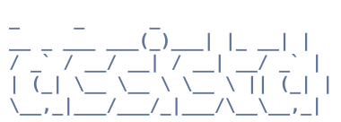

<h1 align="center">
  
</h1>

<p align="center">
  <a href="https://github.com/gnolruf/assistd/actions/workflows/ci.yml"></a>
  <a href="https://github.com/gnolruf/assistd/actions/workflows/codeql.yml"></a>
  <a href="https://github.com/gnolruf/assistd/releases/latest"></a>
  <a href="https://aur.archlinux.org/packages/assistd"></a>
</p>

A model agent daemon for Linux system management. `assistd` runs and manages an inference server,
exposes a Unix-socket IPC protocol to clients (one-shot CLI, ratatui chat TUI,
window-manager bindings), and integrates with the running compositor for context-aware behavior.

## Features

- **Tools and pipelines.** A single `run` tool exposes shell-shaped
  commands (`cat`, `grep`, `wc`, `head`, `tail`, `sort`, `uniq`, `bash`,
  `see`, `screenshot`, `web`, `wm`, …) the model composes with `|`,
  `&&`, `||`, `;`, plus `~` and glob expansion. Alongside it, `remember`
  and `recall` save and look up facts, and `reminisce` searches
  transcripts from earlier sessions.
- **Voice in/out.** Push-to-talk and continuous listening via
  `whisper.cpp`; spoken responses via Piper TTS, streamed sentence by
  sentence so playback starts before the model has finished.
- **Vision when the model has it.** `see photo.png` and `screenshot`
  attach images to the next turn whenever the loaded model has a
  vision projector; capability is detected at runtime.
- **MCP-compatible.** Connect stdio
  [Model Context Protocol](https://modelcontextprotocol.io) servers
  under `[[mcp.servers]]`; their tools register into the same registry
  the LLM sees, namespaced as `mcp__<server>__<tool>`.
- **Coarse presence.** `Active → Drowsy → Sleeping`. On NVIDIA GPUs
  the daemon watches VRAM and drops to `Sleeping` when another process
  (a game, a second model runner) claims the GPU, freeing all of its
  VRAM; with `[sleep] gpu_auto_wake` it wakes once that process exits.
- **Compositor-aware.** Native i3 and Sway backends; active-window
  context can be injected automatically into every turn.
- **Persistent memory.** SQLite-backed conversation history plus
  semantic search over past chunks for cross-session recall.

### Prerequisites

- Rust toolchain, stable channel (selected by `rust-toolchain.toml`;
  rustup installs it automatically on first build).
- `cmake`, `clang`, `pkg-config` and the ALSA headers (`alsa-lib` /
  `libasound2-dev`) to build. With GCC 15 or newer, build with
  `CXXFLAGS=-fpermissive` until the bundled whisper.cpp is fixed.
- `llama-server` from `llama.cpp` on your `$PATH`. The daemon spawns it
  as a child process.
- `bubblewrap`. Without it the model gets no tools.

Optional: `piper` for TTS, and `grim` (Wayland) or `maim` (X11) for
screenshots.

On Arch, the `assistd` and `assistd-git` AUR packages install the
binary and a systemd user unit (`systemctl --user enable --now assistd`).

### 1. Build

```sh
cargo build --release
```

### 2. Configure

```sh
assistd init-config
```

This writes a working config to `~/.config/assistd/config.toml`. The
defaults are runnable as-is. Open the file if you want to:

- swap `[model] name` for a different Hugging Face GGUF
  (`owner/repo:quant`),
- change `[model] gpu_layers` if VRAM is tight, or pass extra server
  flags through `[model] custom_args`,
- enable voice (`[voice] enabled = true`) or TTS
  (`[voice.synthesis] enabled = true`).

`init-config` refuses to overwrite an existing file. The
[sample config](config/config.sample.toml) lists every key.

### 3. Run the daemon

```sh
assistd daemon
```

The socket opens at once; the model downloads (first launch only) and
loads in the background, and queries wait for it. Logs go to stdout at
`info`; set `RUST_LOG` to change that.

### 4. First query

```sh
assistd query "what time is it?"
```

The reply streams to stdout, with a line for each tool call, and the
process exits 0:

```text
[tool call: run date]
[tool result: run exit:0]
The current time is 14:32 PDT.
```

`query` cannot answer confirmation prompts, so a command that needs
one is denied; use `chat` for those.

### 5. Open the chat TUI

```sh
assistd chat
```

The TUI is a long-lived client onto the running daemon; it exits
with a hint if no daemon is listening (pass `--wait` to wait for one
instead). Only one chat may be open at a time, since every chat
drives the daemon's single conversation.

## Window-manager integration

The bindings that make `assistd` feel native (push-to-talk, presence
toggling, the TUI scratchpad) live in your compositor config rather
than the daemon. Start with the [shared setup page](docs/wm/README.md),
then the [i3](docs/wm/i3.md) or [Sway](docs/wm/sway.md) guide.

## CLI surface

A non-exhaustive tour. `assistd --help` is the canonical reference.

| Command                  | What it does                                                  |
|--------------------------|---------------------------------------------------------------|
| `assistd daemon`         | Run the daemon (foreground).                                  |
| `assistd init-config`    | Write the default config to `~/.config/assistd/config.toml`.  |
| `assistd query <text>`   | One-shot query; prints the streamed response and exits.       |
| `assistd chat`           | Interactive ratatui TUI.                                      |
| `assistd cycle`          | Step `Active → Drowsy → Sleeping → Active`.                   |
| `assistd sleep` / `drowse` / `wake` | Jump to a specific presence state.                 |
| `assistd ptt-start/stop` | Push-to-talk start/stop, for window-manager bindings.         |
| `assistd listen-toggle`  | Toggle hands-free continuous listening.                       |
| `assistd voice-toggle`   | Toggle Piper TTS playback.                                    |
| `assistd voice-skip`     | Abort the current spoken response.                            |
| `assistd memory …`       | Inspect or mutate persistent memory; see `memory --help`.     |
| `assistd tray`           | System tray icon and desktop notifications.                   |
