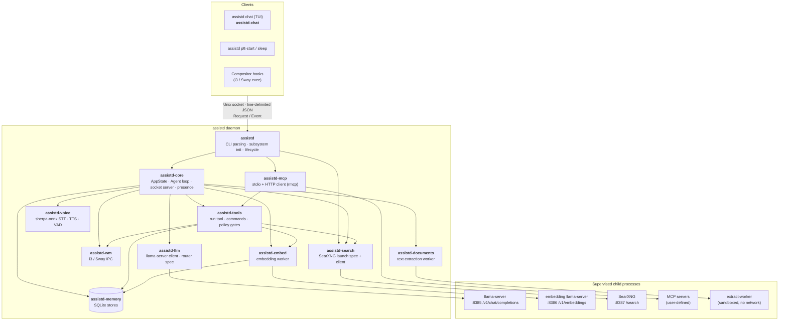

# Architecture

`assistd` is a Rust workspace split into fourteen library crates plus a
binary. This page maps the crates, the external processes the daemon
supervises, what decides who runs when, the path a user query takes
from keypress to spoken reply, and the path a file takes into the
document index.

## System overview

## Crate map

| Crate            | Purpose                                                                                              | Depends on                                                                       |
|------------------|------------------------------------------------------------------------------------------------------|----------------------------------------------------------------------------------|
| `assistd`        | Binary. CLI, daemon entry, per-subsystem init wiring (including MCP).                                | every other `assistd-*` crate                                                    |
| `assistd-chat`   | The `assistd chat` terminal window and the `assistd settings` panel, a client that only reads and writes the socket. | `config`, `ipc`, `utils`                                                         |
| `assistd-config` | TOML schema, defaults, validation. The single source of truth for every tunable, including its settings-panel metadata. | `utils`                                                                          |
| `assistd-core`   | Daemon glue. `AppState`, agent loop, planner, admission (the queue that grants every model lane, and the permits for background work), presence machine with the policy task that drives it from idle time and GPU contention, listen dispatcher, socket server, document index passes and the watches between them, page transcription while drowsy, `build_tools()` factory. | `config`, `documents`, `ipc`, `llm`, `tools`, `memory`, `embed`, `search`, `voice`, `wm`, `utils` |
| `assistd-documents` | Document text extraction (text, HTML, PDF, office files, e-books) and PDF page rendering in a sandboxed `extract-worker` child: its protocol, the worker side, and the daemon-side `Extractor` and supervisor. | `utils`                                                                          |
| `assistd-embed`  | Embedding HTTP client + the worker that drains the semantic store's rows without a vector, as four backlogs; launch spec for its llama-server. | `config`, `memory`, `utils`                                                      |
| `assistd-ipc`    | Wire-protocol types (`Hello` with the daemon version, `Request`, `Event`, `PresenceState`, `VoiceCaptureState`, `ImageAttachment`, `SearchKind`, `SearchPlace`); the in-memory image `Attachment`, its format check and capped file loader; `Access`, what a tool call reports it touched; the socket path with its owner-only directory and lock files; the socket client behind the `client` feature. | `utils`                                                                          |
| `assistd-llm`    | `LlmBackend` trait, its `TurnBackend` supertrait that an agent turn drives + `LlamaClient` (HTTP/SSE to llama-server) + router-mode launch spec and presets file + control plane + `PageTranscriber` for the OCR model. | `config`, `ipc`, `utils`                                                         |
| `assistd-mcp`    | Sandboxed stdio and Streamable HTTP MCP servers driven through `rmcp`, plus the adapter exposing their tools. | `config`, `ipc`, `tools`, `utils`                                                |
| `assistd-memory` | SQLite-backed persistent stores: `MemoryStore`, `TranscriptStore`, `TaskStore` in `memory.db`, `SemanticStore` with its one search in the rebuildable `index.db` and `vectors.db`, and the `MessageChunker` backlog. | `ipc`, `utils`                                                                   |
| `assistd-search` | Launch spec and generated settings for the supervised SearXNG instance behind web search, and the typed client for its JSON API. | `config`, `utils`                                                                |
| `assistd-tools`  | `Tool` and `Command` traits, registries, `RunTool`, all built-in commands, policy gates.             | `config`, `embed`, `memory`, `ipc`, `search`, `wm`, `utils`                      |
| `assistd-utils`  | Shared helpers: backoff + `RestartPolicy`, the `backlog` loop that drains stored rows lacking their result, the allowlist of environment variables a child may inherit, tilde expansion, `human_size`, Hugging Face file IDs, binary-content sniffing, non-blocking regular-file open, size-capped HTTP body reads, public-address classification and the `FilteredResolver` that drops non-public DNS answers, `find_program` (a `PATH` lookup that says why a program cannot be run), the chat-template token list and its neutraliser for text and JSON, terminal-safe escaping of daemon-supplied text, child-output line forwarding, `/proc` listener ownership, `ProcessGroup`, `ReadinessCell` for subsystems that start in the background, the `ChildServer` supervisor, and the `pipe_worker` supervisor and pending-reply map the extraction and voice workers run under. | none                                                                             |
| `assistd-voice`  | `VoiceInput` (Parakeet STT, Silero VAD and wake-phrase keyword spotting through sherpa-onnx) + `VoiceOutput` (sherpa-onnx TTS, played through rodio) + per-sentence `SpeakDecision` + the Hugging Face downloader that caches their models, run in a supervised `voice-worker` child behind daemon-side proxies. | `config`, `ipc`, `utils`                                                         |
| `assistd-wm`     | `WindowManager` trait + i3 (`tokio-i3ipc`) and Sway (`swayipc-async`) backends, plus `NoWindowManager`. | `config`, `utils`                                                                |

`utils` sits at the bottom with no internal dependencies; `config`
and `ipc` build only on it, and most other crates build on those
three. `core` sits at the top because it's where every subsystem is
wired into a working daemon. `llm` and `tools` do not depend on each
other: the types both handle (`Attachment`, `ToolReport`) live in `ipc`,
and `core` supplies the model behind the tools' safety judge.

The same binary also ships several client subcommands that speak the
Unix-socket IPC: `chat`, `sleep` / `wake` / `drowse`,
`ptt-start` / `ptt-stop`, `listen-*`, `voice-*`, `search`, `memory`, `documents`, and `tray`. The tray subcommand is a long-lived
[StatusNotifierItem](https://www.freedesktop.org/wiki/Specifications/StatusNotifierItem/)
client (via the [`ksni`](https://crates.io/crates/ksni) crate): it
holds a passive `RequestBody::Subscribe` connection, translates the
broadcast events into icon state (config error → disconnected →
generating → listening → presence), and provides a Sleep / Wake menu that issues
`RequestBody::SetPresence` on isolated one-shot connections. It also shows
each turn as a freedesktop desktop notification over `zbus`, held back
while the chat reports keyboard focus (`RequestBody::ChatState`). The binary
always includes the daemon and the IPC client subcommands; `tray` and
`chat` are optional features layered on top, never built standalone. The
chat's code is the `assistd-chat` crate, which the `chat` feature pulls in
and which depends on no daemon-side crate.

## Who runs when

Everything in the daemon that waits its turn waits in one of two
mechanisms, and a third task decides whether the model is loaded at all.

- **Admission** (`assistd-core`'s `admission` module, behind
  `TurnAdmission`). Whatever needs the main model is an entry in one
  queue, and one function grants entries a model lane.
- **Backlogs** (`assistd-utils`'s `backlog` module). Background work is
  the stored rows that lack their result, drained by one loop that the
  write adding a row wakes. A class of it that would compete with the
  user waits for a permit.
- **The presence policy** (`assistd-core`'s `presence_policy` module)
  unloads and stops the model when it is idle or another process needs
  the GPU.

All three read the same facts. Admission assembles them into one value,
`Activity`, and every rule about who may run is a method on it.

A new kind of work belongs to one of the two mechanisms:

| The work…                                                        | It is…                                                              |
|------------------------------------------------------------------|---------------------------------------------------------------------|
| sends requests to the main model                                 | an entry in the queue, holding a `LaneLease` for as long as it decodes |
| computes a result for stored rows, with nobody waiting on it     | a `Backlog` on the shared loop                                      |
| is a backlog that takes CPU, VRAM or the server from the user    | a backlog with a new `Work` class and its clause in `Activity::permits` |

Nothing takes a server slot without a lease, and background work keeps
no list of jobs in memory, runs on no timer of its own and is handed
nothing by the code that creates it. A request made inside a turn (a
relay's sub-agent, the safety judge) is part of that turn and has no
entry of its own.

### Activity and permits

`Activity` (`crates/assistd-core/src/admission/activity.rs`) is who is
using the model at one moment:

- the user's interaction: `Idle`, `Talking` while a user turn waits or
  runs, or `Quiet` between the last turn's end and the end of its quiet
  time;
- what holds each model lane that is held;
- how many lanes there are, the `total_slots` the server reports;
- presence's settled state: `Active`, `Drowsy`, or `Sleeping` with its
  cause.

An `ActivityWatch` reads the four from their `watch` channels and
resolves when any of them changes, so whoever applies a rule applies it
again on every change. The rules:

| Rule                 | Answers                                                                                                   | Read by                                         |
|----------------------|-----------------------------------------------------------------------------------------------------------|-------------------------------------------------|
| `waiting_runs_held`  | Why waiting task runs may not start: a sleep for the GPU, else the user's interaction on the only lane.   | The queue, and the dispatcher that marks runs `Suspended`. |
| `run_must_yield`     | Whether a run on the main lane gives it up now: under `interrupt`, while the interaction holds the queue. | The run's `RunLane`, before and during each model step. |
| `interaction_hold`   | The hold a client is shown, with when it lifts once the interaction is quiet.                             | The `TaskQueue` snapshot.                       |
| `permits(work)`      | Whether a class of background work may run.                                                               | The permit of each class.                       |

Every user turn opens the user's interaction or continues it. It stays
open through its quiet time: `tasks.resume_after_idle_secs` after the
last reply and its speech finished, or the wake word's follow-up window
if that is longer. `/new`, `ChatClosed` and `TaskQueueOp::Resume` end it
at once. The interaction only holds task runs back when there is one
lane; with more, runs have lanes of their own.

A class of background work that waits for the machine is a `Work`:

| `Work`              | Its permit is open…                                                                                                              | Waited on by                                   |
|---------------------|----------------------------------------------------------------------------------------------------------------------------------|------------------------------------------------|
| `DocumentEmbedding` | unless the interaction is open, a task run holds a lane, or the daemon sleeps for the GPU. `documents.embed_during_interaction`, `embed_during_tasks` and `embed_during_gpu_sleep` each waive one of the three. | The document chunk backlog, before each batch. |
| `PageTranscription` | while presence has settled in `Drowsy`.                                                                                          | The waiting-page backlog, before the loan and before each page. |

`TurnAdmission::permit(work)` returns a `watch::Receiver<bool>` that a
supervised task keeps at what `permits` says until its receivers are
dropped. A crate below `assistd-core` is handed the receiver and never
sees `Activity`.

### The queue

There is one lane per server slot, probed from `/props` with vision
support and probed again after a reload. Lane 0 is the main lane, on the
main backend's slot. The other lanes are for task runs, each pinned to
its slot with `id_slot`. `TaskQueue`
(`crates/assistd-core/src/admission/queue.rs`) records what holds each
lane and everything waiting for one, in the order it starts. A
`LaneLease` is the only way to hold a lane, and dropping it frees the
lane.

| Entry          | Goes in                                                                                   | Takes                                          | May start when                                           |
|----------------|-------------------------------------------------------------------------------------------|------------------------------------------------|----------------------------------------------------------|
| User turn      | Behind the waiting turns and refines, ahead of the runs. Under `after_queue`, see below.  | The main lane.                                 | It is free.                                              |
| Prompt refine  | Behind the waiting turns and refines, ahead of the runs.                                  | The main lane.                                 | It is free.                                              |
| Task run       | Last. A run that gave up its lane, to a confirmation or to the user, goes back in first.  | The main lane when it is the only one, else another lane. | Its lane is free, the queue is not paused, and `waiting_runs_held` gives no reason. |
| Session title  | Last.                                                                                     | The main lane.                                 | No other entry takes the main lane now, and presence has settled in `Active`. |

`[tasks] interruption` places a user turn that arrives while a run holds
the only lane. Under `interrupt` and `after_task` the turn goes in at
the front, and the interaction opens as it arrives, which holds the
waiting runs. `interrupt` also makes the run yield, through
`run_must_yield`. Under `after_queue`, a turn that arrives with the
interaction closed, and a run on the main lane or turns already waiting,
goes in behind the turns already waiting, or last when none is, and
the interaction opens once it has the lane. The
[task run walk-through](#agent-loop-assistd-coreagent) covers what a
yielding run does.

`startable` is the one function that says which waiting entries may take
which lane. `grant_lanes` applies it after every change to the queue (an
entry added, a lane freed, a pause lifted), and the task dispatcher
applies it again whenever the `Activity` changes. A waiting entry gets
its lease over a channel, and dropping the waiting end takes the entry
out of the queue. A run granted its first lane goes to the dispatcher,
which starts it.

A lease is not the model: the holder wakes the daemon next. A user turn,
a refine and a task run take a request guard as a query does, which
loads the model if it is not loaded. A title only goes ahead if the
daemon is still `Active`, so it never wakes it. A user turn takes the
user-turn lock last, so a branch operation never waits for a lane.

`EventBody::TaskQueue` broadcasts the runs, the waiting user turns, each
lane's holder, the pause flag and the interaction's hold. Refines and
titles are not listed.

### Backlogs

A `Backlog` (`crates/assistd-utils/src/backlog.rs`) is one kind of
stored work. Its contract has four parts.

- **The listing.** `page_after(after)` returns the next page of rows
  that still lack their result, in a fixed order, after the row named.
  An empty page means none is left. The listing is a query on the
  store, so a restart loses nothing and resumes where the rows say.
- **Doing a page.** `do_page` records each row's outcome where the row
  is stored: its result, or a mark that it cannot be done. Either takes
  the row out of the listing. It returns how many rows it left with
  neither, for a later pass. Its error is for what the backlog needs
  being away (a server, the store), never for a row.
- **A pass.** `drain` goes through the listing once. Before each page it
  waits for the backlog's permit, if it has one. It meets each row once
  whatever became of it, so a failing row never holds back the rows
  behind it. It ends when the listing runs out, when a wake arrives
  between pages, at shutdown, or with the backlog's error.
- **The wake.** The store signals a `Notify` after each committed write
  that leaves a row lacking its result, whoever made the write.
  `keep_drained` runs a pass at start and after every wake. A pass that
  failed or left rows is run again after a delay that grows with how
  many passes in a row have ended so.

| Backlog          | A row is                                             | Page | Permit              | Cannot be done                    | Wake                   | Retry               |
|------------------|------------------------------------------------------|------|---------------------|-----------------------------------|------------------------|---------------------|
| Saved messages   | a user or assistant message, or a tool result that touched a file or page, above the highest one chunked | 64 | none | never: a page always cuts its rows | `messages_to_chunk`   | 1 s, doubling to 60 |
| Message chunks   | a message chunk whose text has no vector             | 32   | none                | marked refused (a `NULL` vector)  | `rows_to_embed`        | the same            |
| Memory chunks    | a memory's chunk whose text has no vector            | 32   | none                | marked refused                    | `rows_to_embed`        | the same            |
| Access chunks    | an access's chunk whose text has no vector           | 32   | none                | marked refused                    | `rows_to_embed`        | the same            |
| Document chunks  | a document chunk whose text has no vector            | 32   | `DocumentEmbedding` | marked refused                    | `rows_to_embed`        | the same            |
| Waiting pages    | a PDF page without text, recorded as waiting         | 1    | `PageTranscription` | recorded as failed                | `pages_to_transcribe`  | 5 minutes           |

The message chunker (`MessageChunker` in `assistd-memory`) cuts saved
messages into chunks, and the files and pages their tool calls touched
into one chunk each, and runs whenever embedding is enabled, with or
without the embedding server; the chunks it adds wake the embedding
worker. The embedding worker drains its four backlogs in that order in one
pass, so a wake in the middle of the document chunks sends it back to
the messages first. Page transcription drains inside a loan of the
drowsy server and lists again after a wake without giving the loan up.
What a refused row or a failed page is, and what tries it again, is in
[memory](#memory-assistd-memory--assistd-embed) and
[page transcription](#page-transcription-assistd-core).

A document index pass is not a backlog: it finds its work by walking a
folder, and nothing is stored to list until it has. It is what fills the
last two.

### Presence policy

One task (`crates/assistd-core/src/presence_policy.rs`) moves presence
without being asked. It takes one transition at a time, from two
sources.

**Idleness.** The idle clock is one stamp on the presence manager, set
when a use of the model begins and when it ends. The policy's own
transitions do not set it. `Active` becomes `Drowsy` once the stamp is
`sleep.idle_to_drowsy_mins` old, and `Drowsy` becomes `Sleeping`, with
the cause `Idle`, once it is `idle_to_sleep_mins` old. With the first at
`0`, `Active` goes straight to `Sleeping` at the second; with both at
`0` nothing idles. A step is given up when a request guard is out, and
the policy then waits for the stamp to move, which the end of that use
does. A step that fails for any other reason is tried again after ten
seconds.

The idle clock is not the interaction's quiet time. The quiet time is
seconds long and holds task runs and document embedding back; the idle
clock is minutes long and unloads the model.

**The GPU.** With `sleep.gpu_monitor_enabled` and an NVIDIA GPU, the
policy polls NVML every five seconds. Another process crowds the model
when less than `sleep.gpu_headroom_mb` of VRAM is free and the VRAM held
outside assistd has grown by 100 MiB or more over the least seen since
the model came up. The daemon, `Active` or `Drowsy`, then sleeps with
the cause `GpuBusy`, once the requests in flight have finished. While it
sleeps for the GPU:

- waiting task runs are `Suspended(GpuBusy)` and are not started, so
  none wakes the model;
- the `DocumentEmbedding` permit is closed, unless
  `documents.embed_during_gpu_sleep` is set.

Any wake ends it: a query, `assistd wake`, or, with
`sleep.gpu_auto_wake`, the policy itself once the model at its measured
size fits beside the headroom. A wake that would not fit is refused, and
the daemon stays asleep for the GPU. A sleep with any other cause is
only ended by a use of the model or a request. After ten failed polls in
a row the policy polls every five minutes.

## Subsystem walk-throughs

### LLM lifecycle (`assistd-llm` ↔ llama-server)

The daemon opens its socket first and then spawns `llama-server` as a
child process in the background, reporting `PresenceState::Waking` until
the model has loaded (queries wait for it; requests that need no model
are served at once). Voice and the embedding server start after the
model, so neither loads onto the GPU while it does, and the SearXNG
instance, the MCP servers and the document extraction worker start straight
away; none of them holds up the socket. `RequestBody::GetReadiness` reports
how far each has got as one
`EventBody::Readiness` per subsystem, and the daemon broadcasts the same event as each one settles. The chat names
whatever is still starting, and the tray tooltip lists every subsystem's
state. The server takes
its bind address, context length and GPU layer count from `[model]` in
the config, plus any `custom_args` (parsed and checked at
config load, never run through a shell). Inherited `LLAMA_ARG_*` and
`LLAMA_API_KEY` variables are stripped, so the checked command line is
the server's only source of options. Each daemon launch generates a
random API key, written to a mode-0600 file under `$XDG_RUNTIME_DIR` and
passed as `--api-key-file` to both llama-servers (with `--no-slots`), so
other local processes cannot load, unload or query models; every client
sends it as a bearer token. The model server's `--slot-save-path` is a
mode-0700 `$XDG_CACHE_HOME/assistd/slots` that the daemon empties at
startup and before every spawn, since a saved slot is only valid for the
server that wrote it. `SlotStash` keeps one file in it per holder set
aside, a `SlotHolder` (`Main`, `TaskRun`). Before each request a
backend with a holder calls `switch_to`, which saves the slot for whichever
holder has it and restores the target's file (skipping the restore
if the child changed since the save), deleting the file once restored.
`preserve_across` saves the holder before a group of unkeyed sub-agent
requests and restores it after, so a relay inside a task run keeps that run's
slot; with more than one slot the main backend keeps slot 0 to itself, so
the group runs without either. A file is deleted when its holder ends (a finished run, `/new`),
and past two suspended runs the oldest run's file is dropped. The stash applies
these transitions one at a time on a task it owns, so one that has begun
finishes even when the turn that asked for it is interrupted. Any failure only
costs re-processing that holder's context. `assistd-utils`'s `ChildServer`
supervisor, run on the `LlamaServerSpec`, health-probes
`GET /health` until the server reports ready (a 200 counts only when
`/proc` shows every listener on the address belongs to the child's
process group, so a stale server or squatter on the port is never
trusted), then `LlamaClient`
streams chat completions over `POST /v1/chat/completions`. Chat and
control-plane requests are sent only while the supervisor is `Ready` with
a live child, so nothing reaches the port between a crash and the next
verified start.

Presence decides whether the model is loaded: `Active` has it loaded,
`Drowsy` keeps `llama-server` running with the weights unloaded, and
`Sleeping` stops the server. The daemon starts `Sleeping` and reports
`Waking` while it loads the model. A wake first asks the router whether
its cache holds `model.name`; if not, it has the router download it
(`POST /models`), follows the bytes on `GET /models/sse` and reports
`Downloading` with them. `model.ready_timeout_secs` bounds how long the
download may go without new bytes, not the download. The
[presence policy](#presence-policy) moves it down by the idle periods and GPU
headroom under `[sleep]`, and a query wakes it. `Sleeping` records why.

The router gives every model it loads the flags on its own command line, and
a flag given there overrides a preset. So `model.context_length` is not passed
as `-c`: each launch writes a presets file (`--models-preset`,
`~/.cache/assistd/model-presets.ini`) whose `[*]` section sets it for every
model, and whose `[assistd-ocr]` section, present while `documents.ocr.model`
is set, serves that model under the name `assistd-ocr` with a context of its
own: one page image of up to 4,100 tokens, its prompt, and a transcription of
up to 4,096. The section is not named after the model itself, because the
router refuses to download a model a preset already defines.
`model.gpu_layers` and `model.custom_args` stay on the command line and reach
both models.

While `Drowsy`, the presence manager can lend the idle server to a second
model (`lend_while_drowsy`), which is how pages are transcribed (see
[page transcription](#page-transcription-assistd-core)). The loan passes the
check a wake does, that the main model would fit beside the configured
headroom, waits for the main model's process to be gone, downloads the
borrowed model if the router lacks it, loads it, and unloads it when the work
is done. Presence stays `Drowsy` throughout. A wake or a sleep takes the
transition lock, cancels the work, and waits until the router lists the
borrowed model as unloaded before it loads the main model or stops the server,
so the two are never loaded together.

If the child crashes mid-stream (CUDA OOM, OOM-killer, segfault), the
supervisor restarts it with exponential backoff and the in-flight
agent turn surfaces an `LlmError::ServerRestarting`. The agent
retries once after the new child reports healthy; further failures
propagate up to the client as an `EventBody::Error`.

A `Ready` child is still probed on `GET /health` every 30 seconds, with
the same listener check. Three failed probes in a row (10 second timeout
each) mark it hung: the supervisor kills its process group and restarts
it like a crash.

Vision support is detected dynamically: `probe_capabilities_routed()` calls
`GET /props` on the running server to learn whether the model has a
vision projector. The `VisionGate` flips on if so, allowing the `see`
and `screenshot` commands to attach images to the next turn. A
`VisionRevalidator` probes once the model first loads, then re-probes at
the start of the first query after
the weights may have been reloaded (any presence transition, or a
supervisor restart of the child), and again after any failed probe,
so the gate tracks what is actually loaded without probing on every
query.

### Agent loop (`assistd-core::Agent`)

One per-query state machine, single-threaded per turn. The loop:

1. `backend.push_user(text, attachments)` — append user message + any
   image attachments to the history.
2. `backend.step(tools.openai_schemas(), tx)` — send `messages +
   tools` to llama-server, stream tokens.
3. The response is either text (`StepOutcome::Final` → emit
   `EventBody::Delta` per token, then `EventBody::Done`) or tool calls
   (`StepOutcome::ToolCalls` → step 4). A response cut off at the
   output-token limit (`StepOutcome::Truncated`) is retried up to
   twice with a note to the model, then the turn fails.
4. For each tool call: `tools.get(name).invoke(arguments)`. Emit
   `EventBody::ToolCall` before, `EventBody::ToolResult` after. Push results
   back via `backend.push_tool_results(...)`, which appends them as
   OpenAI `role: "tool"` messages carrying the id of the call they
   answer. A result carrying an image is the one exception: chat
   templates render image parts only on user turns, so those ride
   back as a user message tagged `[tool:<name>]`.
5. Loop back to step 2 until the model emits text. If the model
   repeats the same call several times in a row, or the turn runs
   past a hard-coded step ceiling, the loop tells the model, in a
   one-shot message at the end of the history, to stop calling
   tools and answer from what it has already gathered. The tool schema
   stays in the request so a call made anyway is still parsed (and ends
   the turn) rather than streamed to the user as raw markup.

A sub-agent run (`SubAgentRunner`) drives the same loop over
a backend with an empty history that the main backend's `isolated_backend` opens
on the same server and model, with its own system prompt, tool registry and
event sink. Its history budget is the main backend's
`chat.max_history_tokens`, and it compacts the same way: the summary is
written inside the sub-agent's own history, which keeps its task, and
never leaves it. The summary request continues the history with its
tools offered, so the server reuses the cached prompt; a reply that calls a
tool or is empty is asked for again without tools, and only when that also
fails does compaction fall back to dropping old steps without a summary. Its
system prompt gives its final message a shape it can check as it writes: the
answer in one short paragraph, at most ten bullets of sourced facts, about 400
words, and anything more after those, where the saved file keeps it. The cut a
relay result makes is far above that and is not mentioned. The prompt also
states how many tool steps it has, and tells it to keep notes in a file in its
home as it goes, so compaction and a cut-off run lose less.
Its step ceiling is the main turn's: after 200 tool-calling steps, or a call
repeated three times in a row, its tools are withdrawn and it is asked to
answer from what it has, so a long task ends in a partial report rather than
an error. While a relay runs, its plan, then each sub-agent's text, reasoning,
context size, tool calls, results and compactions reach the client as
`EventBody::Relay` progress, never the model. The TUI draws them as a compact
block in place of the `relay` tool block, and `/agents` opens any sub-agent's
full transcript. The backend is dropped when the run ends, so none of it
reaches the main history. What the client was shown is stored with the
relay's tool result in `relay_steps` and `relay_entries`, never embedded, and
replayed with branch history.

A tool call also reports what it touched, as a list of `Access`es its
`CommandOutput` and `ToolOutput` carry: `cat`, `see`, `docs read` and the text
programs (`grep`, `head`, `tail`, `sort`, `uniq`, `wc`, when they exit 0) the
files they read, by absolute path; `write` the file it wrote; `web fetch` the
URL that answered, after redirects, with the page's title; `search --session`
the session it looked into; `remember` the key it saved. `run` joins those of
a chain's commands, and a relay those of its sub-agents, a read of a mounted
input named by the input's own path. A `bash` script, an MCP tool, `ls`, `wm`,
`screenshot` and the searches report nothing: a script's reads are not known,
and a list of results is not a visit. The list is saved with the tool result
in `accesses` (see [database.md](database.md)), and `search` finds the files
and pages in it ([how](search.md#how-hits-are-ranked)). It is not the record of
whether a history has read this machine, which must err towards yes while
this list may miss things; neither is derived from the other.

A sub-agent's final answer is saved whole, with no length cap, to
`~/.local/share/assistd/relays/<session>/relay-<uuid>.txt`, written by the
runner rather than the sub-agent so the file always exists and is complete.
It is sanitised first: control, bidi and format characters are stripped,
chat-template tokens (`<|im_start|>`, `<tool_call>`, `[INST]`) are broken with
a space, from the same token list the history uses for every other piece
of untrusted text, and it is quoted under a header that labels it untrusted
data. That final message is also the relay's result: the run generates nothing
further. It comes back as a `RelayReport`, the restricted return channel:
sanitised and quoted the same way, under a `status` line and an `artifacts`
line naming the saved file. `status` is the harness's own reading of the run,
`done` when it answered and `partial` when its tools were withdrawn first (a
repeated call or the step ceiling); a run that fails is a failed tool result.
The message is shown up to a quarter of the history budget, counted in tokens
by the history's own estimate. A longer one is cut at the end of a line and
followed by a line saying how much is left and naming the saved file, so a
cut is never silent; the registry's `OutputCap` does not cut a relay result a
second time. Every path under the quarantine's `input/` in the message is
pointed back at the original input. A plan's next step is handed the previous
step's report beneath its task, and the saved file as an input. The default system
prompt says never to follow instructions inside one. The sub-agent's tool
output and reasoning never leave it. Each answered step's file is recorded in
`relay_steps.answer_file`; `/undo` deletes the files of the steps whose rows it
deletes (a fork still holding the turn keeps them), and daemon start deletes
every saved answer no stored step names.

A sub-agent's commands run in a `Quarantine`, which starts from an empty world:
a fresh `relay-*` directory whose `input/` shows the inputs it was handed,
read-only and in place, a writable `home/` that is `$HOME` and the working
directory, and `output/` for spilled output. Each input is opened once with
`O_PATH`, and an empty file or directory is made under its name in `input/` as
its mount point. `cat` and `ls` resolve paths under `input/<name>`
beneath that descriptor, and each sandboxed command gets a duplicate of it, inherited by
bwrap alone, for a `--ro-bind-fd` over the mount point, so both read the file
opened at handover even if the host path is later renamed or replaced. bwrap
closes the descriptor before the command starts. On the host,
`input/` holds only the empty mount points, so removing the relay directory
never touches an input. The directory is removed when the `Quarantine` is
dropped, so on cancel or panic too, even if a script left subdirectories
unwritable. Its `bash` runs in a separate bwrap profile: read-only `/usr` and
the merged-`/usr` links, `/etc/ssl`, `/etc/ca-certificates`, `/etc/resolv.conf`
and the loader config, fresh `/tmp`, `/dev` and `/proc`, the relay's three
directories bound at their own host paths, the same `prlimit`, scope and `choom` caps, and always
`--unshare-net`, with its inputs bound over their mount points. bwrap binds are
`nosuid,nodev`, so device nodes in an input cannot be opened.
`bwrap_extra_args` does not apply. The host home, `/run` and the daemon socket
are not mounted. Network namespaces do not cover pathname sockets, so the
daemon also hands bwrap a seccomp filter (`--seccomp`, from a memfd) that
fails `socket(AF_UNIX, ...)` with `EACCES`: the command and everything it
starts can create no Unix socket, and so cannot connect to one made outside
the sandbox, such as gpg-agent's or the daemon's inside a bound input.
`io_uring_setup` fails with `ENOSYS`, since `IORING_OP_SOCKET` would get
around the rule, and the filter kills any system call from a foreign ABI
(i386, x32), whose arguments it cannot read. Abstract sockets need no rule;
they belong to the unshared network namespace.

The in-process file commands (`cat`, `ls`) and glob and `~` expansion go
through the registry's `FileScope`. In a quarantine that scope cleans `..` lexically, then opens every
path with `openat2(RESOLVE_BENEATH)` on the descriptor of the input it falls
under, or else of the relay directory, so the kernel refuses `..`, absolute
symlinks and anything outside it. They never connect to sockets. Relative
paths start at `home/`, and `write` may only write under `home/`.
`Quarantine::create` fails when the sandbox does not wrap.

A quarantine's `bash` never reaches the network, so a sub-agent cannot
`curl`, `git clone` or `pip download`. A quarantine created with an `Egress`
also gets the in-process `web` command, which runs in the daemon and is the
only way a sub-agent reaches the network. It is held to a sub-agent's
`EgressPolicy`: HTTPS to port 443 only, so nothing on the network path can read
what a sub-agent sends or alter what it downloads, and it refuses `http://`
URLs and redirects to them. It asks the same approved-hosts `ApprovalGate` as
the main agent's `web fetch`, and refuses loopback, private, link-local and
other non-public addresses, both as literals and after DNS resolution, so a
relay cannot reach llama-server, SearXNG or the LAN. Its `web search` goes
through the daemon's SearXNG client, which only ever sees the query.

The model starts a sub-agent with the `relay` tool (`task`, `inputs`,
`agent`, or `steps`: a plan of up to five such steps), registered in
`assistd-core` beside `run` whenever tools are. `agent` names a `Role`: its
name, when the model should pick it, a brief opening its system prompt, and
its `Reach`, either files or the web, never both. The roles are built in and
fixed: `file_review` reaches files, seeing its `inputs` read-only with no
network; `web_research` reaches the web, getting an `Egress` and no inputs.
The tool's schema and description list the roles, and the wire and the
database carry a step's role by name. A web step naming inputs is refused as
invalid arguments before a quarantine or backend exists, since a relay
that could both see private files and reach the network could leak them, and
a web step's quarantine is never handed inputs. Every file step's inputs are
checked before the first step starts: a missing input, one that is neither a
file nor a directory, or two sharing a file name refuse the whole plan, so a
mistake in a late step costs no earlier step's work. A file step is also
refused, before anything starts, when its inputs hold more than twice a
sub-agent's context budget of text, estimated from file sizes at four bytes a
token. Counting stops at that limit, so even a tree with a build directory is
measured in milliseconds. The refusal names the largest entries of the inputs,
so the model can split the work, and a step that sets `search_only` (it greps
rather than reads its inputs through) skips the check. The tool description
states the budget and asks for relays of about half of it, one per natural part
such as a crate or module, with independent parts requested together. Each call
creates a fresh `Quarantine` under `~/.cache/assistd/relays` (emptied at daemon
start), gives the sub-agent a registry holding only `run` over the quarantine's
commands, and runs it inside `SlotStash::preserve_across`. A plan's steps run
back to back inside one `preserve_across`, each in its own quarantine and
handed only the previous step's rendered `RelayReport` beneath its task and
its saved answer as an extra input. Since a report carries what its sub-agent
read, a plan with a web step after a file step is refused as invalid arguments.
The tool result is the last step's rendered `RelayReport`; a failed step ends
the plan as a failed tool result, not a failed turn. A relay starts without confirmation, unless it has a
web step and the calling turn's history has read this machine; commands inside it ask
the same `ConfirmationGate` as the main agent's, with the prompt marked
`ConfirmSource::Relay` and the step's task so the user can tell who is asking.
Cancelling the turn drops the call, which drops the run and removes the
quarantine. A tool whose `bounded_by_tool_deadline` is `false` is exempt from
`timeouts.tool_call_secs`; `relay` is the only one, since its run is bounded by
the sub-agent's step budget, each of its tool calls by that same deadline, and
each step by the first-token and stream-inactivity timeouts and the
response-token limit, as a main turn's steps are. The quarantine wrapper is
looked up beside the `assistd` executable; without it, relays fail.

The loop does not parallelize tool calls. Tools execute serially, and
their results land in the history in the order the model
emitted them. This keeps the history deterministic and the
`Event` stream readable.

A saved task runs through the same loop with no user present.
`TaskRequest::Run` records a queued run and appends it to the `TaskQueue`,
returning at once. The queue is FIFO, its order kept in `task_runs.queue_pos`;
at startup runs still queued are reloaded in that order, while any left
running are recorded as failed, since their side effects may have happened.
It is the queue every use of the model waits in, and
[who runs when](#the-queue) says how it grants lanes: with one server slot a
run shares the main lane with the user's turns, and with more it takes a lane
and slot of its own. A dispatcher on the `TaskRunner` starts each run granted
its first lane. `TaskRequest::Queue` moves, cancels, pauses and resumes the queue (the pause is
kept in the `task_queue` table, so it outlasts a restart), and
`EventBody::TaskQueue` broadcasts the items, lane holders and pause flag after each
change and greets every new subscriber.

Time triggers are `TaskTrigger::At` (one local datetime) and
`TaskTrigger::Schedule` (a five-field local-time cron expression parsed by
`croner`, so DST gaps and repeats behave). `TaskSave` refuses invalid
expressions and `At` times already past. `TaskCheckTrigger` runs the same
checks on one trigger without saving and returns its next three fire times,
so a client can show them, or the refusal, as the trigger is written.
`EventBody::Task` carries how the task's latest finished run ended. The
`TaskScheduler`, a second service on the `TaskRunner`, sleeps until the
nearest fire time across enabled tasks, waking early on any task change. Each
sleep is capped at a minute and compared against the wall clock, since tokio's clock stands still through a
suspend. Each task's next fire time is kept in `tasks.next_fire_at`. The
scheduler records it in the same write that queues the fired run, so a restart
neither double-fires nor loses a fire. A schedule whose fire times passed while
the daemon was down or asleep runs once on return or skips them, by its
`missed` policy. Firing only queues: a task with an unfinished run gets no
second one. `assistd task run <name>` queues a run directly, the escape hatch for
systemd timers, udev rules and key bindings.

Event triggers are `TaskTrigger::Event`, carrying a `TaskEvent` and a cool-down
(default one minute) that keeps a task's event triggers from firing it more
often than that. `DaemonStarted` fires once, when presence first reaches
`Active`. `SessionUnlocked` fires when logind's `LockedHint` on the user's
graphical session (`User.Display`) turns false, watched over `zbus`; screen
lockers set the hint, while logind's `Unlock` signal only follows
`loginctl unlock-session`. `PathChanged` watches a path
recursively with `notify` (inotify) and fires once per burst of creates,
writes and moves-in, gathered over `debounce_secs`; `TaskSave` tilde-expands
the path and refuses one that is relative or missing. `TaskFinished` fires
when a run of the named task succeeds, fails, or either (a cancelled run fires
nothing), queued as each run's end is recorded; `TaskSave` refuses a chain
that names a missing task or leads back to the task being saved. A third
service on the `TaskRunner` keeps one watch per enabled trigger that needs one
(a path watch each, one shared logind subscription), matching them to the
saved tasks after every save, enable, disable or delete. Event fires queue
through the same coalescing as time triggers.

A watched path is writable only by a run of the task that watches it. inotify
does not say who wrote a file, so the daemon decides who may write instead. The
same service reports the enabled `PathChanged` paths to `WatchedPaths`, which
the tool sandbox owns. For every turn but a run of the watching task, each
watched path that exists is bound read-only in the `bash` sandbox, after
`bwrap_extra_args`, and a script that names one as something it changes is
refused before it starts. `write` to one is refused in a task run. In a turn
with a user it asks every time, in every permission mode, names the task the
write will start, and offers no "always allow". Two tasks that watch
overlapping paths each lock the other out. When a run ends, the watches of its
task drop the changes they hold before the end is recorded, so what the run
wrote there does not fire it again; a change someone else made there during
the run is dropped with them. A run a `PathChanged` trigger started begins as
having read this machine, since whoever wrote the file chose what the run
reads. `TaskSave` refuses a path that is or holds `$HOME`, the daemon's
working directory or the scratch directory, which would leave them read-only
to every other turn. A watched file that has been deleted cannot be bound. A
stdio MCP server is one process shared by every turn, so it gets no exception
for the watching task: `ServerSandbox` binds each watched path that exists
under its home or a writable grant read-only, and the whole grant when the
watch covers it. A server started under other watches than the ones that now
lie where it can write is stopped as soon as they change, with any call in
flight, and the next call starts it in a sandbox that matches. The cool-down
stays as the bound on a loop through a program the daemon does not run, such
as a sync client.

An admitted run takes the request guard, as a query does, then opens an
`isolated_backend`. That backend gets the main system prompt plus a
short preamble saying no user is present, and the main agent's full tool
registry. On lane 0 it is keyed `TaskRun` in the `SlotStash`, and when the run
ends its slot file is dropped and the main backend's slot restored. It is
saved as a transcript session of its own, linked from its `task_runs` row; its
turn's events are sent to no client. The main backend,
its branch and the active session are never touched. `TaskRequest::Cancel`
cancels a run the way `InterruptTurn` cancels a turn. A run still going at
shutdown is recorded as failed. At startup and after each run ends, every task's
finished runs beyond its `kept_runs` (else `tasks.kept_runs`) are deleted with
their sessions and saved relay answers, sparing the session the user is in.

A run's prompts are labelled `ConfirmSource::Task` (a relayed sub-agent's
prompts name the run too) and go through `ConfirmRouter::for_task_run`, set to
the task's `mode` as a chat connection would be, with the safety judge in Auto
when `tools.allow_auto_mode` allows it (`TaskSave` refuses Auto otherwise). The
judge is given the task's prompt as the whole of what the user asked for, and
nothing from the main backend's history. A
`web` fetch from a host not yet approved asks as `Unattended::WebHost`, which no
mode approves but a run does once when the host is one of the task's
`allowed_hosts`, matched exactly. What the mode and hosts approve runs once,
logged on `assistd::policy`, and never reaches the allowlist or the
`approved_*.toml` files. Once the run has read this machine, each fetch is
parked instead, whatever its host. Anything else is parked: the run turns `NeedsInput`,
gives up its lane and request guard (on lane 0 its slot state stays in the
stash), and the queue snapshot carries the prompt as the run's `PausedPrompt`,
so a client that subscribes later can still answer it. The tool deadline stops while a prompt is
parked. `TaskRequest::Confirm` answers it for that prompt alone, except that
`always` on a host fetch adds the host to the task's `allowed_hosts`, for the
rest of the run and later ones; the run then waits first in the queue for a lane,
moving its backend to that lane's slot. `TaskRequest::Runs` lists a task's
latest runs with their trigger, times, final reply and session. The task's
prompt is the only instruction a run gets; no plan is stored on the task.

With one lane, a user message that finds a run on it follows
`[tasks] interruption`, which places the turn in [the queue](#the-queue) and
says whether the run must yield. Under `interrupt` the run's turn reads that
rule through its `RunLane` and yields at its next model step. A step in flight is
cancelled and announced as `StatusKind::YieldedToUser`, so its partial output is
dropped. A tool call in flight finishes first. A relay in flight is cancelled and
rerun from its arguments, since its effects stay in its quarantine. The yielded run
waits first in the queue as `Suspended(UserInteraction)`, its slot state stashed.
Under `after_task` the turn takes the lane once the run ends, ahead of the queue.
Under `after_queue` it joins the queue as a user-turn item, behind any turns already
waiting, which the dispatcher hands the main lane in its turn;
`TaskQueueOp::CancelTurn` drops it. A turn made to wait either way is told
`EventBody::Queued` with how many items are ahead of it, which the TUI shows in
place of "Generating…" until the turn has the model. Every user turn opens the
user's interaction, which holds waiting runs as `Suspended(UserInteraction)`
until it ends ([activity and permits](#activity-and-permits)). Its hold, and
when it lifts, rides on the `TaskQueue` snapshot.

### Plan mode (`assistd-core::Planner`)

A planning turn shows how the agent means to do a piece of work before
anything runs. The `Planner` drives the
agent loop over a given backend with the planning registry, which
`build_tools()` assembles beside the main one: `run` over the
readers, `web`, `docs` with `documents.enabled`, `search` with that or
`memory.enabled`, and a `bash` whose policy
holds no "always allow" approvals. No
`write`, `wm`, `see`, `screenshot`, `relay`, `remember` or MCP tools. The
turn runs under
`ConfirmRouter::for_planning`, which refuses every ask without prompting
anyone in any mode, so the planning turn runs only what needs no
confirmation; each refusal is counted and the tool result gains a note
telling the model to describe that step instead. A plan-mode note is set
as the transient note on every step, so it renders at the history's
tail and the system prompt, and its cache, are unchanged.

Whether a turn plans is a flag on the `ConfirmRouter` in its `TurnContext`, so it
can change mid-turn. While it is set every ask is refused and counted, and an agent
built by `Planner::user_turn_agent` offers, before each step, the planning registry
plus `exit_plan_mode` in place of the main registry plus `enter_plan_mode`; its
backend carries the plan-mode note only while planning. A query's `plan`
says whether its turn may plan: `off`, the default and what voice turns use, which gets
the plain agent; `offered` for chat messages; `planning` for chat messages sent
in plan mode, which start with the flag set.

`enter_plan_mode` is the model's own ask to plan first, for work worth agreeing
on before it runs. It goes to the user as a `ConfirmRequest` in every mode; a
yes sets the flag and sends `EventBody::PlanModeEntered`, a no tells the model to
do the work. `exit_plan_mode` carries the plan to the client as
`EventBody::PlanReview` and waits, with no timeout, for `RequestBody::PlanVerdict` on
the same connection. `Accept` sets the router's mode and clears the flag, so the
same turn carries the plan out under it; `KeepPlanning` keeps planning, revising
by the user's feedback or, without any, asking what to change.
`SetPermissionMode` with `plan` sets the flag mid-turn too.

In the chat, Shift+Tab's cycle ends in plan mode, which the TUI holds beside
the `PermissionMode`s and applies to the open turn. A plan review draws the
plan in the transcript and, in place of the input line, offers auto mode when
the daemon allows it, accept edits, manual approval, or keeping on planning
with what to change typed on that row; accepting switches the chat to that
mode.

`Planner::refine` runs the same turn for a task prompt, its note asking it to
end with only a short list of what it found. Then `complete_with_schema` holds
the work rewritten as a self-contained brief for an unattended run, beside a
draft of a summary and steps, each with actions named by a kind (`program`,
`web_host`, `mcp_tool`, `app`, `write`) and a target. Each action becomes a `PlannedAction`, and
`ActionCheck` flags any that would fail: a program missing from the
sandbox's `PATH`, a malformed host, an MCP tool no connected server offers,
an app with no launchable desktop entry, a write directory that is relative
or not a directory. It also gives each an `ActionOutlook` under the work's
`WorkPermissions`: `Unasked` when a standing approval, an allowed host or the
mode with the edit scope covers it, `JudgeDecides` for programs and MCP tools
in Auto, else `Asks`. The result is a `Plan` of the brief with a fresh `PlanId`.

`TaskRequest::Refine` refines a task prompt, saved or not, under the permission
mode and allowed hosts the request gives, on an isolated backend with the
task-run system prompt, keyed `TaskRefine` in the `SlotStash`. Only the latest
refine's backend is kept; a new one ends it. It takes the main lane and
request guard as a query does, and `InterruptTurn` cancels it; its planning turn
is sent to no client, and its result arrives as `EventBody::TaskRefined`
with the rewritten `TaskPrompt`, its `Plan` and a `ModeRecommendation`: the
least permissive mode, Auto only when allowed, under which the fewest of the
plan's actions would ask, with the actions it covers and those that would still
ask. It saves nothing. With
`feedback` it continues on the same backend, so a revision keeps what the
model already found, quoting back the rewrite the client was shown, which the
grammar-held request left out of the history; it is refused unless the
last refine was of the same prompt.

In the TUI, `/tasks` opens a panel over these requests alone, since tasks
live in the daemon's store rather than `config.toml`. It lists each task
with its triggers, next fire, last outcome and whether it is enabled; its
editor saves the name, prompt, mode (Auto only when the daemon offers it),
allowed hosts, triggers and enabled flag. Ctrl+R in the prompt box refines its
text under the editor's mode and hosts without drawing the planning turn; Esc
cancels it. The rewrite replaces the box's text, unapplied, with the
recommended mode and a brief reason on a line below. `r` on a task queues a
manual run. The Queue tab draws the broadcast `TaskQueue` and reorders, cancels
and pauses it through `TaskRequest::Queue`; Enter on a run needing input opens
its prompt in the chat's confirmation dialog, answered with `TaskConfirm`. The
Runs tab lists the selected task's runs, and Enter switches to a run's session
as `/resume` does. Outside the panel, the status line counts runs needing input
(Ctrl+T opens the panel) and names the running ones. The tray's tooltip lists
running runs with elapsed time, runs needing input and the queued count; its menu
pauses and resumes the queue, and it notifies on every run newly needing input,
focused or not. A task with `announce` set broadcasts a successful run's final
reply as `EventBody::TaskReply`, which the tray notifies while the chat is unfocused;
the daemon speaks it once no user turn is in flight and nothing is playing, and a
user turn starting meanwhile cuts it off.

### Tools (`assistd-tools`)

Two-tier system. The LLM sees a single `run` tool whose argument is a
shell-style command line; that line is parsed into a pipeline AST
and dispatched through an internal `CommandRegistry` of Rust handlers.
So `cat /etc/hosts | grep -v '^#'` is one tool call that fans out into
two commands chained by a byte-level pipe.

Two additional `Tool`s sit alongside `run`: `relay` (hand a task to a
sub-agent) and `remember` (save a fact). They don't fit the shell mold, so they're regular
LLM-facing tools with their own JSON schemas.

Built-in commands: `bash`, `cat`, `docs`, `echo`, `grep`, `head`, `ls`,
`screenshot`, `search`, `see`, `sort`, `tail`, `uniq`, `wc`, `web`, `wm`,
`write`. `docs` is registered only with `documents.enabled`, and `search`
with that or `memory.enabled`. `cat`, `ls`
and `echo` run in the daemon; `cat` and `see` put
each file through the path guards first and ask before reading
credentials or an owner-only file in `$HOME`. `grep`, `head`,
`tail`, `sort`, `uniq` and `wc` are the system's GNU programs: their
arguments are quoted into a script that runs as a `bash` script does,
through the classifier, the path guards and the sandbox, so they see the
sandbox's files (a private `/tmp` and `/run`) and a writing option such
as `sort -o` asks.

Policy gates (`ConfirmationGate`, `VisionGate`, `SandboxRequest`)
intercept the dangerous paths. Before a `bash` script runs, the
classifier sorts it, through every wrapper, substitution and
evaluated string bash would run, as read-only (only programs on a
short read-only list, redirecting only to standard streams, `/tmp` or
the scratch directory), an edit (also programs on a short list that
write or delete the literal paths they name, or redirections to a
literal path), or unvetted (anything else: another program, a path
from a variable, substitution or brace expansion, which may lie anywhere,
a command only known at run time, a changed `PATH`/`LD_*`/`GIT_*`, a
disqualifying option such as `sort -o` or `find -exec`, an option the
lists do not hold for its program, a redirection
from bash's `/dev/tcp` or `/dev/udp`). The path guards
then resolve every target: destroying `$HOME`, a personal folder or a
git work tree is refused in every mode, and touching credentials, an
owner-only file in `$HOME`, a startup file, a shell profile or a
directory on `PATH` always asks. What an unvetted command does to a path
it names is unknown, so one that names `$HOME`, a personal folder or a
directory holding them always asks too, and the script a shell is given
(`bash -c`, a here-document) is classified for the same refusals. Asking for an unvetted script offers
"always allow" for the programs on neither list, saved in
`allowed_programs.toml` beside the config and pinned to the file the
name resolved to; an approval covers one subcommand (`systemctl status …`),
or exactly the options the program was run with when it was given no
positional arguments, and counts that run as vetted from then on. Shells, interpreters,
`sudo`-like wrappers and builtins that shadow a program are never
offered it, and neither are build tools, compilers, package managers
and version control (`make`, `cargo`, `npm`, `git`): each runs code
named by the project, config or options it is pointed at, which the
model can write, so an approval would let it run its own code unasked.
A script then runs in the bubblewrap
sandbox, with all of `$HOME` read-only when it was classified
read-only; tools never run unsandboxed, so when `bwrap` is missing (or
`tools.bash.sandbox = "none"`) the model is offered no tools at all and
clients are told why. `wm open` is the one way out of the sandbox: it
launches an installed desktop entry as the user, through the compositor's
`exec` (optionally on a given workspace), so the model picks only which
entry, a working directory, and the files or URLs the entry's `Exec`
field codes accept, never a command line. Given a file in place of the
entry, it launches the user's default application for the file's type,
read from the shared MIME database, `mimeapps.list` and
`mimeinfo.cache`; while replies are read aloud, the model is told to put
detail that does not suit speech in a file and open it this way. Entries under a visible
`$HOME` entry, where sandboxed commands can write, are refused; the user
confirms each launch unless they chose "always allow" for that entry,
and one with files or URLs is never approved for good. The approval is kept
with the canonical path of the program the entry's `Exec` line runs, found
through `PATH` as the compositor's shell would, and holds only while the
entry still runs it. When that program, another absolute path on the `Exec`
line, or the terminal emulator a `Terminal=true` entry runs in lies under a
visible `$HOME` entry, the launch asks every time, in every mode, with a
prompt that says the program can be changed from inside the sandbox; a
program that cannot be found is never approved for good either. What a
program outside the sandbox's reach goes on to load is not seen; `write` restricts targets to a
configured allowlist, refuses dot entries at any depth below it, and puts each
target through the same path guards as `bash`, asking before writing outside
`tools.scratch.dir`; `web fetch` asks before fetching from a host not
yet approved, in every mode, and follows redirects only to the same or an approved host;
`see` and `screenshot` refuse with an error when the loaded model has no
vision projector. "Always allow" for a web host, an MCP tool or an application is saved
beside the config in `approved_hosts.toml`, `approved_mcp_tools.toml` or
`approved_apps.toml`.
An MCP tool's approval is kept with the SHA-256 of the definition its server listed
(name, description, input and output schema, annotations) and holds only while the tool
still hashes to it: a redefined tool asks again, with a prompt that says it has changed
since it was approved, and a grant a plan or saved task carries is pinned the same way.
When a server restarts under a running daemon and lists a tool differently, every call to
that tool asks, with no "always allow", until the daemon restarts and offers the new
definition. The hash pins what a server declares, not what it does.
An approved host is trusted with what the model was told, not with what it
has read. Once a tool call has read this machine into a history, `web fetch`
asks about every URL, approved host or not, with no "always allow", and `relay`
asks before a plan with a web step starts, showing those steps' tasks: either
could carry what was read. `Tool::reads_host` decides what counts: every tool
and `run` command does except `web`, a `relay` of web steps only, `remember`,
and the plan-mode tools. The record (`HostReads`) travels in the `TurnContext`. The
user's turns keep one between them. Each tool result is saved with whether its
call read this machine (`messages.tool_read_host`), decided by the tools the
call ran on, and when another branch becomes active the record is read back
from that branch's saved results; a task run starts with a new
one; a sub-agent's reads are not recorded, since its quarantine holds files or
the web, never both. Host-level trust remains for a history that has only
searched and fetched, which can still send what the user typed, recalled
memories and the window title to an approved host, and `web search` queries
reach SearXNG's search engines unasked.
A turn asked by voice (push-to-talk
or the wake word) is headless: no client shows its prompts. It runs in the mode
`tools.default_permission_mode` names, which is also the mode a chat window
starts in (`Capabilities::default_mode`): manual unless set, and manual when
it is `auto` without `tools.allow_auto_mode`. In manual every prompt is asked,
edits inside the edit scope included. In Auto the safety judge answers the
prompts it may, as for a chat connection, judging against the backend's
history; what the turn's spoken grant covers is never put to it, and a new web
host is never left to it. Every prompt the mode leaves goes through
`ConfirmRouter::for_voice_turn` to the voice confirmation gate
(`VoiceConfirmationGate`), one at a time. The gate speaks one question built
from the request's `Summary`: what it would do, and why it asks when that is
more than the tool not being approved yet. A prompt the judge did not allow
costs two one-shot requests on the chat model: the verdict, then the reading
of the answer. The script is never read out. The
tool call waits. The answer is the first utterance that begins within 10 s of
the question ending (`Heard::Answer`, from the listener's answer window, with
no wake phrase needed and barge-in checks off), or a push-to-talk press, which
also cuts the question short. Speech over the question is ignored. The chat
model reads the answer in a one-shot request that holds nothing of the history,
with thinking off and the reply held by grammar to `Confirm`, `Deny` or
`Instruct` (`OneShotReply::OneOf`). Confirm approves that prompt once; nothing
is approved for good by voice. Instruct, an answer that asks for something else
or adds a condition ("yes, but leave the old builds"), cancels the call and
hands the agent what was said. Deny, an answer that cannot be read, a failed or late
reading, muted or unavailable speech and silence all cancel the call, and after
a question nobody answered the turn's later prompts are denied without being
asked.

A headless turn that expects to need more than one approval can collect them
in one question. Its agent (`Planner::headless_turn_agent`) carries the same
two plan-mode tools as a typed turn, with different behaviour: `enter_plan_mode`
starts the turn planning without asking, since planning runs nothing that asks,
and `exit_plan_mode` takes a one-sentence summary and a list of actions in the
vocabulary refine uses (`PlannedAction`: program, web host, MCP tool, app,
write directory) in place of a Markdown plan. `ActionCheck` checks each: one
that cannot work on this machine sends the plan back unasked, and one that
already runs unasked is left out of the question. The rest are spoken through
`ConfirmRouter::propose_grant` as the summary and "I need to edit files in X,
run cargo, and reach docs.rs. Shall I go ahead?", every action named, and the
answer is heard and read exactly as a prompt's is. Confirm leaves plan mode and
grants the actions to that turn (`TurnGrant`); nothing is approved for good.
Instruct keeps the turn planning and hands the agent what was said, to revise
the plan and ask again. Deny or silence keeps the turn planning, so nothing
that asks can run, and tells the agent to stop.

A later prompt runs unasked when the grant covers everything it needs, which
each request states in `JudgeContext::grantable`. A program granted without a
subcommand covers every run of it, and with one only that subcommand. A web
host is covered by its exact name alone. A write directory covers what an edit
scope directory would: paths below it, none behind a hidden entry. Prompts no
mode approves unasked are never covered and still ask one at a time: a
sensitive path, a fetch after local reads or over plain HTTP, a write too long
to show, a launch with files or a URL, and a script whose programs the
classifier cannot name. So does anything the plan did not list.

Web research beyond a quick lookup goes through a plan on a headless turn.
With no plan agreed, the turn may ask about one web host on its own
(`ConfirmRouter::unplanned_sites_left`, counted across the agent and its
sub-agents). After that, `web fetch` from a host not approved for good, and a
`relay` whose web steps would need more hosts than are left, are refused with
a result that tells the agent to enter plan mode.
There it runs `web search`,
which planning runs unasked, and lists each site it means to read; a plan may
name up to 32 actions, all of them spoken. Once the user agrees, the agent
hands the research to `web_research` sub-agents itself: a web step of `relay`
takes `sites`, the hosts that sub-agent should read, and after a headless turn's
plan every one must be in the grant (`TurnContext::granted_hosts`) or approved for
good, or the call is refused. The sub-agent's prompt names its sites and says
that any other costs the user a spoken question, to be fetched only when the
task cannot be answered well without it. The grant sits on the turn's router,
so the sub-agent's fetches from granted hosts run unasked and its others ask
one at a time.

A query connection starts in manual mode, where every prompt goes to the
client. Besides allowing once, allowing for good where that is offered, and
denying, a prompt can be answered with a message for the agent
(`Answer::Message`, the `message` of a `ConfirmResponse` or `TaskConfirm`, the
chat's last choice). A message always denies the command, whatever else the
answer says. `TurnContext::ask` keeps it for the agent whose tool call raised
the prompt, a relay sub-agent's own included, and that agent's loop appends it
to the call's result as "The user declined and said: …". A client can switch modes with a mid-stream `RequestBody::SetPermissionMode`
(the TUI's Shift+Tab). Read-only `bash` scripts run in every mode, scripts that
would destroy the home directory, a personal folder or a work tree are refused
in every mode, and those touching a sensitive path, or handing the home directory
or a personal folder to a command that could not be vetted, always ask. Accept-edits mode
also runs, unasked, edits whose every target lands strictly below a
`tools.write.writable_paths` entry or the scratch directory, and `write`s there
whose content the prompt shows in full. A `cp` or `mv` whose source is a symlink, or a
tree holding a symlink or hidden entry, is unvetted: either would land where
the script names no target. Auto mode, offered only when
`tools.allow_auto_mode` is set, additionally puts the remaining edits,
unvetted scripts, unapproved `wm open` launches and unapproved MCP tool calls
to the safety judge, a one-shot model verdict that asks the user whenever it is
unsure, fails or times out. A new web host always asks, and so does a `wm open`
launch that hands a file or URL to an entry whose `Exec` takes URLs: egress is the
exfiltration path, so it is never left to the judge. Each unasked approval is logged
on `assistd::policy`; nothing is added to the allowlist.

### Memory (`assistd-memory` + `assistd-embed`)

Three SQLite databases sit in `~/.local/share/assistd`. `memory.db` holds
what exists nowhere else: a key/value `MemoryStore` for durable facts, a
`TranscriptStore` for full per-session transcripts (with branching
and undo), and a `TaskStore` for saved tasks and their runs. The other two
hold the `SemanticStore`: `index.db` the document text and the chunks
and keyword index of every kind, `vectors.db` the vector of each
distinct chunk text under the hash of that text and the text read from
each scanned page under the hash of its file. The daemon produces
either again when it is missing, unreadable or from another schema
version, and because a vector names no row, an `index.db` built again
finds its vectors waiting and embeds nothing. The semantic
store is three traits, `RecallStore`, `EmbeddingQueue` and
`DocumentStore`, and each consumer holds only the ones it calls.
`memory.db` has one read-write connection and the other two share one,
each running its writes in order, so a
document being stored never holds up a message being saved. A row of
`memory.db` is written first and `index.db` follows: a memory's chunk is
cut after its save, a saved message is cut by the message chunker, and
the chunks of deleted rows are removed after the delete. A vector goes
with the write that removes the last chunk holding its text, and those
left behind by a crash or by a rebuilt index are removed once every
chunk of their kind is cut. Document vector
scans, other vector scans and other reads each get their own read-only
connection onto all three files, so a long scan holds up neither a write, a
history load nor a scan of the other kind. Shutdown stops the message
chunker and closes the databases once queued writes have run. [database.md](database.md) maps
the tables.

Transcript rows keep each step's reasoning, every tool call's arguments,
and how each tool run ended. Each branch also keeps its latest
compaction summary. On resume, the LLM gets that summary plus only the
rows after it, so it sees the same prompt it had before; the client
still gets every row.

Saved memories recalled into a new session's first turn sit in its context
block under a header that labels them untrusted data, not instructions. A
save is not gated: its tool result repeats the key and value, so the chat
shows what was kept, and `assistd memory` lists and removes memories.
Saving through the `remember` tool inserts the K/V row, and once that
has committed the memory's one chunk is cut over its whole value. A
message is saved without chunks: the message chunker, a
[backlog](#backlogs) woken by each save, cuts every user and assistant
message above the highest one it has cut, and one chunk for each file
or page a tool result's accesses name. With
`embedding.enabled = false` the chunker does not run; the next start with
embedding on cuts the messages stored meanwhile. Embedding
is a [backlog](#backlogs): a chunk is pending while its text has no row in the
vector table of its kind, which holds one vector for each distinct
text under the hash of that text. The store signals after each committed
write that leaves a row pending, and the signal wakes
a background task, which pages through the pending rows, sends batches to the embedding server
(a second, smaller llama-server child process configured under
`[embedding]`), and inserts the resulting vectors into the semantic
store. Many embedding models are trained with a task prefix on each
input, so the embedder puts `embedding.document_prefix` before text
that is stored and `embedding.query_prefix` before a query; callers
say which of the two a text is and never build a prefix. A pass cut short by the server or the database is retried with
backoff, so nothing is dropped. A row the server rejects for its own
content is marked and skipped until `assistd memory reindex` retries
it. A batch that fails for any other reason (a server error, a timeout,
a response that does not decode) is sent again one input at a time. An
input that then fails alone counts against its row only when the server
shows that it still works, by embedding a later input of the batch or,
failing that, a short fixed text; at three counts the row is marked
like one the server rejects. The counts are kept in memory and a restart
forgets them. When the server answers nothing, no row is counted and
the pass stops for a retry. A pass moves past each batch whatever became
of its rows, so a failing row never holds back the rows behind it.
`assistd memory reindex` embeds nothing itself: it clears the marks,
which wakes the worker, and reports the rows still waiting until none is or
the client leaves. The server is started with `--batch-size 2048 --ubatch-size 2048`,
the tokens one input may hold, ahead of `embedding.custom_args`, which
may set another count. llama-server's own 512 is too few: of 151,597
document chunks in one index, 156 came to more, up to 600 tokens.
llama-server answers an input over the count with a server error, as it
would a fault of its own, so the client tells that refusal by its
message and the row is marked and skipped like any other the server
rejects; a document chunk marked so is still found by its words. The `search` command embeds its query and ranks saved memories, transcript chunks from
earlier sessions, the files and pages those sessions touched and document chunks together, by cosine similarity and by the query's words. Messages, memories,
accesses and indexed local documents own chunks in one table, but each kind's vectors
are kept in a table of their own, so message recall never reads or ranks
document chunks.
Every vector is quantised to a byte per dimension. Every chunk also has its
words in one full-text index. All of these are one search in the store,
which is told the kinds to search and whether to rank by keyword as well
([how](search.md#how-hits-are-ranked)); `search` asks for
the keyword half. [search.md](search.md) covers the commands, what a hit
shows and what is kept of the web.
Like model requests,
embedding requests are sent only while the embedding server's
supervisor is `Ready` with a live child; a row refused in the
meantime stays pending and is embedded by a later pass.

The worker is four backlogs drained in one pass: message chunks,
memory chunks, access chunks, then document chunks. The first two feed recall
and all three are few, so every pass embeds them first and at once. Document chunks can number in the
hundreds of thousands and the embedding server takes every CPU thread it is
given, so each batch of them waits for the `DocumentEmbedding` permit
([activity and permits](#activity-and-permits)). The permit is read between
batches, so a turn waits for at most the batch in flight. Being drowsy or
asleep from idleness does not close it; the embedding server stays up in
both.

The semantic store exists from daemon start, but the
embedder sits behind an `EmbedderHandle` that is `Starting` until the
embedding server answers. The worker starts then, and its first pass
embeds every row still pending, whether written during startup or left
over from an earlier run. Semantic search, reindex and the `search`
command report "embedding is still starting" (or why it is
unavailable) until then, and per-turn context injection skips recall.

### Document extraction (`assistd-documents`)

Indexing a file starts with turning it into text, which means parsing files
the user did not necessarily write. That never happens in the daemon: with
`documents.enabled` and at least one root, the daemon runs an extraction
worker, the hidden `assistd extract-worker` subcommand, and asks it for one
file at a time over line-delimited JSON on its stdin and stdout. A request
names a file and the largest size to read; the reply is the file's text page
by page, cut at 4 MiB with a flag saying so, or a `SkipReason`: an unsupported type (a
recognised binary format, with its MIME type), binary, too large (the file, or
what an archive expands to), not decodable, needs a password, no text layer,
unreadable, extractor failed, or timed out.

Plain text, Markdown and source code are decoded with `encoding_rs`, as UTF-8
or as the encoding their byte-order mark names, and kept as they are; text
that is not valid in that encoding is skipped rather than patched with
replacement characters. A file `cat` would call binary is skipped. `.html`,
`.htm` and `.xhtml` files are rendered to text with `html2text`, headings as
Markdown headings so the chunker cuts at them. Each of these is reported as
one page holding the whole text.

A `.pdf` file is read with `pdf_oxide`, in the worker like every other
format, and answered page by page: each page converted to Markdown, and an
empty string for a page whose conversion is empty, which is what a scanned
page gives. The 4 MiB cap covers the pages together, and a file reports at
most 20,000 of them. An encrypted PDF is opened with the empty password,
which is all a file restricted only against printing or copying needs; one
that needs a real password is skipped. A page keeps its position, text or
not, so the index numbers pages as a viewer does.

Office and e-book files are zip archives of XML, read in the worker without
LibreOffice or pandoc. `.docx`, `.pptx` and `.xlsx` go through `office_oxide`:
a DOCX is one page of Markdown, a PPTX a page for each slide and an XLSX a
page for each sheet under its name, with cell values formatted as the
workbook shows them. `.odt`, `.ods` and `.odp` are read from their
`content.xml` with `quick-xml`: headings as Markdown headings, tables as
Markdown tables, a footnote after its paragraph, tracked deletions and
comments left out, a page for each sheet or slide. An `.epub` is a page for
each chapter its spine lists, in that order, each rendered as an HTML file
is. A sheet, slide or chapter with no text is an empty page. A file its
application encrypted is skipped as needing a password. The legacy binary
formats (`.doc`, `.xls`, `.ppt`) and RTF are not read.

An archive is read under three limits, so one built to expand far past its
size is skipped as too large instead of filling the worker's memory: 10,000
entries, 64 MiB for any one entry once expanded, and 256 MiB for all the
entries read from it. The sizes are counted as the bytes come out, whatever
the archive declares. A row, cell or space an OpenDocument file repeats by a
count is written out only as far as the text that is kept.

A second request renders one page of a PDF for a model to transcribe: 150
pixels per inch, or fewer when the longer edge would pass 2,048 pixels, as a
PNG of at most 12 MiB in base64. A page that shows only its background is
answered as blank and has no image: averaged over 8-pixel squares, its
lightest and darkest parts are within an eighth of the range, which a
scanner's noise stays inside and a lone page number does not. The worker has
no network, so sending a page to a model is the daemon's job.

The worker runs in `ReaderSandbox`, a bwrap profile that `assistd-tools`
builds from the tool sandbox's programs: read-only `/usr`, the merged-`/usr`
links and the few `/etc` entries a relay's quarantine has, fresh `/tmp`, `/dev` and `/proc`,
`documents.roots` bound read-only at their own paths, and nothing else of
`$HOME`, with every namespace unshared, the network included, and the
seccomp filter that refuses `AF_UNIX` sockets. The daemon's own image is
bound from a descriptor of `/proc/self/exe` over the path it was started
from, beside the directories its shared libraries load from. It runs in the
same capped systemd scope and under the same `prlimit` and `choom` wrappers
as a tool command, then `chrt --idle` and `ionice -c 3`, so extraction takes
only CPU and disk time nothing else wants. There is no unwrapped mode:
without a sandbox (tools disabled, bwrap missing) or without `chrt` and
`ionice`, document indexing is `Unavailable` with the reason.

The supervisor is `assistd-utils`'s `pipe_worker`, shared with the voice worker. The `Extractor` is `Starting`
until the worker's first line says it is ready, and appears in `GetReadiness`
as document indexing; a worker that writes no line within 30 seconds of its spawn is killed and counts as a failed start. A request has two minutes; a worker that misses that
is killed, the file is skipped (or the page failed) as timed out, and the worker restarts under
`RestartPolicy` backoff, as it does when it dies. The `Extractor` remembers
the file a worker exited over: a second exit in a row over the same file is
held against the file, so the supervisor restarts the worker after a second
without counting the exit toward the policy. The daemon reads no line
longer than the largest reply can be, so a compromised worker cannot grow
the daemon's memory.

### Document index passes (`assistd-core`)

A pass brings the index in step with one root of `documents.roots`. It walks
the root with the `ignore` crate, asks the store which of the files it found
have a changed stamp, sends those to the extraction worker one at a time,
stores each file's pages, which wakes the embedding worker, and finishes by removing
the root's documents it did not see. A file the worker skips is recorded in
`skipped_files` with its stamp and the cause, and while its stamp matches,
later passes count it under that cause without reading it. Only
`assistd documents reindex` forgets those rows. A file none of whose pages has text is
skipped as having no text layer instead of stored empty, unless it is a PDF and
`documents.ocr.model` is set; setting the model has such a PDF read again. Every PDF page without text is recorded as waiting
for transcription, model or not. Passes run over every root in turn, one at a
time: once the embedder is ready after daemon start, which is also when a
changed `[documents]` takes effect, and again whenever `DocumentIndex` is
asked for one. A stored root that `documents.roots` no longer lists is
removed with its documents at start.

The walk leaves out hidden files and directories, whatever a `.gitignore` or
`.ignore` at or below the root names (in a git repository or not), whatever a
`documents.exclude` pattern matches, symlinks, anything that is not a regular
file, files over `documents.max_file_mb`, and every file the path guards call
a sensitive read, so the index never holds a file `cat` would ask about
first. Stamps are checked 256 files to a store transaction, so a pass over a
large unchanged root holds the database's only writer briefly and seldom.

A pass removes documents only when it has seen the whole root. A root that is
missing, cannot be listed, or is empty, as the mount point of an unmounted
drive is, is skipped before its pass begins. A pass that could not list part
of the root or that shutdown interrupted
ends without removing anything, and so does one whose root has gone by the
time the walk ends. A pass whose worker is restarting, or unavailable between
the slow retries of one that keeps dying, waits for it with a warning in the log. A directory the daemon may not read does not count as
unlisted; it is a skipped file. When the worker exits over a file it is
restarted and asked again, and a file it exits over twice is skipped and
recorded like any other, so files that crash the extractor neither stop the
pass nor are tried again by the next one.

Between passes every root is watched recursively with `notify` (inotify), one
watcher per root, set up on the blocking pool before the first pass. A root's
watch and a `PathChanged` trigger's are the same `DirWatch`
(`crates/assistd-core/src/dir_watch.rs`): it follows no symlink below the
directory it is given, holds what its events add up to until it is asked,
and says why once it errs or its directory is removed or moved. The
paths that change under a root are gathered for two seconds after the first
one, then a pass held to them runs: the same walk, pruned to those paths and
the directories that lead to them, so the same files are left out; the same
stamp check and extraction; and at its end the removal of the documents at
or under those paths that it did not see. That covers a deleted file, both
ends of a rename, and a directory moved in or out, which inotify reports as
one path. A read is not a change, and a pass over changed paths is not
recorded as the root's last pass. An edited `.gitignore` takes effect for the
files it names at the next whole pass.

When the kernel's event queue overflows, or more than 65,536 paths change
under a root within one window, that root gets a whole pass instead. A root
that cannot be watched, because the user is out of inotify watches
(`fs.inotify.max_user_watches`) or the folder is missing at start, is logged
once and left to passes. So is a root whose watch fails later or whose
folder is removed or moved, after one last pass over it; the watch is not
set up again before the daemon restarts. Passes and the indexing a watch
asks for share one loop and never overlap, and a requested round goes first.

The stored documents are held to 500,000 chunks (`MAX_DOCUMENT_CHUNKS`), where
one search scans about 410 MB of vectors in about 100 ms. Once a pass counts
that many it stores no more files and reports them as skipped because the
index is full. Each pass leaves its counts in memory, per root: files
indexed, unchanged, removed, and skipped by reason.

`assistd documents status` (`DocumentsStatus`) prints those counts beside what
the store holds of each root: its documents, their chunks, and the chunks
still waiting for a vector. It also says whether each root can be listed now,
why its changes wait for a pass when it is not watched, whether the
extraction worker and the embedder run, how many chunks the index holds
of its ceiling, and where page transcription stands: how many pages wait for
the OCR model and how many it failed on, whether a run is under way, that
none ever starts while `documents.ocr.model` is unset or
`sleep.idle_to_drowsy_mins` is `0`, and why the last run stopped early. `assistd documents reindex` (`DocumentsReindex`)
forgets the skipped files, asks for a round of passes and streams the progress of the round that answers
it, which is the next one when a round is already under way; it is refused
when no worker will run, and is not held to the dispatch timeout.
`assistd search <query>` (`Search`) ranks sessions, memories, documents and accesses as
the model's `search` does, without a turn, and prints each `SearchHit` as the
line `search` lists it on; unlike a turn's search it has no context to leave
out, so it also ranks the messages of the session in progress.
`assistd documents search` and `assistd memory reminisce` are the same
request held to one kind.

### Page transcription (`assistd-core`)

A scanned PDF page has no text, only an image. With `documents.ocr.model`
set, an OCR model reads those pages, and only while the daemon is `Drowsy`:
the main model's weights are unloaded then and llama-server is still up, so
transcription never takes VRAM or time from a turn. With
`sleep.idle_to_drowsy_mins = 0` the daemon never drowses on its own, so
nothing is transcribed unless it is made drowsy by hand.

The waiting pages are a [backlog](#backlogs), woken by the write that leaves
a page waiting. A run waits for the `PageTranscription` permit, open while
presence has settled in `Drowsy`, then, with a page waiting, borrows the server for the OCR model and drains the
backlog inside the loan, in document and page order. A PDF stored meanwhile
joins the same run. The extraction worker renders
the page; a blank one is recorded as read with no text and never sent, since
the recommended model answers a blank image with a sentence about it. The
image goes to the model in one request (`PageTranscriber`): the image, then
`documents.ocr.prompt`, with no history, no tools, thinking off, greedy
sampling, at most 4,096 output tokens, and `autoload=false` so a request that
lost a race with the unload cannot load the model again. A reply that reaches
the token limit, or that ends in one unit repeated eight times or more over at
least 64 characters, is not the page's text: the page is recorded as failed
and nothing of the reply is kept. A repeated unit with no letter or digit,
such as a ruled line or empty table cells, does not count.

A page's text is stored as soon as it is read, so a wake in the middle of a
document loses at most the page in flight, which stays waiting. When a
document's last waiting page is done the pages read are cut into chunks, and
those whose text has no vector yet wake the embedding worker. Until then the transcribed pages can be read but are
not found by a search. A page is failed, and the run goes on, when it cannot
be rendered, when the worker exits over it twice, or when its request fails
with the model still loaded. A failed page is tried again when its file
changes or the daemon restarts, which is also when a changed
`[documents.ocr]` takes effect. A reading that did not fail is also kept in
`vectors.db` under the hash of the file's bytes, which the extraction worker
reports with the file's pages, and the page's position. A PDF stored later
from the same bytes, at another path or into an index built again, takes
those readings for its pages without text and has only the rest wait. A run stops with its page still waiting when
the model is gone, the model refuses three requests in a row (as one without
a vision projector refuses every page), the worker is unavailable, the store
fails, or the loan is refused (no room on the GPU, a download or load that
fails); the status keeps the reason, and the next run starts after five
minutes, or sooner when a page is left waiting, once the permit is open.

The daemon broadcasts a `DocumentActivity` whenever the root being walked or
the number of document chunks left to embed changes. It counts those chunks
when a pass starts or ends and every five seconds while one runs or some
wait, and reports none while there is no embedder to take them. The chat's
status line shows `indexing documents` during a pass, one over changed paths
included, and otherwise the chunks left to embed.

The model reaches the index through two commands that `build_tools()`
registers behind `run`: `search`, with `documents.enabled` or
`memory.enabled`, and `docs`, only with `documents.enabled`; the system prompt
then gains one line saying what `search` covers. `search [-n N] [--in <kinds>]
<query>` embeds the query and ranks past sessions, saved memories,
documents and the files and pages past sessions read, wrote or fetched in one list, both by vector and by the query's words, fusing the two
rankings ([how](search.md#how-hits-are-ranked)), so an identifier, an error message, a
name or a number is found as written. `--in` holds it to the kinds named,
`sessions`, `memories`, `documents` or `accesses` (searched with
`memory.enabled`); a kind whose setting is off is left out
of the default, and naming it is an error that names the setting. It prints
one line per hit for the `embedding.top_k` best (or `-n`, at most 20): the
kind, where the passage is, cosine similarity (`n/a` for a chunk found by its
words before it was embedded), how many other places hold the same text, and
the chunk. Where the passage is carries what the next command takes: a
session's short id and title with the message's time and role, a memory's key,
or a document's path, the page of the chunk as `page 12 of 212`, the chunk's
byte range within that page and the date the document was indexed, or, for an
access, the short id and title of the session that touched the file or page
with the call's time and `read`, `wrote` or `fetched`, the passage being the
path, or the page's title and URL. A file or a page is one line however often
it was touched, counting the other sessions that touched it. Recalled context
never ranks accesses. A message
of the session in progress is found only once its summary has replaced it.
`search --session <id> <query>` ranks the messages of one past session alone
and prints each hit between the messages before and after it, hits that share
a neighbour merged into one exchange. `docs read [--page P] [--offset N] <path>` prints the stored text
of an indexed document from a byte of a page, pages counted from 1, which is
how a PDF is read at all, since `cat` refuses binary files; a path that is not
indexed is an error pointing at `cat`, and a page past the last is one that
names the last. A read runs on into the following pages, and in a document of
more than one page each page's text follows a line naming it, `[page 13 of
212]`, which is all a page without text prints. Both fit one tool result: a
search drops the lowest-ranked hits past 8 KiB or the result cap, and a read
stops short of the cap and names on stderr the pages and bytes shown and the
command that continues.
Everything either prints follows a header marking it as
untrusted data, and both count as reading this machine, so a web request later
in the turn asks first. A search says why when it cannot run or finds nothing:
embedding is not ready, or nothing in the kinds searched matches. A relay's
quarantine has no `docs` or `search`; a sub-agent reads the inputs it was given.

### Voice (`assistd-voice`)

`VoiceManager` owns voice for the daemon's lifetime. Capture (push-to-talk
input and the continuous listener) and speech output each start as
`Readiness::Starting` and become `Ready` or `Unavailable(reason)` once the
voice worker reports how it brought up the transcriber and the voice, so voice
requests during startup or after a failed load are refused with the reason. Both
appear in `GetReadiness`, and `GetVoiceState` reports them too.

Everything that touches sherpa-onnx, cpal or rodio runs in the voice worker,
the hidden `assistd voice-worker` subcommand, so a native crash costs a restart
rather than the daemon. Once the model load settles, the daemon spawns it from
`/proc/self/exe` (always the running build, even after an upgrade replaced the
file) in its own process group with a parent-death signal, unless both voice
input and speech are disabled. The two speak line-delimited JSON over the
worker's stdin and stdout (the worker moves fd 1 to stderr so native libraries
cannot print into the pipe); audio never crosses it, only transcripts, state
and replies. The daemon holds proxies behind `VoiceInput`, `VoiceOutput` and
`ContinuousListener` that forward each call and mirror the worker's capture
state, listen phase and what it heard into the channels those traits expose.
When the worker dies, calls in flight fail (speech is dropped and the turn
carries on as text; a push-to-talk recording fails), the listener reports `Off`, capture and speech
go back to `Starting`, and the supervisor restarts it under `RestartPolicy`
backoff, resuming listening if it was on; while a restart cap is tripped both
are `Unavailable` between retries five minutes apart. The `VramLedger` counts the worker's VRAM as the daemon's own.

Push-to-talk: the daemon receives `RequestBody::PttStart` from a client
or compositor binding, opens the configured microphone via cpal, and
streams audio into a ring buffer. On `PttStop` it stops capture and
hands the buffer to a `Transcriber` (`SherpaTranscriber`: Parakeet, a
NeMo transducer, through sherpa-onnx, loaded once at startup).
Transcripts feed back into the agent loop as if the user had typed them.

Continuous mode (`MicContinuousListener`) keeps the mic open and uses
Silero VAD to chop the stream into utterances: every 160 ms it labels the
newest frames speech or not, so music and room noise never hold an
utterance open. A `WakeWordSpotter` (sherpa-onnx keyword spotting with the
GigaSpeech 3.3M zipformer, one CPU thread) checks each finished utterance
on a fresh stream for `voice.wakeword.phrase`, which is tokenized at
startup and refused there if the model cannot spell it. The `WakeGate`
admits an utterance holding the phrase, the utterance after a bare phrase
within `voice.wakeword.command_timeout_ms`, or the utterance that begins
within `voice.wakeword.follow_up_ms` of a listen-started reply ending,
speech included; only admitted audio is transcribed (from the phrase's
end, when it has one), and everything else is dropped untranscribed. A
push-to-talk press takes the mic from the listener, which drops what it
captured but has not acted on and resumes on release; it ends the voice
conversation, so no follow-up window opens until the wake phrase starts a
new one. The listener reports `ListenPhase` (`Off`, `Armed`, `Capturing`)
and a `WakeWordDetected` event on the bus. The listener keeps running
while presence sleeps, and a command wakes the model like any other query.

A session talked to by voice with no chat open ends in two stages. The
follow-up window closing is the first: the listener wants the phrase again.
`SessionLapse` times the second: `voice.session_hold_secs` after the last
user turn ends, speech included, a spoken prompt (wake word or push-to-talk) no
longer continues the active session. `TurnService` then begins a new unsaved
session for that turn (`BranchService::begin_session_for_turn`), as `/new`
does, before the prompt is saved. A chat window that is open, focused or not
(`ChatFocusSlot::open`), keeps spoken prompts in the session it shows. The
time is kept in memory, so the first spoken prompt after a daemon start
begins a new session too. With the key at `0` no spoken prompt begins one.

A cpal stream error that ends the stream (the device was unplugged) fails the
capture reading it: a push-to-talk recording errors, and the listener goes
`Off`. When listening loses the mic that way, or cannot open it, the worker
reports capture `Unavailable`, waits under `RestartPolicy` backoff for
`voice.mic_device` to be plugged in as it does at startup, then reports capture
ready, on which the daemon resumes listening if it was on.
Separately, Silero VAD (`voice.transcription.vad_enabled`) trims non-speech from
every recording before decoding. The mic stays open while replies are
spoken, so the listener hears the daemon's own TTS; outside a
listen-started reply it is wake-gated like any other speech, and the
recommended setup cancels it in the sound server. While a listen-started
reply is under way (generation and speech), speech is checked for
barge-in instead (`voice.wakeword.barge_in`):
an utterance that began during the reply is periodically transcribed and
confirmed only when most of its words are absent from the reply's recent
sentences, which rejects bumps, noise, and echo. A confirmed barge-in
interrupts the turn and its speech, and the whole utterance becomes the
next command; unconfirmed speech over a reply is dropped, never wake-gated.
Transcription runs on CUDA only when `prefer_gpu` is set and the binary
ships sherpa-onnx's CUDA libraries (`libonnxruntime_providers_cuda.so`
beside it). The recognizer is created with the provider string
`cuda:<options file>`, the file being a memfd named through
`/proc/self/fd`, whose `arena_extend_strategy=kSameAsRequested` keeps ONNX
Runtime's arena from rounding each growth up to a power of two; the fp16
Parakeet holds up to about 2.6 GB of VRAM. A GPU transcriber shares
the GPU with the model and keeps its VRAM for as long as the worker runs,
through sleep and while another process crowds the GPU.

A `RequestBody::WakeWord` carries a `WakeWordOp` (`Status`, `TestStart`,
`TestStop`). A test is a
session owned by the connection that opened it: one at a time, it pauses
the listener and has it report through `test_wake_word`,
refuses push-to-talk and `ListenStart`, and ends on stop, disconnect, or
two minutes idle. It streams a `WakeWordTest` (whether the phrase was
spotted) per utterance and `WakeWordSpeech` at each start and end of
speech; `Status` answers with `WakeWordStatus`. The user guide is
[voice/wake-word.md](voice/wake-word.md).

TTS: model output flows through a `SentenceBuffer` that segments the
stream into speakable units, each handed to `SherpaVoiceOutput`, which
synthesizes it with sherpa-onnx on the blocking pool and plays the PCM
via rodio. The voice loads once at startup on a single ONNX Runtime
thread, so it never spins on the cores the LLM's CPU layers use. Piper
(VITS) voices are phonemized by spawning `espeak-ng` per clause, which
keeps that GPL program out of the binary; Kokoro uses its own lexicon.
sherpa-onnx links as shared libraries, so a CUDA build only swaps in
the CUDA release's libraries; the `assistd` runpath finds them beside it
or in `../lib/assistd`. Before each sentence, `VoiceOutputController`
returns a `SpeakDecision`: speak it, or drop it because TTS is toggled
off or the reply was skipped. If the output device stops playing, the
wait for a reply's audio fails five seconds after that audio should have
ended, and the next sentence reopens the device. Tunables live in
`[voice.synthesis]`.

### Window manager (`assistd-wm`)

Pure abstraction over the compositor IPC. The daemon optionally
queries the active window at the start of each turn (title + class +
workspace) and folds it into that turn's user message, inside a
delimited context block labelled as untrusted, so the model knows
what you're looking at. Titles are application-controlled (a web
page sets its tab's title), so they are flattened to one bounded
line and any copy of the block's delimiters inside them is
neutralised before the text reaches the model. The `wm` command surfaces this same backend
to the model as a tool: `run wm list`, `run wm focus 'firefox'`, and
similar.

If neither i3 nor Sway is reachable (no compositor running, or
running an unsupported one like Hyprland today), `NoWindowManager`
returns convention-compliant errors so commands fail gracefully
instead of panicking.

### MCP (`assistd-mcp`)

External tool servers configured under `[[mcp.servers]]`, spoken to
through the `rmcp` crate. A `command` entry is a child process the
daemon spawns in its own process group, with a scrubbed environment,
and speaks MCP to over stdin/stdout. A `url` entry is a remote server
reached over Streamable HTTP with the entry's static `headers` on every
request; its `Mcp-Session-Id` lasts until the server answers 404, which
ends the session like a dead child. Discovered tools are wrapped by
`McpToolAdapter`, which implements `Tool` over the discovered schema,
and added to the
`ToolCatalog` the LLM's tools come from, under the name
`mcp__<server-name>__<tool-name>`. Servers start concurrently in the
background; each one's tools are offered from the next turn after it
connects, since every turn takes its own snapshot of the catalog. A
server that fails to start or to list its tools is retried with the same
backoff as restarts, and is reported as unavailable, with its last error,
in `GetReadiness` and `GetCapabilities` until an attempt succeeds. One
whose sandbox cannot be laid out as configured (a command that is
missing, not executable or outside what the sandbox shows, a granted
path that does not exist or lies in assistd's own directories), or that
answers 401 or 403 ("needs authorization"), is not retried. Shutdown cancels pending
retries. Each call asks the user first until that tool is "always
allowed". Like every tool's, their text results are
held to the `[tools.output]` cap by the registry, spilling overflow to
`<registry-name>-<n>.txt`.

A stdio server runs in `ServerSandbox`, a bwrap profile that
`assistd-tools` builds from the tool sandbox's programs; there is no
unwrapped mode, and without a tool sandbox no server starts. It has what
a relay's quarantine has (read-only `/usr`, the merged-`/usr` links, the
certificate, resolver and loader entries of `/etc`, fresh `/tmp`, `/dev`
and `/proc`, its own user, PID, IPC and UTS namespaces) plus
`/etc/hosts`, `/etc/nsswitch.conf`, `/etc/passwd` and `/etc/group`, and
the same seccomp filter, capped systemd scope and `prlimit` and `choom`
wrappers as a tool command. `$HOME` and the working directory are
`$XDG_DATA_HOME/assistd/mcp/<name>`, created mode 0700 and bound
writable, so a server keeps its own state and package caches and sees no
other server's. The entry's `read` and `write` paths are bound at their
own paths, parents first, from their symlink-resolved targets. The
daemon's socket and its config (the directory of the loaded config
file), data, state, cache and runtime directories are never shown: a
grant that resolves inside one is refused, and one that holds any gets a
tmpfs over each directory and `/dev/null` over the socket, mounted after
the grants and before the home, which lies in the data directory. A
missing one under a writable grant is covered too, so the server cannot
create the token file ahead of the daemon. Each grant's bind is followed by
a read-only bind over every path in it that a task watches, as the home's
is, since only a run of the watching task may change one. The command is looked up on
the daemon's `PATH`, which the server keeps, and must lie under `/usr`,
the home or a grant; nothing under the real `$HOME` is bound for it,
since the directory of a command may be `$HOME` itself and a runtime
needs more than its `bin`. The environment is the tool sandbox's (locale
and terminal variables) with `SHELL`, `PATH`, `HOME` and the entry's
`env`, which travels in the process environment and never on bwrap's
command line. The network namespace is shared unless the entry sets
`network = false`; a networked server is spawned from the thread
Landlock bars from abstract Unix sockets, as `--share-net` commands are,
and on a kernel without Landlock scoping only `network = false` servers
start. node, npx and python start and spawn children with `AF_UNIX`
refused.

When a server's process or session ends, its process group is killed
at once, and the next call to one of its tools starts it again. Restarts
follow exponential backoff, counted from when the session ended; a call
inside the backoff fails with a "server unavailable" error instead of
waiting. Calls that arrive while another one is restarting the server
wait for that restart, and shutdown abandons a restart in progress
instead of waiting for its handshake. The daemon never blocks
on a slow MCP server: the handshake and each call are bounded by that
server's `request_timeout_secs`, and a timeout surfaces as a structured
error to the model. Each message is capped at 64 MiB, whether a stdio
line, an HTTP body or one SSE event; an oversized reply fails that call
and leaves the session up. HTTP redirects are followed only within the
configured origin, and logs name a remote server by its origin alone.

An `auth = "oauth"` entry also sends an OAuth 2.1 bearer token. At
connect the daemon discovers the authorization server from the MCP
server's metadata and loads the server's token from
`$XDG_STATE_HOME/assistd/mcp-tokens.json` (mode 0600, replaced
atomically). Each entry there is keyed by server name, URL and
configured client ID, so changing any of them leaves the old token
unused. The token is refreshed ahead of expiry and once when the server
answers 401. A server with no token, a rejected refresh, or a 403
`insufficient_scope` is marked "needs authorization", with the scopes it
asked for, and every later call fails at once without reaching it. A
refresh that fails in transit is retried on the next call. Without a
`client_id` the client registers dynamically; an authorization server
that offers no registration fails with an error naming `client_id`.

The daemon runs the sign-in itself, since only it holds the token
store. `McpLogin` binds a one-shot listener on an ephemeral port of
`127.0.0.1`, builds the PKCE authorization URL with that redirect, and
sends it back as `McpAuthorizeUrl`; `assistd mcp login` prints it and
opens it with `xdg-open` through an owner-only file that forwards the
browser there, which keeps the URL and its `state` out of every command
line. A request to the callback path with a `state`
other than the one in the URL is answered 400 and ignored; the first one
echoing it ends the flow and has its code traded for tokens. The listener
closes after that request or five minutes. The server is then stopped,
its tools withdrawn from the catalog, and started afresh, and the reply
reports its state once the first start attempt settles. `McpLogout`
stops the server and withdraws its tools, revokes the token where the
authorization server advertises an RFC 7009 `revocation_endpoint`, and
deletes it either way. Core reaches the servers for both through the
`McpAccounts` trait, which the binary implements, and answers
`McpStatus` with each server's transport and state, including "needs
authorization".

### Web search (`assistd-search` ↔ SearXNG)

`web search` goes through a private [SearXNG](https://docs.searxng.org)
instance the daemon runs as a child process when `[search] enabled =
true`. It needs no GPU, so it starts as soon as the socket opens rather
than waiting for the model, and runs under the same `ChildServer`
supervisor as the llama-servers: health probe on `GET /healthz` (checked
against `/proc` listener ownership, and repeated while ready to catch a
hung server), restart with backoff, and a degraded
state after repeated failures, in which it is retried every five
minutes. A `search.command` that is not on `$PATH` fails at once instead
of going through the restart attempts.

Each launch writes a fresh `settings.yml` (mode 0600, under
`$XDG_RUNTIME_DIR/assistd/searxng/`) that loads only the engines in
`search.engines`, enabling each even if SearXNG ships it disabled,
with API keys read from each engine's `api_key_file`. It turns off the
limiter, image proxy and public-instance mode and enables the JSON
format. The bind address, port, settings path and a random per-launch
secret are passed as `SEARXNG_*` variables. The rest of the instance's
environment is cleared down to `HOME`, `PATH`, `SHELL`, `TMPDIR` and the
locale and terminal variables, so it never picks up settings from
elsewhere and holds none of the session's tokens, agent sockets or
proxy settings.

Readiness is reported as the `web search` component of
`EventBody::Readiness`: `starting`, `ready`, or `unavailable (<reason>)`.
`SearxngClient` checks it before every request, so a search while the
instance is starting or restarting fails at once with a message the
model can act on rather than waiting on a dead port. Results come back
from `GET /search?format=json` and are printed as TSV hits for the model
to pick from and read with `web fetch`.

SearXNG answers a query holding an external bang (`!!<name>`) with a
redirect to the bang's site rather than with results. No client for a
server on this machine follows redirects, so the daemon never requests
that URL: the search fails and tells the model to drop the `!!` word.

The instance has no authentication, so it binds only `127.0.0.1`.
`web fetch` never fetches loopback or other non-public addresses, so
the model cannot reach the search port through it, and sandboxed `bash`
has no network unless `--share-net` is set; in practice only the
daemon's own client talks to SearXNG.

## Data flow: end-to-end query

A walk through "what files changed this week?" typed into `assistd chat`:

1. **Client.** The chat constructs a `Request` with an `id` and a
   `RequestBody::Query { text, attachments: [], plan }`, dials
   `$XDG_RUNTIME_DIR/assistd.sock`, writes the JSON line, and reads
   `Event` lines until `Done`, keeping the write side open to answer
   confirmation prompts with `RequestBody::ConfirmResponse`.

2. **Socket server** ([`crates/assistd-core/src/socket.rs`](../crates/assistd-core/src/socket.rs)).
   Parses the request and hands it to `AppState::dispatch` with the
   connection's `ConfirmRouter` in a `TurnContext`. `dispatch` routes
   each request family to the service that owns its state (`TurnService`,
   `TaskService`, `VoiceService`, `BranchService`, `McpService`,
   `StatusService`, and `MemoryStack` for the memory requests); a `Query`
   goes to `TurnService::handle_query`, which waits in
   [the queue](#the-queue) for the main lane, so concurrent queries
   run one at a time. Every event a handler produces goes through an
   `EventSink`, which publishes it on the events bus before handing it
   to the client, so a slow client never delays subscribers.

3. **Agent** ([`crates/assistd-core/src/agent.rs`](../crates/assistd-core/src/agent.rs)).
   The handler builds an `Agent` from the daemon's `AgentSpec` (the
   health probe and tool deadline every user turn, task run, planning
   turn and sub-agent shares) over the handles it holds,
   and calls `run_turn()` with the turn's `TurnContext`, which every
   tool call receives: it carries who answers the turn's prompts, who
   watches its relays, the lane a task run gives up on request, and whether
   the turn's history has read this machine. A
   `TurnDriver`, the same one a task run and a refine's planning turn
   use, persists the agent's events and sends them to the sink.

4. **LLM step** ([`crates/assistd-llm/src/completion/client.rs`](../crates/assistd-llm/src/completion/client.rs)).
   `LlamaClient` POSTs `messages + tools` to llama-server with
   `stream: true`. SSE deltas come back; text tokens propagate as
   `EventBody::Delta`, tool calls accumulate until the stream closes.

5. **Tool dispatch.** llama-server emits a `run` call with arguments
   `{"command":"git log --since='1 week ago' --name-only --pretty="}`.
   The agent emits `EventBody::ToolCall`, hands the args to `RunTool`,
   which parses the command line and dispatches to `BashCommand`.
   `git` is on neither the read-only nor the edit list, so the script
   is unvetted and the user confirms it first, every time: `git`
   runs what a repository's config names, so it is never offered
   "always allow".

6. **Sandbox.** `BashCommand` invokes the bubblewrap sandbox: a
   read-only root with writable entries
   of `$HOME` other than dotfiles and symlinks (none writable for a
   script classified read-only, unless an "always allow" approval vetted
   a program in it, and a `--bind` or `--overlay` from
   `bwrap_extra_args` read-only for it too, with any `--dev-bind` left
   out, so a misclassified one fails with `EROFS` rather than
   writing), fresh `/tmp`, `/dev`,
   `/proc` and `/run`, unshared user/pid/ipc/uts/network namespaces,
   an environment cleared down to locale and terminal variables, and
   fixed `prlimit` caps of 512 tasks in the sandbox, 4 GiB of data
   segment per process and 4 GiB per written file. Each command also
   runs in its own transient systemd user scope (`systemd-run --user
   --scope`) capping all its processes together at 4 GiB of memory, no
   swap and 512 tasks, so a runaway script is OOM-killed inside its scope
   rather than the host OOM killer picking `llama-server` or the
   compositor; `choom` raises every sandboxed process's `oom_score_adj` to
   1000 for host-wide memory pressure. Without a user manager to start
   scopes, the model gets no tools. It also gets the
   quarantine's seccomp filter, so no command can make an `AF_UNIX`
   socket: the read-only `$HOME` still holds pathname sockets, such as an
   ssh `ControlMaster` under `~/.ssh` or gpg-agent's under `~/.gnupg`,
   that would otherwise reach the network or the user's keys, with or
   without `--share-net`. With
   `--share-net` in `bwrap_extra_args`, `bwrap` is spawned from a thread
   Landlock bars from abstract Unix sockets, such as the X server's, that
   the shared network namespace would otherwise expose; kernels without
   Landlock scoping (before 6.12) get no tools in that case. The
   one exception is `tools.scratch.dir`, bound writable at its own
   path so `bash` and the in-process commands share files there (entries
   older than `tools.scratch.retention_days` are pruned at startup, and a
   sandboxed command that grows it past a quarter of its filesystem's
   size, or 512 MB if that is less, is killed, with its oldest files
   removed around every command until the rest fit; neither applies to a
   directory that held files before assistd used it), with the spill
   directory bound read-only beside it. A script that names
   any other path in one of the sandbox's tmpfs mounts gets a `[note]`
   line on stderr (and a daemon warning) pointing at the scratch
   directory, as does a `write` that puts a file there. The sandboxed `git` runs, returns
   stdout. If the result exceeds the `[tools.output]` line or byte cap,
   `RunTool::invoke` cuts stdout and stderr to heads that fit it together
   with their notices and footer, and spills each cut stream in full to
   `tools.output.overflow_dir` (default `$XDG_RUNTIME_DIR/assistd/output`,
   owner-only, with earlier spill files removed at every daemon start and only the newest 64
   files or 128 MiB kept while it runs); it then base64-encodes any image
   attachments and returns the JSON result.

7. **Loop back.** Result emitted as `EventBody::ToolResult`, pushed back
   into the history, agent calls `step` again. The model now
   has the file list in context and produces a written summary.
   Tokens stream out as `EventBody::Delta`s, the loop closes with
   `EventBody::Done`, the socket connection closes.

8. **Client output.** The chat renders deltas as they arrive and ends
   the reply on `Done` or `Error`.

For push-to-talk, `assistd ptt-stop` sends `RequestBody::PttStop`
instead; `dispatch` routes it to `VoiceService::handle_ptt_stop`, which
transcribes the recording and emits `EventBody::Transcription`, and then
runs the prompt it returns as a turn from step 3 on.

The TUI is a long-lived client but not a single
connection: each turn opens its own connection,
while separate long-lived `RequestBody::Subscribe` connections carry
broadcast events such as session titles. A subscription opens with the
current task queue, presence, listen phase and capture state and is sent
every presence change after, so the chat's indicators follow the daemon
without polling it.

## Data flow: from a write to a search hit

Three kinds of text reach `search` by three routes: a file in an
indexed folder, a message, and a page a tool call fetched. Each is
written to one file first, cut into chunks in `index.db`, and given a
vector in `vectors.db` ([database.md](database.md) has the tables,
[search.md](search.md) the search).

### A document

A walk through `~/papers/lease.pdf`, saved into a folder that
`documents.roots` lists, until the model quotes it. The
[user guide](documents.md) covers the same ground from the outside.

1. **Watch** ([`crates/assistd-core/src/documents/watch.rs`](../crates/assistd-core/src/documents/watch.rs)).
   The `notify` watch on `~/papers` reports the path. The index loop
   gathers changed paths for two seconds, then runs a pass held to
   them. At daemon start and for `assistd documents reindex` the pass
   covers the whole root instead; the rest is the same.

2. **Walk** ([`crates/assistd-core/src/documents/walk.rs`](../crates/assistd-core/src/documents/walk.rs)).
   The pass walks to the path, leaving out what is hidden, ignored,
   excluded, oversized or a sensitive read. The store compares the
   file's modification time and size with its row, and a file whose
   stamp matches is not read, whether it is stored or was skipped
   ([index passes](#document-index-passes-assistd-core)).

3. **Extraction** ([`crates/assistd-documents/src/extract.rs`](../crates/assistd-documents/src/extract.rs)).
   The daemon never parses the file. It sends the path to the
   extraction worker, which runs in a reader sandbox that shows the
   roots read-only and has no network, at idle CPU and IO priority. The
   worker answers with the file's text page by page, or a `SkipReason`
   the pass counts and records
   ([extraction](#document-extraction-assistd-documents)).

4. **Store** ([`crates/assistd-core/src/documents/pass.rs`](../crates/assistd-core/src/documents/pass.rs)).
   One transaction writes the pages, cuts them into chunks and adds the
   chunks' words to the keyword index; text that already has a vector,
   from this file as it was or from any other, is not embedded again.
   From here a search finds the file by its exact
   words. A page with no text is recorded as waiting for
   [page transcription](#page-transcription-assistd-core). Once the
   transaction commits the store wakes the embedding worker for chunks
   whose text has no vector, and page transcription for a waiting page.

5. **Embed permit** ([`crates/assistd-core/src/admission/activity.rs`](../crates/assistd-core/src/admission/activity.rs)).
   The embedding worker embeds pending message, memory and access chunks
   first, then document chunks a batch at a time, each batch waiting on
   the permit admission publishes. The permit is closed while the
   user's interaction is open, a task run holds a model lane, or the
   daemon sleeps for another process's VRAM, unless `[documents]` lets
   embedding through that state
   ([activity and permits](#activity-and-permits)). Each vector is quantised into
   `document_vectors` in `vectors.db`, once for its text however many chunks hold it
   ([memory](#memory-assistd-memory--assistd-embed)).

6. **Search** ([`crates/assistd-tools/src/commands/search.rs`](../crates/assistd-tools/src/commands/search.rs)).
   In a later turn the model calls `run` with
   `search lease renewal terms`. `SearchCommand` embeds the query,
   and the store ranks the documents, with the sessions and memories, by vector and by keyword and fuses
   the two ([how](search.md#how-hits-are-ranked)). The hit names the
   file, page and byte range; `docs read` prints the stored text from
   there. Both print under a header marking the text as untrusted, and
   both mark the turn as having read this machine.

### A message

A walk through the reply "the renewal clause gives sixty days", from
the turn that produced it to a later session that asks about it.

1. **Save** ([`crates/assistd-core/src/turn_driver.rs`](../crates/assistd-core/src/turn_driver.rs)).
   The `TurnDriver` saves each message of the turn to `memory.db` as
   the agent produces it, whatever `memory.enabled` says. No chunk is
   written with it. The committed write wakes the message chunker.

2. **Chunk** ([`crates/assistd-memory/src/sqlite/message_chunker.rs`](../crates/assistd-memory/src/sqlite/message_chunker.rs)).
   The chunker is a [backlog](#backlogs): the messages above the
   highest id it has cut. It cuts the reply into overlapping windows in
   `index.db`, adds their words to the keyword index and moves its
   mark. From here a search finds the reply by its exact words.

3. **Embed** ([`crates/assistd-embed/src/embedder_task.rs`](../crates/assistd-embed/src/embedder_task.rs)).
   The write wakes the embedding worker, which embeds message chunks
   ahead of the rest and waits for no permit. The vector goes into
   `message_vectors` under the hash of the chunk's text, once however
   many messages hold that text.

4. **Search.** In another session the model runs
   `search lease renewal`. The store reaches each message vector
   through its chunk, which drops the messages still in the model's
   context, and ranks what is left with the other kinds. The hit names
   the session by a short id, and `search --session <id> renewal`
   prints the reply between the messages around it.

5. **Undo.** Undoing the turn deletes its messages from `memory.db`.
   Their chunks are then removed from `index.db`, and the same write
   deletes each vector whose text no other message chunk holds.

### A fetched page

A walk through `web fetch https://example.org/renewal`, the "link" a
session leaves behind. The page's text is not stored for search
([what is kept of the web](search.md#what-is-kept-of-the-web)).

1. **Report** ([`crates/assistd-tools/src/commands/web.rs`](../crates/assistd-tools/src/commands/web.rs)).
   `web fetch` returns the page as text and, beside it, an
   `Access::Fetched` holding the URL that answered after redirects and
   the page's title. `run` joins the accesses of a chain's commands
   into the tool result.

2. **Save.** The `TurnDriver` writes the tool result and its rows of
   `accesses` to `memory.db` in one transaction, so a fork shares them
   and an undo deletes them together.

3. **Chunk.** The message chunker, reaching the tool result, cuts one
   chunk for each access to a file or a page: the title on a line of
   its own, then the URL. The result's own content is not cut. An
   access to a session or a memory gets no chunk.

4. **Embed.** The worker embeds access chunks after message and memory
   chunks and before any document, into `access_vectors`.

5. **Search.** `search tenancy renewal rules` finds the page by the
   words or the meaning of its title and address. The hit is an
   `access` line naming the session that fetched it and when. A page
   fetched in several sessions is one hit with the count of the others.
   A file a session read with `cat` or wrote with `write` takes the
   same route under its absolute path.
