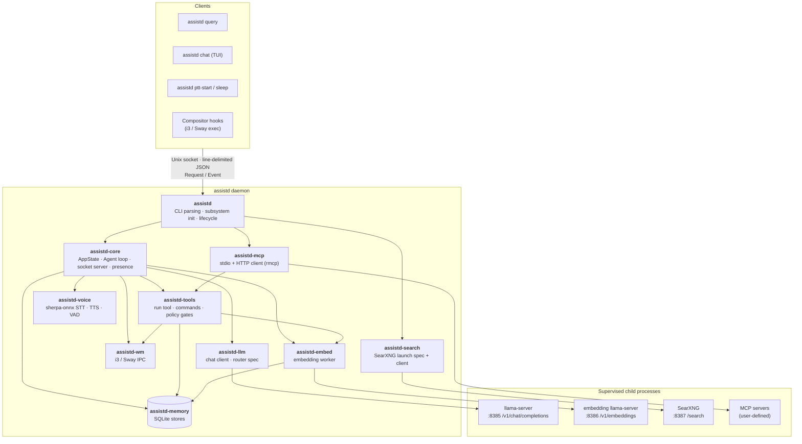

# Architecture

`assistd` is a Rust workspace split into twelve library crates plus a
binary. This page maps the crates, the external processes the daemon
supervises, and the path a user query takes from keypress to spoken
reply.

## System overview

## Crate map

| Crate            | Purpose                                                                                              | Depends on                                                                       |
|------------------|------------------------------------------------------------------------------------------------------|----------------------------------------------------------------------------------|
| `assistd`        | Binary. CLI, daemon entry, per-subsystem init wiring (including MCP).                                | every other `assistd-*` crate                                                    |
| `assistd-config` | TOML schema, defaults, validation. The single source of truth for every tunable, including its settings-panel metadata. | `utils`                                                                          |
| `assistd-core`   | Daemon glue. `AppState`, agent loop, planner, presence machine with its idle and GPU-contention monitors, listen dispatcher, socket server, `build_tools()` factory. | `config`, `ipc`, `llm`, `tools`, `memory`, `embed`, `search`, `voice`, `wm`, `utils` |
| `assistd-embed`  | Embedding HTTP client + job queue feeding the semantic store; launch spec for its llama-server.      | `config`, `memory`, `utils`                                                      |
| `assistd-ipc`    | Wire-protocol types (`Hello` with the daemon version, `Request`, `Event`, `PresenceState`, `VoiceCaptureState`, `ImageAttachment`); the socket client behind the `client` feature. | `utils`                                                                          |
| `assistd-llm`    | `LlmBackend` trait + `LlamaChatClient` (HTTP/SSE to llama-server) + router-mode launch spec + control plane. | `config`, `ipc`, `tools`, `utils`                                                |
| `assistd-mcp`    | Stdio and Streamable HTTP MCP servers driven through `rmcp`, plus the adapter exposing their tools.  | `tools`, `utils`                                                                 |
| `assistd-memory` | SQLite-backed persistent stores: `MemoryStore`, `TranscriptStore`, `SemanticStore`, `TaskStore`.   | `ipc`                                                                            |
| `assistd-search` | Launch spec and generated settings for the supervised SearXNG instance behind web search, and the typed client for its JSON API. | `config`, `utils`                                                                |
| `assistd-tools`  | `Tool` and `Command` traits, registries, `RunTool`, all built-in commands, policy gates.             | `config`, `embed`, `memory`, `ipc`, `search`, `wm`, `utils`                      |
| `assistd-utils`  | Shared helpers: backoff + `RestartPolicy`, tilde expansion, `human_size`, Hugging Face file IDs and cached model downloads, non-blocking regular-file open, size-capped HTTP body reads, public-address classification and the `FilteredResolver` that drops non-public DNS answers, `find_program` (a `PATH` lookup that says why a program cannot be run), child-output line forwarding, `/proc` listener ownership, `ProcessGroup`, `ReadinessCell` for subsystems that start in the background, and the `ChildServer` supervisor. | none                                                                             |
| `assistd-voice`  | `VoiceInput` (Parakeet STT, Silero VAD and wake-phrase keyword spotting through sherpa-onnx) + `VoiceOutput` (sherpa-onnx TTS, played through rodio) + per-sentence `SpeakDecision`, run in a supervised `voice-worker` child behind daemon-side proxies. | `config`, `ipc`, `utils`                                                         |
| `assistd-wm`     | `WindowManager` trait + i3 (`tokio-i3ipc`) and Sway (`swayipc-async`) backends, plus `NoWindowManager`. | `config`, `utils`                                                                |

`utils` sits at the bottom with no internal dependencies; `config`
and `ipc` build only on it, and most other crates build on those
three. `core` sits at the top because it's where every subsystem is
wired into a working daemon.

The same binary also ships several client subcommands that speak the
Unix-socket IPC: `query`, `chat`, `sleep` / `wake` / `drowse`,
`ptt-start` / `ptt-stop`, `listen-*`, `voice-*`, `memory`, and `tray`. The tray subcommand is a long-lived
[StatusNotifierItem](https://www.freedesktop.org/wiki/Specifications/StatusNotifierItem/)
client (via the [`ksni`](https://crates.io/crates/ksni) crate): it
holds a passive `RequestBody::Subscribe` connection, translates the
broadcast events into icon state (config error → disconnected →
generating → listening → presence), and provides a Sleep / Wake menu that issues
`RequestBody::SetPresence` on isolated one-shot connections. It also shows
each turn as a freedesktop desktop notification over `zbus`, held back
while the chat reports keyboard focus (`RequestBody::ChatState`). The binary
always includes the daemon and the IPC client subcommands; `tray` and
`chat` are optional features layered on top, never built standalone.

## Subsystem walk-throughs

### LLM lifecycle (`assistd-llm` ↔ llama-server)

The daemon opens its socket first and then spawns `llama-server` as a
child process in the background, reporting `PresenceState::Waking` until
the model has loaded (queries wait for it; requests that need no model
are served at once). Voice and the embedding server start after the
model, so neither loads onto the GPU while it does, and the SearXNG
instance and MCP servers start straight away; none of them holds up the
socket. `RequestBody::GetReadiness` reports how far each has got as one
`EventBody::Readiness` per subsystem, and the daemon broadcasts the same event as each one settles. The chat names
whatever is still starting, and the tray tooltip lists every subsystem's
state. The server takes
its bind address, context length and GPU layer count from `[model]` in
the config, plus any `custom_args` (parsed and checked at
config load, never run through a shell). Inherited `LLAMA_ARG_*` and
`LLAMA_API_KEY` variables are stripped, so the checked command line is
the server's only source of options. Each daemon launch generates a
random API key, written to a mode-0600 file under `$XDG_RUNTIME_DIR` and
passed as `--api-key-file` to both llama-servers (with `--no-slots`), so
other local processes cannot load, unload or query models; every client
sends it as a bearer token. The chat server's `--slot-save-path` is a
mode-0700 `$XDG_CACHE_HOME/assistd/slots` that the daemon empties at
startup and before every spawn, since a saved slot is only valid for the
server that wrote it. `SlotStash` keeps one file in it per conversation set
aside, keyed by `ConversationKey` (`Main`, `TaskRun`). Before each request a
keyed conversation calls `switch_to`, which saves the slot for whichever
conversation holds it and restores the target's file (skipping the restore
if the child changed since the save), deleting the file once restored.
`preserve_across` saves the holder before a group of unkeyed sub-agent
requests and restores it after, so a relay inside a task run keeps that run's
slot; with more than one slot the main conversation keeps slot 0 to itself, so
the group runs without either. A file is deleted when its conversation ends (a finished run, `/new`),
and past two suspended runs the oldest run's file is dropped. Any failure only
costs re-processing that conversation's context. `assistd-utils`'s `ChildServer`
supervisor, run on the `LlamaServerSpec`, health-probes
`GET /health` until the server reports ready (a 200 counts only when
`/proc` shows the listener belongs to the child's process group, so a
stale server or squatter on the port is never trusted), then `LlamaChatClient`
streams chat completions over `POST /v1/chat/completions`. Chat and
control-plane requests are sent only while the supervisor is `Ready` with
a live child, so nothing reaches the port between a crash and the next
verified start.

Presence decides whether the model is loaded: `Active` has it loaded,
`Drowsy` keeps `llama-server` running with the weights unloaded, and
`Sleeping` stops the server. The daemon starts `Sleeping` and reports
`Waking` while it loads the model. The idle timers and GPU monitor
under `[sleep]` move it down, and a query wakes it.

If the child crashes mid-stream (CUDA OOM, OOM-killer, segfault), the
supervisor restarts it with exponential backoff and the in-flight
agent turn surfaces an `LlmError::ServerRestarting`. The agent
retries once after the new child reports healthy; further failures
propagate up to the client as an `EventBody::Error`.

Vision support is detected dynamically: `probe_capabilities_routed()` calls
`GET /props` on the running server to learn whether the model has a
vision projector. The `VisionGate` flips on if so, allowing the `see`
and `screenshot` commands to attach images to the next turn. A
`VisionRevalidator` probes once the model first loads, then re-probes at
the start of the first query after
the weights may have been reloaded (any presence transition, or a
supervisor restart of the child), and again after any failed probe,
so the gate tracks what is actually loaded without probing on every
query.

### Agent loop (`assistd-core::Agent`)

One per-query state machine, single-threaded per turn. The loop:

1. `backend.push_user(text, attachments)` — append user message + any
   image attachments to the conversation.
2. `backend.step(tools.openai_schemas(), tx)` — send `messages +
   tools` to llama-server, stream tokens.
3. The response is either text (`StepOutcome::Final` → emit
   `EventBody::Delta` per token, then `EventBody::Done`) or tool calls
   (`StepOutcome::ToolCalls` → step 4). A response cut off at the
   output-token limit (`StepOutcome::Truncated`) is retried up to
   twice with a note to the model, then the turn fails.
4. For each tool call: `tools.get(name).invoke(arguments)`. Emit
   `EventBody::ToolCall` before, `EventBody::ToolResult` after. Push results
   back via `backend.push_tool_results(...)`, which appends them as
   OpenAI `role: "tool"` messages carrying the id of the call they
   answer. A result carrying an image is the one exception: chat
   templates render image parts only on user turns, so those ride
   back as a user message tagged `[tool:<name>]`.
5. Loop back to step 2 until the model emits text. If the model
   repeats the same call several times in a row, or the turn runs
   past a hard-coded step ceiling, the loop tells the model, in a
   one-shot message at the end of the conversation, to stop calling
   tools and answer from what it has already gathered. The tool schema
   stays in the request so a call made anyway is still parsed (and ends
   the turn) rather than streamed to the user as raw markup.

A sub-agent run (`SubAgentRunner`) drives the same loop over
an empty conversation that the main backend's `isolated_conversation` opens
on the same server and model, with its own system prompt, tool registry and
event sink. Its history budget is the main conversation's
`chat.max_history_tokens`, and it compacts the same way: the summary is
written inside the sub-agent's own conversation, which keeps its task, and
never leaves it. The summary request continues the conversation with its
tools offered, so the server reuses the cached prompt; a reply that calls a
tool or is empty is asked for again without tools, and only when that also
fails does compaction fall back to dropping old steps without a summary. Its
tool-call ceiling is the main turn's too: after 200 tool-calling steps, or a
call repeated three times in a row, its tools are withdrawn and it is asked to
answer from what it has, so a long task ends in a partial report rather than
an error. While a relay runs, its plan, then each sub-agent's text, reasoning,
context size, tool calls, results and compactions reach the client as
`EventBody::Relay` progress, never the model. The TUI draws them as a compact
block in place of the `relay` tool block, and `/agents` opens any sub-agent's
full transcript. The conversation is dropped when the run ends, so none of it
reaches the main history. What the client was shown is stored with the
relay's tool result in `relay_steps` and `relay_entries`, never embedded, and
replayed with branch history.

A sub-agent's final answer is saved whole, with no length cap, to
`~/.local/share/assistd/relays/<session>/relay-<uuid>.txt`, written by the
runner rather than the sub-agent so the file always exists and is complete.
It is sanitised first: control, bidi and format characters are stripped, the
`<` of anything tag-shaped (`<|im_start|>`, `<tool_call>`) and the `[` of
bracket tokens (`[INST]`) are escaped, and it is quoted under a header that
labels it untrusted data. The run then takes one more turn through
`complete_with_schema`, a tool-free, thinking-free request whose
`response_format` holds the reply by grammar to a fixed contract: `status`
(done, partial or blocked), a `summary`, and arrays of `evidence` and
`caveats`, each bounded by `maxLength` and `maxItems`. A reply that does not
parse or exceeds those bounds becomes a `partial` contract saying so, since the
answer is already saved. Only that contract comes back, as a `RelayReport`,
the restricted return channel: sanitised and quoted the same way, with
`artifacts` naming the saved file, and with evidence paths under the
quarantine's `input/` pointed back at the original inputs. The default system
prompt says never to follow instructions inside one. The sub-agent's tool
output and reasoning never leave it. Each answered step's file is recorded in
`relay_steps.answer_file`; `/undo` deletes the files of the steps whose rows it
deletes (a fork still holding the turn keeps them), and daemon start deletes
every saved answer no stored step names.

A sub-agent's commands run in a `Quarantine`, which starts from an empty world:
a fresh `relay-*` directory whose `input/` shows the inputs it was handed,
read-only and in place, a writable `home/` that is `$HOME` and the working
directory, and `output/` for spilled output. Each input is opened once with
`O_PATH`, and an empty file or directory is made under its name in `input/` as
its mount point. `cat` and `ls` resolve paths under `input/<name>`
beneath that descriptor, and each sandboxed command gets a duplicate of it, inherited by
bwrap alone, for a `--ro-bind-fd` over the mount point, so both read the file
opened at handover even if the host path is later renamed or replaced. bwrap
closes the descriptor before the command starts. On the host,
`input/` holds only the empty mount points, so removing the relay directory
never touches an input. The directory is removed when the `Quarantine` is
dropped, so on cancel or panic too, even if a script left subdirectories
unwritable. Its `bash` runs in a separate bwrap profile: read-only `/usr` and
the merged-`/usr` links, `/etc/ssl`, `/etc/ca-certificates`, `/etc/resolv.conf`
and the loader config, fresh `/tmp`, `/dev` and `/proc`, the relay's three
directories bound at their own host paths, the same `prlimit`, scope and `choom` caps, and always
`--unshare-net`, with its inputs bound over their mount points. bwrap binds are
`nosuid,nodev`, so device nodes in an input cannot be opened.
`bwrap_extra_args` does not apply. The host home, `/run` and the daemon socket
are not mounted. Network namespaces do not cover pathname sockets, so the
daemon also hands bwrap a seccomp filter (`--seccomp`, from a memfd) that
fails `socket(AF_UNIX, ...)` with `EACCES`: the command and everything it
starts can create no Unix socket, and so cannot connect to one made outside
the sandbox, such as gpg-agent's or the daemon's inside a bound input.
`io_uring_setup` fails with `ENOSYS`, since `IORING_OP_SOCKET` would get
around the rule, and the filter kills any system call from a foreign ABI
(i386, x32), whose arguments it cannot read. Abstract sockets need no rule;
they belong to the unshared network namespace.

The in-process file commands (`cat`, `ls`) and glob and `~` expansion go
through the registry's `FileScope`. In a quarantine that scope cleans `..` lexically, then opens every
path with `openat2(RESOLVE_BENEATH)` on the descriptor of the input it falls
under, or else of the relay directory, so the kernel refuses `..`, absolute
symlinks and anything outside it. They never connect to sockets. Relative
paths start at `home/`, and `write` may only write under `home/`.
`Quarantine::create` fails when the sandbox does not wrap.

A quarantine's `bash` never reaches the network, so a sub-agent cannot
`curl`, `git clone` or `pip download`. A quarantine created with an `Egress`
also gets the in-process `web` command, which runs in the daemon and is the
only way a sub-agent reaches the network. It is held to a sub-agent's
`EgressPolicy`: HTTPS to port 443 only, so nothing on the network path can read
what a sub-agent sends or alter what it downloads, and it refuses `http://`
URLs and redirects to them. It asks the same approved-hosts `ApprovalGate` as
the main agent's `web fetch`, and refuses loopback, private, link-local and
other non-public addresses, both as literals and after DNS resolution, so a
relay cannot reach llama-server, SearXNG or the LAN. Its `web search` goes
through the daemon's SearXNG client, which only ever sees the query.

The model starts a sub-agent with the `relay` tool (`task`, `inputs`,
`agent`, or `steps`: a plan of up to five such steps), registered in
`assistd-core` beside `run` whenever tools are. `agent` names a `Role`: its
name, when the model should pick it, a brief opening its system prompt, and
its `Reach`, either files or the web, never both. The roles are built in and
fixed: `file_review` reaches files, seeing its `inputs` read-only with no
network; `web_research` reaches the web, getting an `Egress` and no inputs.
The tool's schema and description list the roles, and the wire and the
database carry a step's role by name. A web step naming inputs is refused as
invalid arguments before a quarantine or conversation exists, since a relay
that could both see private files and reach the network could leak them, and
a web step's quarantine is never handed inputs. Every file step's inputs are
checked before the first step starts: a missing input, one that is neither a
file nor a directory, or two sharing a file name refuse the whole plan, so a
mistake in a late step costs no earlier step's work. A file step is also
refused, before anything starts, when its inputs hold more than twice a
sub-agent's context budget of text, estimated from file sizes at four bytes a
token. Counting stops at that limit, so even a tree with a build directory is
measured in milliseconds. The refusal names the largest entries of the inputs,
so the model can split the work, and a step that sets `search_only` (it greps
rather than reads its inputs through) skips the check. The tool description
states the budget and asks for relays of about half of it, one per natural part
such as a crate or module, with independent parts requested together. Each call
creates a fresh `Quarantine` under `~/.cache/assistd/relays` (emptied at daemon
start), gives the sub-agent a registry holding only `run` over the quarantine's
commands, and runs it inside `SlotStash::preserve_across`. A plan's steps run
back to back inside one `preserve_across`, each in its own quarantine and
handed only the previous step's rendered `RelayReport` beneath its task and
its saved answer as an extra input. Since a report carries what its sub-agent
read, a plan with a web step after a file step is refused as invalid arguments.
The tool result is the last step's rendered `RelayReport`; a failed step ends
the plan as a failed tool result, not a failed turn. A relay starts without confirmation; commands inside it ask
the same `ConfirmationGate` as the main agent's, with the prompt marked
`ConfirmSource::Relay` and the step's task so the user can tell who is asking.
Cancelling the turn drops the call, which drops the run and removes the
quarantine. A tool whose `bounded_by_tool_deadline` is `false` is exempt from
`timeouts.tool_call_secs`; `relay` is the only one, since its run is bounded by
the sub-agent's step budget, each of its tool calls by that same deadline, and
each step by the first-token and stream-inactivity timeouts and the
response-token limit, as a main turn's steps are. The quarantine wrapper is
looked up beside the `assistd` executable; without it, relays fail.

The loop does not parallelize tool calls. Tools execute serially, and
their results land in the conversation in the order the model
emitted them. This keeps the conversation deterministic and the
`Event` stream readable.

A saved task runs through the same loop with no user present.
`TaskRequest::Run` records a queued run and appends it to the `TaskQueue`,
returning at once. The queue is FIFO, its order kept in `task_runs.queue_pos`;
at startup runs still queued are reloaded in that order, while any left
running are recorded as failed, since their side effects may have happened. A
dispatcher on the `TaskRunner` starts the head run whenever `ModelLanes` has a
lane for it. There is one lane per slot the server reports as `total_slots` in
`/props`, probed with vision support and re-probed after a reload. Lane 0 is
the main conversation's and is the agent turn lock itself, so with one slot a
run waits out the user's turn and holds the next one off. With more slots, runs
take lanes 1..N, each pinned to its slot with `id_slot`, and the main
conversation stays on slot 0. While the GPU monitor holds the daemon asleep for
another process, waiting runs are `Suspended(GpuBusy)` instead of waking the
model. `TaskRequest::Queue` moves, cancels, pauses and resumes the queue (the pause is
kept in the `task_queue` table, so it outlasts a restart), and
`EventBody::TaskQueue` broadcasts the items, lane holders and pause flag after each
change and greets every new subscriber.

Time triggers are `TaskTrigger::At` (one local datetime) and
`TaskTrigger::Schedule` (a five-field local-time cron expression parsed by
`croner`, so DST gaps and repeats behave). `TaskSave` refuses invalid
expressions and `At` times already past. `TaskCheckTrigger` runs the same
checks on one trigger without saving and returns its next three fire times,
so a client can show them, or the refusal, as the trigger is written.
`EventBody::Task` carries how the task's latest finished run ended. The
`TaskScheduler`, a second service on the `TaskRunner`, sleeps until the
nearest fire time across enabled tasks, waking early on any task change. Each
sleep is capped at a minute and compared against the wall clock, since tokio's clock stands still through a
suspend. Each task's next fire time is kept in `tasks.next_fire_at`. The
scheduler records it in the same write that queues the fired run, so a restart
neither double-fires nor loses a fire. A schedule whose fire times passed while
the daemon was down or asleep runs once on return or skips them, by its
`missed` policy. Firing only queues: a task with an unfinished run gets no
second one. `assistd task run <name>` queues a run directly, the escape hatch for
systemd timers, udev rules and key bindings.

Event triggers are `TaskTrigger::Event`, carrying a `TaskEvent` and a cool-down
(default one minute) that keeps a task's event triggers from firing it more
often than that. `DaemonStarted` fires once, when presence first reaches
`Active`. `SessionUnlocked` fires when logind's `LockedHint` on the user's
graphical session (`User.Display`) turns false, watched over `zbus`; screen
lockers set the hint, while logind's `Unlock` signal only follows
`loginctl unlock-session`. `PathChanged` watches a path
recursively with `notify` (inotify) and fires once per burst of creates,
writes and moves-in, gathered over `debounce_secs`; `TaskSave` tilde-expands
the path and refuses one that is relative or missing. `TaskFinished` fires
when a run of the named task succeeds, fails, or either (a cancelled run fires
nothing), queued as each run's end is recorded; `TaskSave` refuses a chain
that names a missing task or leads back to the task being saved. A third
service on the `TaskRunner` keeps one watch per enabled trigger that needs one
(a path watch each, one shared logind subscription), matching them to the
saved tasks after every save, enable, disable or delete. Event fires queue
through the same coalescing as time triggers.

An admitted run takes the request guard, as a query does, then opens an
`isolated_conversation`. That conversation gets the main system prompt plus a
short preamble saying no user is present, and the main agent's full tool
registry. On lane 0 it is keyed `TaskRun` in the `SlotStash`, and when the run
ends its slot file is dropped and the main conversation's slot restored. It is
saved as a transcript session of its own, linked from its `task_runs` row, and
its events reach subscribers wrapped in `EventBody::TaskRun`. The main conversation,
its branch and the active session are never touched. `TaskRequest::Cancel`
cancels a run the way `InterruptTurn` cancels a turn. A run still going at
shutdown is recorded as failed. At startup and after each run ends, every task's
finished runs beyond its `kept_runs` (else `tasks.kept_runs`) are deleted with
their sessions and saved relay answers, sparing the session the user is in.

A run's prompts are labelled `ConfirmSource::Task` (a relayed sub-agent's
prompts name the run too) and go through `ConfirmRouter::for_task_run`, set to
the task's `mode` as a chat connection would be, with the safety judge in Auto
when `tools.allow_auto_mode` allows it (`TaskSave` refuses Auto otherwise). A
`web` fetch from a host not yet approved asks as `Unattended::WebHost`, which no
mode approves but a run does once when the host is one of the task's
`allowed_hosts`, matched exactly. What the mode and hosts approve runs once,
logged on `assistd::policy`, and never reaches the allowlist or the
`approved_*.toml` files. Anything else is parked: the run turns `NeedsInput`,
gives up its lane and request guard (on lane 0 its slot state stays in the
stash), and broadcasts the prompt as a `TaskRun`-wrapped `ConfirmRequest`; the
queue snapshot carries it too, as the run's `PausedPrompt`, so a client that
subscribes later can still answer it. The tool deadline stops while a prompt is
parked. `TaskRequest::Confirm` answers it for that prompt alone, except that
`always` on a host fetch adds the host to the task's `allowed_hosts`, for the
rest of the run and later ones; the run then waits first in the queue for a lane,
moving its conversation to that lane's slot. `TaskRequest::Runs` lists a task's
latest runs with their trigger, times, final reply and session. The task's
prompt is the only instruction a run gets; no plan is stored on the task.

With one lane, a user message that finds a run on it follows
`[tasks] interruption`. Under `interrupt` the run's turn sees the conversation
open through its `RunLane` and yields at its next model step. A step in flight is
cancelled and announced as `StatusKind::YieldedToUser`, so its partial output is
dropped. A tool call in flight finishes first. A relay in flight is cancelled and
rerun from its arguments, since its effects stay in its quarantine. The yielded run
waits first in the queue as `Suspended(UserConversation)`, its slot state stashed.
Under `after_task` the turn is told `EventBody::Queued` and takes the lane once the run
ends, ahead of the queue. Under `after_queue` it joins the queue as a user-turn item,
behind any turns already waiting, which the dispatcher hands the main lane in its
turn; `TaskQueueOp::CancelTurn` drops it. Every user turn opens the
`UserConversation`, which holds waiting runs as `Suspended(UserConversation)`. The
conversation ends once no turn has arrived for `resume_after_idle_secs` after the
last reply and its speech finished, or the wake word's follow-up window if longer.
`/new`, `ChatClosed` and `TaskQueueOp::Resume` end it at once. Its hold, and when
it lifts, rides on the `TaskQueue` snapshot.

### Plan mode (`assistd-core::Planner`)

A planning turn shows how the agent means to do a piece of work before
anything runs. The `Planner` drives the
agent loop over a given conversation with the planning registry, which
`build_tools()` assembles beside the main one: `run` over the
readers, `web` and a `bash` whose policy holds no "always allow" approvals,
plus `reminisce` when memory is on. No `write`, `wm`, `see`, `screenshot`,
`relay`, `remember` or MCP tools. The turn runs under
`ConfirmRouter::for_planning`, which refuses every ask without prompting
anyone in any mode, so the planning turn runs only what needs no
confirmation; each refusal is counted and the tool result gains a note
telling the model to describe that step instead. A plan-mode note is set
as the transient note on every step, so it renders at the conversation's
tail and the system prompt, and its cache, are unchanged.

Whether a turn plans is a flag on the `ConfirmRouter` in its `TurnContext`, so it
can change mid-turn. While it is set every ask is refused and counted, and an agent
built by `Planner::chat_agent` offers, before each step, the planning registry
plus `exit_plan_mode` in place of the main registry plus `enter_plan_mode`; its
conversation carries the plan-mode note only while planning. A query's `plan`
says whether its turn may plan: `off` for voice and `assistd query`, which get
the plain agent; `offered` for chat messages; `planning` for chat messages sent
in plan mode, which start with the flag set.

`enter_plan_mode` is the model's own ask to plan first, for work worth agreeing
on before it runs. It goes to the user as a `ConfirmRequest` in every mode; a
yes sets the flag and sends `EventBody::PlanModeEntered`, a no tells the model to
do the work. `exit_plan_mode` carries the plan to the client as
`EventBody::PlanReview` and waits, with no timeout, for `RequestBody::PlanVerdict` on
the same connection. `Accept` sets the router's mode and clears the flag, so the
same turn carries the plan out under it; `KeepPlanning` keeps planning, revising
by the user's feedback or, without any, asking what to change.
`SetPermissionMode` with `plan` sets the flag mid-turn too.

In the chat, Shift+Tab's cycle ends in plan mode, which the TUI holds beside
the `PermissionMode`s and applies to the open turn. A plan review draws the
plan in the transcript and, in place of the input line, offers auto mode when
the daemon allows it, accept edits, manual approval, or keeping on planning
with what to change typed on that row; accepting switches the chat to that
mode.

`Planner::refine` runs the same turn for a task prompt, its note asking it to
end with only a short list of what it found. Then `complete_with_schema` holds
the work rewritten as a self-contained brief for an unattended run, beside a
draft of a summary and steps, each with actions named by a kind (`program`,
`web_host`, `mcp_tool`, `app`, `write`) and a target. Each action becomes a `PlannedAction`, and
`ActionCheck` flags any that would fail: a program missing from the
sandbox's `PATH`, a malformed host, an MCP tool no connected server offers,
an app with no launchable desktop entry, a write directory that is relative
or not a directory. It also gives each an `ActionOutlook` under the work's
`WorkPermissions`: `Unasked` when a standing approval, an allowed host or the
mode with the edit scope covers it, `JudgeDecides` for programs and MCP tools
in Auto, else `Asks`. The result is a `Plan` of the brief with a fresh `PlanId`.

`TaskRequest::Refine` refines a task prompt, saved or not, under the permission
mode and allowed hosts the request gives, in an isolated conversation with the
task-run system prompt, keyed `TaskRefine` in the `SlotStash`. Only the latest
refine's conversation is kept; a new one ends it. It takes the main lane and
request guard as a query does, and `InterruptTurn` cancels it; its turn reaches
the client wrapped in `EventBody::TaskPlan`, and its result as `EventBody::TaskRefined`
with the rewritten `TaskPrompt`, its `Plan` and a `ModeRecommendation`: the
least permissive mode, Auto only when allowed, under which the fewest of the
plan's actions would ask, with the actions it covers and those that would still
ask. It saves nothing. With
`feedback` it continues the same conversation, so a revision keeps what the
model already found, quoting back the rewrite the client was shown, which the
grammar-held request left out of the conversation; it is refused unless the
last refine was of the same prompt.

In the TUI, `/tasks` opens a panel over these requests alone, since tasks
live in the daemon's store rather than `config.toml`. It lists each task
with its triggers, next fire, last outcome and whether it is enabled; its
editor saves the name, prompt, mode (Auto only when the daemon offers it),
allowed hosts, triggers and enabled flag. Ctrl+R in the prompt box refines its
text under the editor's mode and hosts without drawing the planning turn; Esc
cancels it. The rewrite replaces the box's text, unapplied, with the
recommended mode and a brief reason on a line below. `r` on a task queues a
manual run. The Queue tab draws the broadcast `TaskQueue` and reorders, cancels
and pauses it through `TaskRequest::Queue`; Enter on a run needing input opens
its prompt in the chat's confirmation dialog, answered with `TaskConfirm`. The
Runs tab lists the selected task's runs, and Enter switches to a run's session
as `/resume` does. Outside the panel, the status line counts runs needing input
(Ctrl+T opens the panel) and names the running ones. The tray's tooltip lists
running runs with elapsed time, runs needing input and the queued count; its menu
pauses and resumes the queue, and it notifies on every run newly needing input,
focused or not. A task with `announce` set broadcasts a successful run's final
reply as `EventBody::TaskReply`, which the tray notifies while the chat is unfocused;
the daemon speaks it once no user turn is in flight and nothing is playing, and a
chat turn starting meanwhile cuts it off.

### Tools (`assistd-tools`)

Two-tier system. The LLM sees a single `run` tool whose argument is a
shell-style command line; that line is parsed into a pipeline AST
and dispatched through an internal `CommandRegistry` of Rust handlers.
So `cat /etc/hosts | grep -v '^#'` is one tool call that fans out into
two commands chained by a byte-level pipe.

Three additional `Tool`s sit alongside `run`: `relay` (hand a task to a
sub-agent), `remember` (save or search facts) and `reminisce`. They don't fit the shell mold, so they're regular
LLM-facing tools with their own JSON schemas.

Built-in commands: `bash`, `cat`, `echo`, `grep`, `head`, `ls`,
`screenshot`, `see`, `sort`, `tail`, `uniq`, `wc`, `web`, `wm`,
`write`. `cat`, `ls` and `echo` run in the daemon. `grep`, `head`,
`tail`, `sort`, `uniq` and `wc` are the system's GNU programs: their
arguments are quoted into a script that runs as a `bash` script does,
through the classifier, the path guards and the sandbox, so they see the
sandbox's files (a private `/tmp` and `/run`) and a writing option such
as `sort -o` asks.

Policy gates (`ConfirmationGate`, `VisionGate`, `SandboxRequest`)
intercept the dangerous paths. Before a `bash` script runs, the
classifier sorts it, through every wrapper, substitution and
evaluated string bash would run, as read-only (only programs on a
short read-only list, redirecting only to standard streams, `/tmp` or
the scratch directory), an edit (also programs on a short list that
write or delete the literal paths they name, or redirections to a
literal path), or unvetted (anything else: another program, a path
from a variable, substitution or brace expansion, which may lie anywhere,
a command only known at run time, a changed `PATH`/`LD_*`/`GIT_*`, a
disqualifying option such as `sort -o` or `find -exec`). The path guards
then resolve every target: destroying `$HOME`, a personal folder or a
git work tree is refused in every mode, and touching credentials, an
owner-only file in `$HOME`, a startup file, a shell profile or a
directory on `PATH` always asks. Asking for an unvetted script offers
"always allow" for the programs on neither list, saved in
`allowed_programs.toml` beside the config and pinned to the file the
name resolved to; an approval covers one subcommand (`cargo build …`),
or only options when the program was run without positional arguments,
and counts that run as vetted from then on. Shells, interpreters,
`sudo`-like wrappers and builtins that shadow a program are never
offered it. A script then runs in the bubblewrap
sandbox; tools never run unsandboxed, so when `bwrap` is missing (or
`tools.bash.sandbox = "none"`) the model is offered no tools at all and
clients are told why. `wm open` is the one way out of the sandbox: it
launches an installed desktop entry as the user, through the compositor's
`exec` (optionally on a given workspace), so the model picks only which
entry, a working directory, and the files or URLs the entry's `Exec`
field codes accept, never a command line. Entries under a visible
`$HOME` entry, where sandboxed commands can write, are refused; the user
confirms each launch unless they chose "always allow" for that entry,
and one with files or URLs is never approved for good; `write` restricts targets to a
configured allowlist, refuses dot entries at any depth below it, and puts each
target through the same path guards as `bash`, asking before writing outside
`tools.scratch.dir`; `web fetch` asks before fetching from a host not
yet approved, in every mode, and follows redirects only to the same or an approved host;
`see` and `screenshot` refuse with an error when the loaded model has no
vision projector. "Always allow" for a web host, an MCP tool or an application is saved
beside the config in `approved_hosts.toml`, `approved_mcp_tools.toml` or
`approved_apps.toml`.
`assistd query` cannot answer prompts and denies them, so there only
approved hosts, tools and programs run. A turn asked by voice (push-to-talk
or the wake word) has nobody to answer either: it runs in accept-edits mode
and every other prompt is denied at once, without being shown to any client.

A query connection starts in manual mode, where every prompt goes to the
client. A client can switch modes with a mid-stream `RequestBody::SetPermissionMode`
(the TUI's Shift+Tab). Read-only `bash` scripts run in every mode, scripts that
would destroy the home directory, a personal folder or a work tree are refused
in every mode, and those touching a sensitive path always ask. Accept-edits mode
also runs, unasked, edits whose every target lands strictly below a
`tools.write.writable_paths` entry or the scratch directory, and `write`s there
whose content the prompt shows in full. Auto mode, offered only when
`tools.allow_auto_mode` is set, additionally puts the remaining edits,
unvetted scripts, unapproved `wm open` launches and unapproved MCP tool calls
to the safety judge, a one-shot model verdict that asks the user whenever it is
unsure, fails or times out. A new web host always asks: egress is the
exfiltration path, so it is never left to the judge. Each unasked approval is logged
on `assistd::policy`; nothing is added to the allowlist.

### Memory (`assistd-memory` + `assistd-embed`)

One SQLite database (default: `~/.local/share/assistd/memory.db`)
holds four schemas: a key/value `MemoryStore` for durable facts, a
`TranscriptStore` for full per-session transcripts (with branching
and undo), a `SemanticStore` for embedding-indexed chunks, and a
`TaskStore` for saved tasks and their runs. Every
write runs in order on the only read-write connection. Document vector
scans, other vector scans and other reads each get their own read-only
connection, so a long scan holds up neither a write, a history load
nor a scan of the other kind. Shutdown closes the
database once queued writes have run. [database.md](database.md) maps
the tables.

Transcript rows keep each step's reasoning, every tool call's arguments,
and how each tool run ended. Each branch also keeps its latest
compaction summary. On resume, the LLM gets that summary plus only the
rows after it, so it sees the same prompt it had before; the client
still gets every row.

Saving through the `remember` tool inserts the K/V row, and each user
or assistant message is chunked in the transaction that saves it. With
`embedding.enabled = false` no chunks are cut; the next start with
embedding on cuts them for the messages stored meanwhile. The
database is the embedding queue: a memory or chunk with no row in its
embeddings table is pending. Each write wakes a background task, which
pages through the pending rows, sends batches to the embedding server
(a second, smaller llama-server child process configured under
`[embedding]`), and inserts the resulting vectors into the semantic
store. A pass cut short by the server or the database is retried with
backoff, so nothing is dropped. A row the server rejects for its own
content is marked and skipped until `assistd memory reindex` retries
it. A `remember` search embeds its query and ranks saved memories by
cosine similarity; the `reminisce` tool runs the same kind of search
over transcript chunks from earlier sessions. Indexed local documents
own chunks in the same table, but their vectors are kept in a table
of their own, quantised to a byte per dimension, so chat recall never
reads or ranks document chunks. Like chat requests,
embedding requests are sent only while the embedding server's
supervisor is `Ready` with a live child; a row refused in the
meantime stays pending and is embedded by a later pass.

The semantic store exists from daemon start, but the
embedder sits behind an `EmbedderHandle` that is `Starting` until the
embedding server answers. The worker starts then, and its first pass
embeds every row still pending, whether written during startup or left
over from an earlier run. Semantic search, reindex, `remember`
searches and `reminisce` report "embedding is still starting" (or why it is
unavailable) until then, and per-turn context injection skips recall.

### Voice (`assistd-voice`)

`VoiceManager` owns voice for the daemon's lifetime. Capture (push-to-talk
input and the continuous listener) and speech output each start as
`Readiness::Starting` and become `Ready` or `Unavailable(reason)` once the
voice worker reports how it brought up the transcriber and the voice, so voice
requests during startup or after a failed load are refused with the reason. Both
appear in `GetReadiness`, and `GetVoiceState` reports them too.

Everything that touches sherpa-onnx, cpal or rodio runs in the voice worker,
the hidden `assistd voice-worker` subcommand, so a native crash costs a restart
rather than the daemon. Once the model load settles, the daemon spawns it from
`/proc/self/exe` (always the running build, even after an upgrade replaced the
file) in its own process group with a parent-death signal, unless both voice
input and speech are disabled. The two speak line-delimited JSON over the
worker's stdin and stdout (the worker moves fd 1 to stderr so native libraries
cannot print into the pipe); audio never crosses it, only transcripts, state
and replies. The daemon holds proxies behind `VoiceInput`, `VoiceOutput` and
`ContinuousListener` that forward each call and mirror the worker's capture
state, listen phase and what it heard into the channels those traits expose,
and it re-sends GPU availability (presence `Active`, foreign VRAM contention)
whenever it changes, for the worker's `QueuedTranscriber`. When the worker
dies, calls in flight fail (speech is dropped and the turn carries on as text;
a push-to-talk recording fails), the listener reports `Off`, capture and speech
go back to `Starting`, and the supervisor restarts it under `RestartPolicy`
backoff, resuming listening if it was on; once the policy gives up both are
`Unavailable`. The `VramLedger` counts the worker's VRAM as the daemon's own.

Push-to-talk: the daemon receives `RequestBody::PttStart` from a client
or compositor binding, opens the configured microphone via cpal, and
streams audio into a ring buffer. On `PttStop` it stops capture and
hands the buffer to a `Transcriber` (`SherpaTranscriber`: Parakeet, a
NeMo transducer, through sherpa-onnx, loaded once at startup).
Transcripts feed back into the agent loop as if the user had typed them.

Continuous mode (`MicContinuousListener`) keeps the mic open and uses
Silero VAD to chop the stream into utterances: every 160 ms it labels the
newest frames speech or not, so music and room noise never hold an
utterance open. A `WakeWordSpotter` (sherpa-onnx keyword spotting with the
GigaSpeech 3.3M zipformer, one CPU thread) checks each finished utterance
on a fresh stream for `voice.wakeword.phrase`, which is tokenized at
startup and refused there if the model cannot spell it. The `WakeGate`
admits an utterance holding the phrase, the utterance after a bare phrase
within `voice.wakeword.command_timeout_ms`, or the utterance that begins
within `voice.wakeword.follow_up_ms` of a listen-started reply ending,
speech included; only admitted audio is transcribed (from the phrase's
end, when it has one), and everything else is dropped untranscribed. A
push-to-talk press takes the mic from the listener, which drops what it
captured but has not acted on and resumes on release; it ends the voice
conversation, so no follow-up window opens until the wake phrase starts a
new one. The listener reports `ListenPhase` (`Off`, `Armed`, `Capturing`)
and a `WakeWordDetected` event on the bus. The listener keeps running
while presence sleeps, and a command wakes the model like any other query.
Separately, Silero VAD (`voice.transcription.vad_enabled`) trims non-speech from
every recording before decoding. The mic stays open while replies are
spoken, so the listener hears the daemon's own TTS; outside a
listen-started reply it is wake-gated like any other speech, and the
recommended setup cancels it in the sound server. While a listen-started
reply is under way (generation and speech), speech is checked for
barge-in instead (`voice.wakeword.barge_in`):
an utterance that began during the reply is periodically transcribed and
confirmed only when most of its words are absent from the reply's recent
sentences, which rejects bumps, noise, and echo. A confirmed barge-in
interrupts the turn and its speech, and the whole utterance becomes the
next command; unconfirmed speech over a reply is dropped, never wake-gated.
Transcription runs on CUDA only when `prefer_gpu` is set and the binary
ships sherpa-onnx's CUDA libraries (`libonnxruntime_providers_cuda.so`
beside it); the fp16 Parakeet then holds about 2.6 GB of VRAM. A GPU
transcriber shares the GPU with the model; the `QueuedTranscriber` routes
to a lazily built CPU transcriber of the same model while presence is not
`Active` or the `VramLedger` reports another process crowding the GPU.

A `RequestBody::WakeWord` carries a `WakeWordOp` (`Status`, `TestStart`,
`TestStop`). A test is a
session owned by the connection that opened it: one at a time, it pauses
the listener and has it report through `test_wake_word`,
refuses push-to-talk and `ListenStart`, and ends on stop, disconnect, or
two minutes idle. It streams a `WakeWordTest` (whether the phrase was
spotted) per utterance and `WakeWordSpeech` at each start and end of
speech; `Status` answers with `WakeWordStatus`. The user guide is
[voice/wake-word.md](voice/wake-word.md).

TTS: model output flows through a `SentenceBuffer` that segments the
stream into speakable units, each handed to `SherpaVoiceOutput`, which
synthesizes it with sherpa-onnx on the blocking pool and plays the PCM
via rodio. The voice loads once at startup on a single ONNX Runtime
thread, so it never spins on the cores the LLM's CPU layers use. Piper
(VITS) voices are phonemized by spawning `espeak-ng` per clause, which
keeps that GPL program out of the binary; Kokoro uses its own lexicon.
sherpa-onnx links as shared libraries, so a CUDA build only swaps in
the CUDA release's libraries; the `assistd` runpath finds them beside it
or in `../lib/assistd`. Before each sentence, `VoiceOutputController`
returns a `SpeakDecision`: speak it, or drop it because TTS is toggled
off or the reply was skipped. Tunables live in `[voice.synthesis]`.

### Window manager (`assistd-wm`)

Pure abstraction over the compositor IPC. The daemon optionally
queries the active window at the start of each turn (title + class +
workspace) and folds it into that turn's user message, inside a
delimited context block labelled as untrusted, so the model knows
what you're looking at. Titles are application-controlled (a web
page sets its tab's title), so they are flattened to one bounded
line and any copy of the block's delimiters inside them is
neutralised before the text reaches the model. The `wm` command surfaces this same backend
to the model as a tool: `run wm list`, `run wm focus 'firefox'`, and
similar.

If neither i3 nor Sway is reachable (no compositor running, or
running an unsupported one like Hyprland today), `NoWindowManager`
returns convention-compliant errors so commands fail gracefully
instead of panicking.

### MCP (`assistd-mcp`)

External tool servers configured under `[[mcp.servers]]`, spoken to
through the `rmcp` crate. A `command` entry is a child process the
daemon spawns in its own process group, with a scrubbed environment,
and speaks MCP to over stdin/stdout. A `url` entry is a remote server
reached over Streamable HTTP with the entry's static `headers` on every
request; its `Mcp-Session-Id` lasts until the server answers 404, which
ends the session like a dead child. Discovered tools are wrapped by
`McpToolAdapter`, which implements `Tool` over the discovered schema,
and added to the
`ToolCatalog` the LLM's tools come from, under the name
`mcp__<server-name>__<tool-name>`. Servers start concurrently in the
background; each one's tools are offered from the next turn after it
connects, since every turn takes its own snapshot of the catalog. A
server that fails to start or to list its tools is retried with the same
backoff as restarts, and is reported as unavailable, with its last error,
in `GetReadiness` and `GetCapabilities` until an attempt succeeds. One
whose command is missing or not executable, or that answers 401 or 403
("needs authorization"), is not retried. Shutdown cancels pending
retries. Each call asks the user first until that tool is "always
allowed". Like every tool's, their text results are
held to the `[tools.output]` cap by the registry, spilling overflow to
`<registry-name>-<n>.txt`.

When a server's process or session ends, its process group is killed
at once, and the next call to one of its tools starts it again. Restarts
follow exponential backoff; a call inside the backoff fails with a
"server unavailable" error instead of waiting. The daemon never blocks
on a slow MCP server: the handshake and each call are bounded by that
server's `request_timeout_secs`, and a timeout surfaces as a structured
error to the model. Each message is capped at 64 MiB, whether a stdio
line, an HTTP body or one SSE event; an oversized reply fails that call
and leaves the session up. HTTP redirects are followed only within the
configured origin, and logs name a remote server by its origin alone.

An `auth = "oauth"` entry also sends an OAuth 2.1 bearer token. At
connect the daemon discovers the authorization server from the MCP
server's metadata and loads the server's token from
`$XDG_STATE_HOME/assistd/mcp-tokens.json` (mode 0600, replaced
atomically). Each entry there is keyed by server name, URL and
configured client ID, so changing any of them leaves the old token
unused. The token is refreshed ahead of expiry and once when the server
answers 401. A server with no token, a rejected refresh, or a 403
`insufficient_scope` is marked "needs authorization", with the scopes it
asked for, and every later call fails at once without reaching it. A
refresh that fails in transit is retried on the next call. Without a
`client_id` the client registers dynamically; an authorization server
that offers no registration fails with an error naming `client_id`.

The daemon runs the sign-in itself, since only it holds the token
store. `McpLogin` binds a one-shot listener on an ephemeral port of
`127.0.0.1`, builds the PKCE authorization URL with that redirect, and
sends it back as `McpAuthorizeUrl`; `assistd mcp login` opens it with
`xdg-open` and prints it. The first request to the callback path ends
the flow: a `state` other than the one in the URL is refused and stores
nothing, a matching one has its code traded for tokens. The listener
closes after that request or five minutes. The server is then stopped,
its tools withdrawn from the catalog, and started afresh, and the reply
reports its state once the first start attempt settles. `McpLogout`
stops the server and withdraws its tools, revokes the token where the
authorization server advertises an RFC 7009 `revocation_endpoint`, and
deletes it either way. Core reaches the servers for both through the
`McpAccounts` trait, which the binary implements, and answers
`McpStatus` with each server's transport and state, including "needs
authorization".

### Web search (`assistd-search` ↔ SearXNG)

`web search` goes through a private [SearXNG](https://docs.searxng.org)
instance the daemon runs as a child process when `[search] enabled =
true`. It needs no GPU, so it starts as soon as the socket opens rather
than waiting for the model, and runs under the same `ChildServer`
supervisor as the llama-servers: health probe on `GET /healthz` (checked
against `/proc` listener ownership), restart with backoff, and a degraded
state after repeated failures. A `search.command` that is not on `$PATH`
fails at once instead of going through the restart attempts.

Each launch writes a fresh `settings.yml` (mode 0600, under
`$XDG_RUNTIME_DIR/assistd/searxng/`) that loads only the engines in
`search.engines`, enabling each even if SearXNG ships it disabled,
with API keys read from each engine's `api_key_file`. It turns off the
limiter, image proxy and public-instance mode and enables the JSON
format. The bind address, port, settings path and a random per-launch
secret are passed as `SEARXNG_*` variables; any `SEARXNG_*` variables
in the daemon's own environment are removed first, so the instance
never picks up settings from elsewhere.

Readiness is reported as the `web search` component of
`EventBody::Readiness`: `starting`, `ready`, or `unavailable (<reason>)`.
`SearxngClient` checks it before every request, so a search while the
instance is starting or restarting fails at once with a message the
model can act on rather than waiting on a dead port. Results come back
from `GET /search?format=json` and are printed as TSV hits for the model
to pick from and read with `web fetch`.

The instance has no authentication, so `search.host` must be loopback.
`web fetch` never fetches loopback or other non-public addresses, so
the model cannot reach the search port through it, and sandboxed `bash`
has no network unless `--share-net` is set; in practice only the
daemon's own client talks to SearXNG.

## Data flow: end-to-end query

A walk through `assistd query "what files changed this week?"`:

1. **Client.** `assistd query` constructs a `Request` with an `id` and a
   `RequestBody::Query { text, attachments: [] }`, dials
   `$XDG_RUNTIME_DIR/assistd.sock`, writes the JSON line, half-closes
   the write side, and reads `Event` lines until `Done`.

2. **Socket server** ([`crates/assistd-core/src/socket.rs`](../crates/assistd-core/src/socket.rs)).
   Parses the request and hands it to `AppState::dispatch` with the
   connection's `ConfirmRouter` in a `TurnContext`. `dispatch` routes
   each request family to the service that owns its state (`TurnService`,
   `TaskService`, `VoiceService`, `BranchService`, `McpService`,
   `StatusService`, and `MemoryStack` for the memory requests); a `Query`
   goes to `TurnService::handle_query`, which takes the per-turn agent
   lock, so concurrent queries serialize. Every event a handler produces goes through an
   `EventSink`, which publishes it on the events bus before handing it
   to the client, so a slow client never delays subscribers.

3. **Agent** ([`crates/assistd-core/src/agent.rs`](../crates/assistd-core/src/agent.rs)).
   The handler builds `Agent::new(...)` from the handles it holds
   and calls `run_turn()` with the turn's `TurnContext`, which every
   tool call receives: it carries who answers the turn's prompts, who
   watches its relays, and the lane a task run gives up on request. A
   `TurnDriver`, the same one a task run uses, persists the agent's
   events and sends them to the sink.

4. **LLM step** ([`crates/assistd-llm/src/chat/client.rs`](../crates/assistd-llm/src/chat/client.rs)).
   `LlamaChatClient` POSTs `messages + tools` to llama-server with
   `stream: true`. SSE deltas come back; text tokens propagate as
   `EventBody::Delta`, tool calls accumulate until the stream closes.

5. **Tool dispatch.** llama-server emits a `run` call with arguments
   `{"command":"git log --since='1 week ago' --name-only --pretty="}`.
   The agent emits `EventBody::ToolCall`, hands the args to `RunTool`,
   which parses the command line and dispatches to `BashCommand`.
   `git` is on neither the read-only nor the edit list, so the script
   is unvetted and the user confirms it first, unless they have
   already "always allowed" `git log`, which makes it read-only.

6. **Sandbox.** `BashCommand` invokes the bubblewrap sandbox: a
   read-only root with writable entries
   of `$HOME` other than dotfiles and symlinks, fresh `/tmp`, `/dev`,
   `/proc` and `/run`, unshared user/pid/ipc/uts/network namespaces,
   an environment cleared down to locale and terminal variables, and
   fixed `prlimit` caps of 512 tasks in the sandbox, 4 GiB of data
   segment per process and 4 GiB per written file. Each command also
   runs in its own transient systemd user scope (`systemd-run --user
   --scope`) capping all its processes together at 4 GiB of memory, no
   swap and 512 tasks, so a runaway script is OOM-killed inside its scope
   rather than the host OOM killer picking `llama-server` or the
   compositor; `choom` raises every sandboxed process's `oom_score_adj` to
   1000 for host-wide memory pressure. Without a user manager to start
   scopes, the model gets no tools. It also gets the
   quarantine's seccomp filter, so no command can make an `AF_UNIX`
   socket: the read-only `$HOME` still holds pathname sockets, such as an
   ssh `ControlMaster` under `~/.ssh` or gpg-agent's under `~/.gnupg`,
   that would otherwise reach the network or the user's keys, with or
   without `--share-net`. With
   `--share-net` in `bwrap_extra_args`, `bwrap` is spawned from a thread
   Landlock bars from abstract Unix sockets, such as the X server's, that
   the shared network namespace would otherwise expose; kernels without
   Landlock scoping (before 6.12) get no tools in that case. The
   one exception is `tools.scratch.dir`, bound writable at its own
   path so `bash` and the in-process commands share files there (entries
   older than `tools.scratch.retention_days` are pruned at startup), with
   the spill directory bound read-only beside it. A script that names
   any other path in one of the sandbox's tmpfs mounts gets a `[note]`
   line on stderr (and a daemon warning) pointing at the scratch
   directory, as does a `write` that puts a file there. The sandboxed `git` runs, returns
   stdout. If the result exceeds the `[tools.output]` line or byte cap,
   `RunTool::invoke` cuts stdout and stderr to heads that fit it together
   with their notices and footer, and spills each cut stream in full to
   `tools.output.overflow_dir` (default `$XDG_RUNTIME_DIR/assistd/output`,
   owner-only, with earlier spill files removed at every daemon start and only the newest 64
   files or 128 MiB kept while it runs); it then base64-encodes any image
   attachments and returns the JSON result.

7. **Loop back.** Result emitted as `EventBody::ToolResult`, pushed back
   into the conversation, agent calls `step` again. The model now
   has the file list in context and produces a written summary.
   Tokens stream out as `EventBody::Delta`s, the loop closes with
   `EventBody::Done`, the socket connection closes.

8. **Client output.** `assistd query` prints deltas as they arrive,
   exits 0 on `Done` or non-zero on `Error`.

For push-to-talk, `assistd ptt-stop` sends `RequestBody::PttStop`
instead; `dispatch` routes it to `VoiceService::handle_ptt_stop`, which
transcribes the recording and emits `EventBody::Transcription`, and then
runs the prompt it returns as a turn from step 3 on.

For `assistd chat`, the TUI is a long-lived client but not a single
connection: each turn opens its own connection, kept writable so the
TUI can answer confirmation prompts with `RequestBody::ConfirmResponse`,
while separate long-lived `RequestBody::Subscribe` connections carry
broadcast events such as session titles. A subscription opens with the
current task queue, presence, listen phase and capture state and is sent
every presence change after, so the chat's indicators follow the daemon
without polling it.
