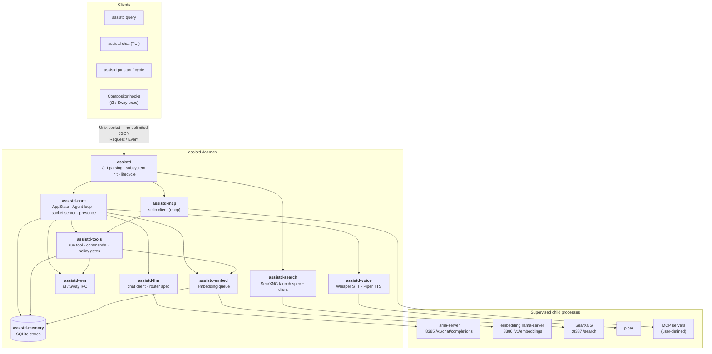

# Architecture

`assistd` is a Rust workspace split into twelve library crates plus a
binary. This page maps the crates, the external processes the daemon
supervises, and the path a user query takes from keypress to spoken
reply.

## System overview

## Crate map

| Crate            | Purpose                                                                                              | Depends on                                                                       |
|------------------|------------------------------------------------------------------------------------------------------|----------------------------------------------------------------------------------|
| `assistd`        | Binary. CLI, daemon entry, per-subsystem init wiring (including MCP).                                | every other `assistd-*` crate                                                    |
| `assistd-config` | TOML schema, defaults, validation. The single source of truth for every tunable.                    | `utils`                                                                          |
| `assistd-core`   | Daemon glue. `AppState`, agent loop, presence machine, socket server, `build_tools()` factory.       | `config`, `ipc`, `llm`, `tools`, `memory`, `embed`, `search`, `voice`, `wm`, `utils` |
| `assistd-embed`  | Embedding HTTP client + job queue feeding the semantic store; launch spec for its llama-server.      | `config`, `memory`, `utils`                                                      |
| `assistd-ipc`    | Wire-protocol types (`Request`, `Event`, `PresenceState`, `VoiceCaptureState`, `ImageAttachment`).   | `utils`                                                                          |
| `assistd-llm`    | `LlmBackend` trait + `LlamaChatClient` (HTTP/SSE to llama-server) + router-mode launch spec + control plane. | `config`, `ipc`, `tools`, `utils`                                                |
| `assistd-mcp`    | Stdio MCP servers driven through `rmcp`, plus the adapter exposing their tools through `Tool`.       | `tools`, `utils`                                                                 |
| `assistd-memory` | SQLite-backed persistent stores: `MemoryStore`, `TranscriptStore`, `SemanticStore`.                | none                                                                             |
| `assistd-search` | Launch spec and generated settings for the supervised SearXNG instance behind web search, and the typed client for its JSON API. | `config`, `utils`                                                                |
| `assistd-tools`  | `Tool` and `Command` traits, registries, `RunTool`, all built-in commands, policy gates.             | `config`, `embed`, `memory`, `ipc`, `search`, `wm`, `utils`                      |
| `assistd-utils`  | Shared helpers: backoff + `RestartPolicy`, tilde expansion, `human_size`, Hugging Face file IDs and cached model downloads, non-blocking regular-file open, size-capped HTTP body reads, `find_program` (a `PATH` lookup that says why a program cannot be run), child-output line forwarding, `/proc` listener ownership, `ProcessGroup`, `ReadinessCell` for subsystems that start in the background, and the `ChildServer` supervisor. | none                                                                             |
| `assistd-voice`  | `VoiceInput` (Whisper STT, VAD continuous mode) + `VoiceOutput` (Piper TTS) + per-sentence `SpeakDecision`. | `config`, `ipc`, `utils`                                                         |
| `assistd-wm`     | `WindowManager` trait + i3 (`tokio-i3ipc`) and Sway (`swayipc-async`) backends, plus `NoWindowManager`. | `utils`                                                                          |

`utils` sits at the bottom with no internal dependencies; `config`
and `ipc` build only on it, and most other crates build on those
three. `core` sits at the top because it's where every subsystem is
wired into a working daemon.

The same binary also ships several client subcommands that speak the
Unix-socket IPC: `query`, `chat`, `cycle` / `sleep` / `wake` /
`drowse`, `ptt-start` / `ptt-stop`, `listen-*`, `voice-*`, `memory`,
and `tray`. The tray subcommand is a long-lived
[StatusNotifierItem](https://www.freedesktop.org/wiki/Specifications/StatusNotifierItem/)
client (via the [`ksni`](https://crates.io/crates/ksni) crate): it
holds a passive `Request::Subscribe` connection, translates the
broadcast events into icon state (config error → disconnected →
generating → listening → presence), and provides a Sleep / Wake menu that issues
`Request::SetPresence` on isolated one-shot connections. It also shows
each turn as a freedesktop desktop notification over `zbus`, held back
while the chat reports keyboard focus (`Request::ChatState`). The binary
always includes the daemon and the IPC client subcommands; `tray` and
`chat` are optional features layered on top, never built standalone.

## Subsystem walk-throughs

### LLM lifecycle (`assistd-llm` ↔ llama-server)

The daemon opens its socket first and then spawns `llama-server` as a
child process in the background, reporting `PresenceState::Waking` until
the model has loaded (queries wait for it; requests that need no model
are served at once). Voice and the embedding server start after the
model, so neither loads onto the GPU while it does, and the SearXNG
instance and MCP servers start straight away; none of them holds up the
socket. `Request::GetReadiness` reports how far each has got as one
`Event::Readiness` per subsystem, and the daemon broadcasts the same event as each one settles. The chat names
whatever is still starting, and the tray tooltip lists every subsystem's
state. The server takes
its bind address, context length and GPU layer count from `[model]` in
the config, plus any `custom_args` (parsed and checked at
config load, never run through a shell). Inherited `LLAMA_ARG_*` and
`LLAMA_API_KEY` variables are stripped, so the checked command line is
the server's only source of options. Each daemon launch generates a
random API key, written to a mode-0600 file under `$XDG_RUNTIME_DIR` and
passed as `--api-key-file` to both llama-servers (with `--no-slots`), so
other local processes cannot load, unload or query models; every client
sends it as a bearer token. `assistd-utils`'s `ChildServer`
supervisor, run on the `LlamaServerSpec`, health-probes
`GET /health` until the server reports ready (a 200 counts only when
`/proc` shows the listener belongs to the child's process group, so a
stale server or squatter on the port is never trusted), then `LlamaChatClient`
streams chat completions over `POST /v1/chat/completions`. Chat and
control-plane requests are sent only while the supervisor is `Ready` with
a live child, so nothing reaches the port between a crash and the next
verified start.

Presence decides whether the model is loaded: `Active` has it loaded,
`Drowsy` keeps `llama-server` running with the weights unloaded, and
`Sleeping` stops the server. The daemon starts `Sleeping` and reports
`Waking` while it loads the model. The idle timers and GPU monitor
under `[sleep]` move it down, and a query wakes it.

If the child crashes mid-stream (CUDA OOM, OOM-killer, segfault), the
supervisor restarts it with exponential backoff and the in-flight
agent turn surfaces an `LlmError::ServerRestarting`. The agent
retries once after the new child reports healthy; further failures
propagate up to the client as an `Event::Error`.

Vision support is detected dynamically: `probe_capabilities_routed()` calls
`GET /props` on the running server to learn whether the model has a
vision projector. The `VisionGate` flips on if so, allowing the `see`
and `screenshot` commands to attach images to the next turn. A
`VisionRevalidator` probes once the model first loads, then re-probes at
the start of the first query after
the weights may have been reloaded (any presence transition, or a
supervisor restart of the child), and again after any failed probe,
so the gate tracks what is actually loaded without probing on every
query.

### Agent loop (`assistd-core::Agent`)

One per-query state machine, single-threaded per turn. The loop:

1. `backend.push_user(text, attachments)` — append user message + any
   image attachments to the conversation.
2. `backend.step(tools.openai_schemas(), tx)` — send `messages +
   tools` to llama-server, stream tokens.
3. The response is either text (`StepOutcome::Final` → emit
   `Event::Delta` per token, then `Event::Done`) or tool calls
   (`StepOutcome::ToolCalls` → step 4). A response cut off at the
   output-token limit (`StepOutcome::Truncated`) is retried up to
   twice with a note to the model, then the turn fails.
4. For each tool call: `tools.get(name).invoke(arguments)`. Emit
   `Event::ToolCall` before, `Event::ToolResult` after. Push results
   back via `backend.push_tool_results(...)`, which appends them as
   OpenAI `role: "tool"` messages carrying the id of the call they
   answer. A result carrying an image is the one exception: chat
   templates render image parts only on user turns, so those ride
   back as a user message tagged `[tool:<name>]`.
5. Loop back to step 2 until the model emits text. If the model
   repeats the same call several times in a row, or the turn runs
   past a hard-coded step ceiling, the loop tells the model, in a
   one-shot message at the end of the conversation, to stop calling
   tools and answer from what it has already gathered. The tool schema
   stays in the request so a call made anyway is still parsed (and ends
   the turn) rather than streamed to the user as raw markup.

The loop does not parallelize tool calls. Tools execute serially, and
their results land in the conversation in the order the model
emitted them. This keeps the conversation deterministic and the
`Event` stream readable.

### Tools (`assistd-tools`)

Two-tier system. The LLM sees a single `run` tool whose argument is a
shell-style command line; that line is parsed into a pipeline AST
and dispatched through an internal `CommandRegistry` of in-process
Rust handlers. So `cat /etc/hosts | grep -v '^#'` is one tool call
that fans out into two in-process commands chained by a byte-level
pipe.

Two additional `Tool`s sit alongside `run`: `remember` (save or
search facts) and `reminisce`. They don't fit the shell mold, so they're regular
LLM-facing tools with their own JSON schemas.

Built-in commands: `bash`, `cat`, `echo`, `grep`, `head`, `ls`,
`screenshot`, `see`, `sort`, `tail`, `uniq`, `wc`, `web`, `wm`,
`write`.

Policy gates (`ConfirmationGate`, `VisionGate`, `SandboxRequest`)
intercept the dangerous paths: a `bash` script runs without asking only
when every program it can run is on `[tools.bash] allowed_programs` and
nothing in it matches a destructive pattern; otherwise the user confirms,
and can "always allow" the programs it named. A redirection that writes
outside `/tmp` and `tools.scratch.dir` also needs confirmation. It then runs in the bubblewrap
sandbox; tools never run unsandboxed, so when `bwrap` is missing (or
`tools.bash.sandbox = "none"`) the model is offered no tools at all and
clients are told why. `wm open` is the one way out of the sandbox: it
launches an installed desktop entry as the user, through the compositor's
`exec` (optionally on a given workspace), so the model picks only which
entry, a working directory, and the files or URLs the entry's `Exec`
field codes accept, never a command line. Entries under a visible
`$HOME` entry, where sandboxed commands can write, are refused; the user
confirms each launch unless they chose "always allow" for that entry,
and one with files or URLs always asks; `write` restricts targets to a
configured allowlist, refuses dot entries at any depth below it, and asks
before writing outside `tools.scratch.dir`; `web fetch` asks before fetching from a host not
yet approved and follows redirects only to the same or an approved host;
`see` and `screenshot` refuse with an error when the loaded model has no
vision projector. "Always allow" for a web host, an MCP tool or an application is saved
beside the config in `approved_hosts.toml`, `approved_mcp_tools.toml` or
`approved_apps.toml`.
Clients that cannot answer prompts (`assistd query`, push-to-talk) deny
them, so there only approved hosts, tools and programs run.

A query connection starts in manual mode, where every prompt goes to the
client. A client can switch it to accept-commands mode with a mid-stream
`Request::SetPermissionMode` (the TUI's Shift+Tab). That mode approves once,
without asking, the prompts rated `Risk::Routine`: programs off the allowlist
that "always allow" could cover, `wm open` of an app with no files or URLs,
and `write` outside the scratch directory. Destructive patterns, scripts no
check can fully see, protected paths, new web hosts and unapproved MCP tools
still ask; the denylist still refuses, and nothing is added to the allowlist.

### Memory (`assistd-memory` + `assistd-embed`)

One SQLite database (default: `~/.local/share/assistd/memory.db`)
holds three schemas: a key/value `MemoryStore` for durable facts, a
`TranscriptStore` for full per-session transcripts (with branching
and undo), and a `SemanticStore` for embedding-indexed chunks. Every
write runs in order on the only read-write connection. Vector scans
and other reads each get their own read-only connection, so a long
scan holds up neither a write nor a history load. Shutdown closes the
database once queued writes have run. [database.md](database.md) maps
the tables.

Transcript rows keep each step's reasoning, every tool call's arguments,
and how each tool run ended. Each branch also keeps its latest
compaction summary. On resume, the LLM gets that summary plus only the
rows after it, so it sees the same prompt it had before; the client
still gets every row.

Saving through the `remember` tool inserts the K/V row and queues an embedding job
for its value on a `tokio::sync::mpsc` channel. Each user or assistant
message is chunked in the transaction that saves it, and its chunks are
queued on the same channel. A background task drains the queue,
sends batches to the embedding server (a second, smaller
llama-server child process configured under
`[embedding]`), and inserts the resulting vectors into the semantic
store. A `remember` search embeds its query and ranks saved memories by
cosine similarity; the `reminisce` tool runs the same kind of search
over transcript chunks from earlier sessions. Like chat requests,
embedding requests are sent only while the embedding server's
supervisor is `Ready` with a live child; a row refused in the
meantime stays unindexed until `assistd memory reindex` picks it up.

The queue and the semantic store exist from daemon start, but the
embedder sits behind an `EmbedderHandle` that is `Starting` until the
embedding server answers. Jobs queued before then wait in the channel and
are embedded once the worker starts. Semantic search, reindex, `remember`
searches and `reminisce` report "embedding is still starting" (or why it is
unavailable) until then, and per-turn context injection skips recall.

### Voice (`assistd-voice`)

`VoiceManager` owns voice for the daemon's lifetime. Capture (push-to-talk
input and the continuous listener) and speech output each start as
`Readiness::Starting` and become `Ready` or `Unavailable(reason)` once the
background warmup brings up Whisper and Piper, so voice requests during
startup or after a failed load are refused with the reason. Both appear
in `GetReadiness`, and `GetVoiceState` reports them too.

Push-to-talk: the daemon receives `Request::PttStart` from a client
or compositor binding, opens the configured microphone via cpal, and
streams audio into a ring buffer. On `PttStop` it stops capture and
hands the buffer to a `Transcriber` (Whisper via `whisper-rs`,
loaded once at startup). Transcripts feed back into the agent loop
as if the user had typed them.

Continuous mode (`MicContinuousListener`) keeps the mic open and uses
WebRTC VAD to chop the stream into utterances. Each is transcribed with
the wake phrase as Whisper's initial prompt, and a `WakeGate` keeps only
speech that opens with the phrase, the utterance after a bare phrase
within `voice.wakeword.command_timeout_ms`, or the utterance that begins
within `voice.wakeword.follow_up_ms` of a listen-started reply ending,
speech included; everything else is dropped. A push-to-talk press takes
the mic from the listener, which drops what it captured but has not acted
on and resumes on release; it ends the voice conversation, so no follow-up
window opens until the wake phrase starts a new one.
The listener reports `ListenPhase` (`Off`, `Armed`, `Capturing`) and a
`WakeWordDetected` event on the bus. The listener keeps running while
presence sleeps, and a command wakes the model like any other query.
Separately, whisper.cpp's Silero VAD (`voice.transcription.vad_enabled`) trims non-speech from
every recording before decoding. While `VoiceOutputController`
reports that a reply is being spoken (plus a short hangover), a
`PlaybackGate` discards mic frames and resets the VAD so the daemon
never transcribes its own TTS; `voice.wakeword.playback_gate = false`
removes the gate for setups whose sound server already cancels echo.
To avoid GPU thrashing during
chat generation, the `QueuedTranscriber` waits for the LLM to go idle
before running Whisper, falling back to a CPU Whisper if the wait
times out or another process holds the GPU.

TTS: model output flows through a `SentenceBuffer` that segments the
stream into speakable units, each handed to `PiperVoiceOutput`,
which spawns the `piper` binary per utterance with `--output-raw`,
writes the sentence to its stdin, reads raw PCM from its stdout, and
plays it via rodio. Before each sentence, `VoiceOutputController`
returns a `SpeakDecision`: speak it, or drop it because TTS is toggled
off or the reply was skipped. Tunables live in `[voice.synthesis]`.

### Window manager (`assistd-wm`)

Pure abstraction over the compositor IPC. The daemon optionally
queries the active window at the start of each turn (title + class +
workspace) and folds it into that turn's user message, inside a
delimited context block labelled as untrusted, so the model knows
what you're looking at. Titles are application-controlled (a web
page sets its tab's title), so they are flattened to one bounded
line and any copy of the block's delimiters inside them is
neutralised before the text reaches the model. The `wm` command surfaces this same backend
to the model as a tool: `run wm list`, `run wm focus 'firefox'`, and
similar.

If neither i3 nor Sway is reachable (no compositor running, or
running an unsupported one like Hyprland today), `NoWindowManager`
returns convention-compliant errors so commands fail gracefully
instead of panicking.

### MCP (`assistd-mcp`)

External tool servers configured under `[[mcp.servers]]`. Each entry
is a child process the daemon spawns in its own process group, with a
scrubbed environment, and speaks MCP to over stdin/stdout through the
`rmcp` crate. Discovered tools are wrapped by `McpToolAdapter`, which
implements `Tool` over the discovered schema, and added to the
`ToolCatalog` the LLM's tools come from, under the name
`mcp__<server-name>__<tool-name>`. Servers start one after another in the
background; each one's tools are offered from the next turn after it
connects, since every turn takes its own snapshot of the catalog. A
server that fails to start is reported as unavailable in `GetReadiness`
and `GetCapabilities`. Each call asks the user first until
that tool is "always allowed". Like every tool's, their text results are
held to the `[tools.output]` cap by the registry, spilling overflow to
`<registry-name>-<n>.txt`.

When a server's process or session ends, its process group is killed
at once, and the next call to one of its tools starts it again. Restarts
follow exponential backoff; a call inside the backoff fails with a
"server unavailable" error instead of waiting. The daemon never blocks
on a slow MCP server: the handshake and each call are bounded by that
server's `request_timeout_secs`, and a timeout surfaces as a structured
error to the model.

### Web search (`assistd-search` ↔ SearXNG)

`web search` goes through a private [SearXNG](https://docs.searxng.org)
instance the daemon runs as a child process when `[search] enabled =
true`. It needs no GPU, so it starts as soon as the socket opens rather
than waiting for the model, and runs under the same `ChildServer`
supervisor as the llama-servers: health probe on `GET /healthz` (checked
against `/proc` listener ownership), restart with backoff, and a degraded
state after repeated failures. A `search.command` that is not on `$PATH`
fails at once instead of going through the restart attempts.

Each launch writes a fresh `settings.yml` (mode 0600, under
`$XDG_RUNTIME_DIR/assistd/searxng/`) that loads only the engines in
`search.engines`, enabling each even if SearXNG ships it disabled,
with API keys read from each engine's `api_key_file`. It turns off the
limiter, image proxy and public-instance mode and enables the JSON
format. The bind address, port, settings path and a random per-launch
secret are passed as `SEARXNG_*` variables; any `SEARXNG_*` variables
in the daemon's own environment are removed first, so the instance
never picks up settings from elsewhere.

Readiness is reported as the `web search` component of
`Event::Readiness`: `starting`, `ready`, or `unavailable (<reason>)`.
`SearxngClient` checks it before every request, so a search while the
instance is starting or restarting fails at once with a message the
model can act on rather than waiting on a dead port. Results come back
from `GET /search?format=json` and are printed as TSV hits for the model
to pick from and read with `web fetch`.

The instance has no authentication, so `search.host` must be loopback.
`web fetch` never fetches loopback or other non-public addresses, so
the model cannot reach the search port through it, and sandboxed `bash`
has no network unless `--share-net` is set; in practice only the
daemon's own client talks to SearXNG.

## Data flow: end-to-end query

A walk through `assistd query "what files changed this week?"`:

1. **Client.** `assistd query` constructs `Request::Query { id,
   text, attachments: [] }`, dials
   `$XDG_RUNTIME_DIR/assistd.sock`, writes the JSON line, half-closes
   the write side, and reads `Event` lines until `Done`.

2. **Socket server** ([`crates/assistd-core/src/socket.rs`](../crates/assistd-core/src/socket.rs)).
   Parses the request and hands it to `AppState::dispatch`, which
   routes a `Query` to `handle_query`; that takes the per-turn agent
   lock, so concurrent queries serialize.

3. **Agent** ([`crates/assistd-core/src/agent.rs`](../crates/assistd-core/src/agent.rs)).
   The handler builds `Agent::new(...)` from the cached `AppState`
   and calls `run_turn()`.

4. **LLM step** ([`crates/assistd-llm/src/chat/client.rs`](../crates/assistd-llm/src/chat/client.rs)).
   `LlamaChatClient` POSTs `messages + tools` to llama-server with
   `stream: true`. SSE deltas come back; text tokens propagate as
   `Event::Delta`, tool calls accumulate until the stream closes.

5. **Tool dispatch.** llama-server emits a `run` call with arguments
   `{"command":"git log --since='1 week ago' --name-only --pretty="}`.
   The agent emits `Event::ToolCall`, hands the args to `RunTool`,
   which parses the command line and dispatches to `BashCommand`.
   `git` is not on the default allowlist, so the user confirms the
   command first unless they have already "always allowed" `git`;
   `git log` matches no destructive pattern.

6. **Sandbox.** `BashCommand` invokes the bubblewrap sandbox: a
   read-only root with writable entries
   of `$HOME` other than dotfiles and symlinks, fresh `/tmp`, `/dev`,
   `/proc` and `/run`, unshared pid/ipc/uts/network namespaces, and
   an environment cleared down to locale and terminal variables. With
   `--share-net` in `bwrap_extra_args`, `bwrap` is spawned from a thread
   Landlock bars from abstract Unix sockets, such as the X server's, that
   the shared network namespace would otherwise expose; kernels without
   Landlock scoping (before 6.12) get no tools in that case. The
   one exception is `tools.scratch.dir`, bound writable at its own
   path so `bash` and the in-process commands share files there (entries
   older than `tools.scratch.retention_days` are pruned at startup), with
   the spill directory bound read-only beside it. A script that names
   any other path in one of the sandbox's tmpfs mounts gets a `[note]`
   line on stderr (and a daemon warning) pointing at the scratch
   directory, as does a `write` that puts a file there. The sandboxed `git` runs, returns
   stdout. If the result exceeds the `[tools.output]` line or byte cap,
   `RunTool::invoke` cuts stdout and stderr to heads that fit it together
   with their notices and footer, and spills each cut stream in full to
   `tools.output.overflow_dir` (default `$XDG_RUNTIME_DIR/assistd/output`,
   owner-only, with earlier spill files removed at every daemon start and only the newest 64
   files or 128 MiB kept while it runs); it then base64-encodes any image
   attachments and returns the JSON result.

7. **Loop back.** Result emitted as `Event::ToolResult`, pushed back
   into the conversation, agent calls `step` again. The model now
   has the file list in context and produces a written summary.
   Tokens stream out as `Event::Delta`s, the loop closes with
   `Event::Done`, the socket connection closes.

8. **Client output.** `assistd query` prints deltas as they arrive,
   exits 0 on `Done` or non-zero on `Error`.

For push-to-talk, `assistd ptt-stop` sends `Request::PttStop`
instead; `dispatch` routes it to `handle_ptt_stop`, which transcribes
the recording, emits `Event::Transcription`, and runs the turn from
step 3 on.

For `assistd chat`, the TUI is a long-lived client but not a single
connection: each turn opens its own connection, kept writable so the
TUI can answer confirmation prompts with `Request::ConfirmResponse`,
while separate long-lived `Request::Subscribe` connections carry
broadcast events such as session titles.
