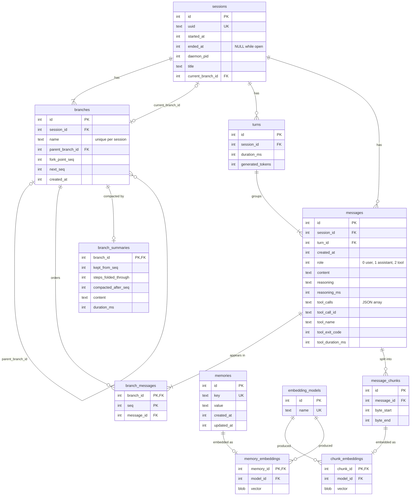

# Database schema

`assistd-memory` keeps everything the daemon remembers in one SQLite
file, by default `~/.local/share/assistd/memory.db` (`[memory] db_path`).
With `[memory] enabled = false` the file is never opened.

## Entity-relationship diagram

Every table is `STRICT`, and every timestamp is Unix milliseconds.
Branches, turns, and messages carry their `session_id` and reference
each other through composite `(session_id, id)` keys, so nothing can
point across sessions. Deleting a session, branch, message, or memory
cascades to the rows that hang off it.

## Transcripts

- **`sessions`**: one row per conversation, written with its first
  message. A clean daemon shutdown sets `ended_at`. If a daemon dies
  without one, the next daemon resumes the newest session that is still
  open and whose `daemon_pid` is dead, and writes its own pid there.
  `title` is a short name the model generates from the first prompt.
- **`branches`**: each session starts with a `main` branch. Forking
  copies the source branch's `branch_messages` rows (and its summary)
  under a new name, records `parent_branch_id` and `fork_point_seq`
  (the parent's last seq at the fork), and makes the fork the session's
  current branch. `next_seq` hands out the branch's next position.
- **`turns`**: one row per user prompt and everything the model did in
  response. `duration_ms` and `generated_tokens` are filled in together
  once the turn finishes.
- **`messages`**: every user prompt, assistant step, and tool result.
  Assistant rows may carry `reasoning` (with how long it took) and a
  non-empty `tool_calls` JSON array; tool rows always carry the call
  id, tool name, exit code, and run time. `CHECK` constraints tie each
  of these columns to its role.
- **`branch_messages`**: the ordered list of messages on each branch,
  keyed by a branch-local `seq`. Messages are stored once and shared
  by every branch forked after them, which is what makes forking
  cheap. Undo removes the last turn's rows from the branch, then
  deletes any of its messages (and the turn) that no other branch
  still references.
- **`branch_summaries`**: at most one compaction summary per branch.
  `kept_from_seq` is the user message from which history is kept word
  for word; `steps_folded_through`, when set, marks the tool steps of
  that turn folded into the summary; `compacted_after_seq` is the
  newest seq at the time. On resume the model gets the summary plus
  the rows from `kept_from_seq` on, while clients still see every row.
  Undoing a turn the summary covers drops the summary.

## Key/value memories

**`memories`** holds the facts saved by the `remember` tool and
`assistd memory`, one row per unique `key`. Saving an existing key
overwrites `value` in place and bumps `updated_at`. A trigger deletes
the memory's embedding whenever its value changes, so a stale vector
never outlives the text it was computed from.

## Embeddings

- **`message_chunks`**: user and assistant messages are cut into
  overlapping windows of 512 characters (64 shared) in the same
  transaction that saves the message. Each chunk is a byte range into
  `messages.content`, so the text itself is never stored twice. Tool
  results are not chunked.
- **`embedding_models`**: one row per embedding model name seen, so
  each vector records which model produced it.
- **`chunk_embeddings`** / **`memory_embeddings`**: at most one vector
  per chunk or memory, stored as a BLOB of little-endian `f32`s,
  L2-normalised by the embedder so a dot product is cosine similarity.
  Vectors are written by the background embedding queue; a memory's
  vector is only stored if its value hasn't changed since the job was
  queued. Rows with no vector for the configured model, or a vector
  from a different model, are what `assistd memory reindex` fills in.

Search (`recall`, `reminisce`) scans every vector for the current model
on a dedicated read-only connection and keeps the top matches; there
is no vector index. `reminisce` leaves out the current session's
messages.

## Storage

- One read-write connection runs every write in order; two read-only
  connections serve history loads and vector scans, so neither blocks
  the other.
- The database runs in WAL mode with foreign keys and `secure_delete`
  on. After a delete or overwrite the WAL is checkpointed and truncated
  so removed text doesn't linger in the sidecar files.
- New databases use 16 KiB pages, which pack several 768- or
  1024-dimension vectors per page.
- The data directory is created `0700` and the database and its
  `-wal`, `-shm`, and `-journal` files are kept `0600`.
- The schema version lives in `PRAGMA user_version` and migrations run
  through `rusqlite_migration` when the database opens. A schema change
  is a new migration appended after the existing ones.
