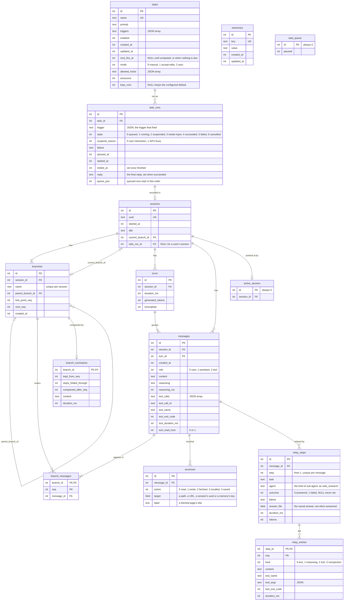
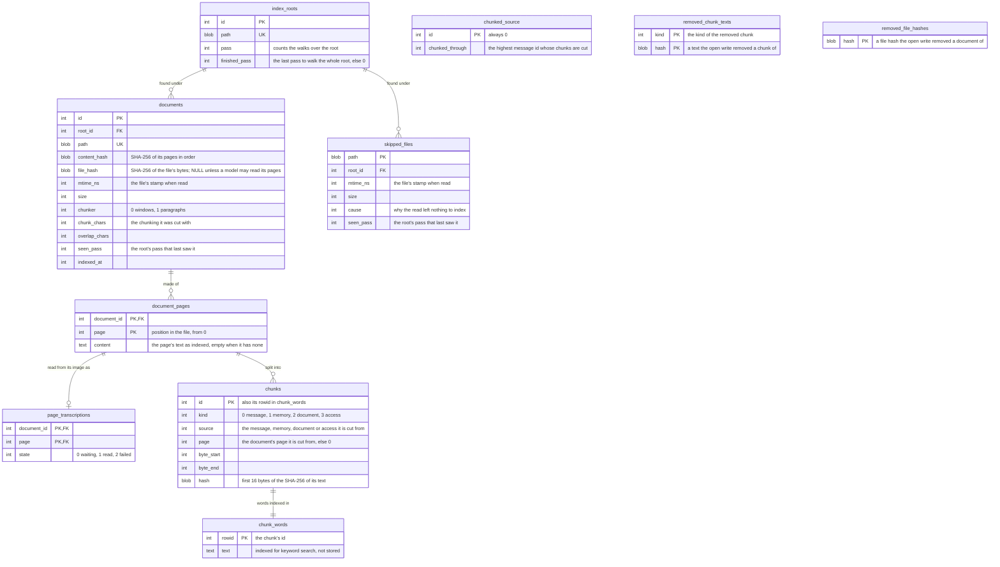

# Database schema

`assistd-memory` keeps what the daemon remembers in three SQLite files in
`$XDG_DATA_HOME/assistd` (`~/.local/share/assistd` by default), split by
what losing each would cost.

- **`memory.db`** holds what exists nowhere else: sessions, memories and
  tasks. The daemon never replaces it.
- **`index.db`** holds what can be built again without a model, from
  `memory.db` and from the files on disk: document text, the chunks of
  every kind and their keyword index. The daemon builds it again itself
  when it has to ([Repair at start](#repair-at-start)).
- **`vectors.db`** holds what a model computed, which takes hours of
  model time to produce again: the vector of every distinct chunk text,
  and the text the OCR model read from each scanned page. Nothing in it
  names a row of another file, so it outlasts an `index.db` that is
  built again.

Chats are saved whatever `[memory] enabled` says; turning it off only
withholds the memory tools and recalled context from the model.

[search.md](search.md) describes the search these files serve, and
[documents.md](documents.md) the document index from the outside.

## What losing a file costs

| File         | Losing it costs                                                                 | The daemon replaces it                                  |
|--------------|---------------------------------------------------------------------------------|---------------------------------------------------------|
| `memory.db`  | Every session, memory and task, and the record of what tool calls touched. Nothing else holds them. | Never. It refuses to start when the file cannot be opened. |
| `index.db`   | The time to cut the messages and memories again and to read the indexed files again. No model runs: the vectors and the scanned pages' text wait in `vectors.db`. | When it is missing, unreadable or from another schema version. |
| `vectors.db` | Model time. Every chunk text is embedded again, and until then a search finds text by its words only. The readings kept for scanned pages go too: a page already read keeps its text in `index.db`, and is read again by the OCR model once its file is stored afresh. | When it is missing, unreadable or from another schema version. |

As a scale for the last row: the 154,468 distinct texts of the index
measured [below](#scans) are 2.4 hours at the 18 chunks a second
measured for embedding on the CPU.

So a backup needs only `memory.db`, copied while the daemon is stopped.
`index.db` holds the text of every indexed file and `vectors.db` the
text read from scanned pages, so a copy of either holds documents
([privacy](documents.md#privacy)).

To reset a file, stop the daemon and move or delete it with its `-wal`
and `-shm` files. The next start creates an empty one.

- **`memory.db`**: the next start begins with no sessions, memories or
  tasks. `index.db` drops the chunks cut from the old file and
  `vectors.db` the vectors of their text; documents and their vectors
  stay. A schema change to `memory.db` may require this reset instead
  of shipping a migration.
- **`index.db`**: everything in it is built again
  ([Repair at start](#repair-at-start)).
- **`vectors.db`**: every chunk waits for a vector, and the daemon logs
  how many texts wait. Scanned pages keep the text `index.db` holds for
  them, but a scan stored again, or every scan once `index.db` is also
  built again, waits for the OCR model.

Some changes empty part of a file without a reset:

| Change                                                        | What is emptied                                   |
|---------------------------------------------------------------|---------------------------------------------------|
| `embedding.model`, `custom_args` or `document_prefix`, or a model reporting another dimension | The four vector tables. Everything is embedded again. |
| `documents.ocr.model` or `prompt`                             | `page_readings`. Pages already read keep their text until their file is indexed again. |
| A folder removed from `documents.roots`                       | Its documents, at the next start, and the vectors and readings only they held. |
| `assistd documents reindex`                                   | `skipped_files`. Stored documents are read again only when their file changed. |
| `assistd memory reindex`                                      | The marks on text the embedding server refused.   |

Every table is `STRICT`, and every timestamp is Unix milliseconds.

## `memory.db`

Branches, turns, and messages carry their `session_id` and reference
each other through composite `(session_id, id)` keys, so nothing can
point across sessions. Deleting a session, branch, message, or memory
cascades to the rows that hang off it in this file; the chunks cut from
it, in `index.db`, follow ([What ties the files together](#what-ties-the-files-together)).

### Transcripts

- **`sessions`**: one row per conversation, written with its first
  message. `title` is a short name the model generates from the first
  prompt. `task_run_id` marks the session of a task run.
- **`active_session`**: at most one row, naming the session the user's
  conversation is on. It is written when a session is saved or switched
  to and deleted when the user starts a new one, and a starting daemon
  resumes the session it names on that session's current branch.
- **`branches`**: each session starts with a `main` branch. Forking
  copies the source branch's `branch_messages` rows (and its summary)
  under a new name, records `parent_branch_id` and `fork_point_seq`
  (the parent's last seq at the fork), and makes the fork the session's
  current branch. `next_seq` hands out the branch's next position.
- **`turns`**: one row per user prompt and everything the model did in
  response. `duration_ms` and `generated_tokens` are filled in together
  once the turn finishes. `incomplete` is set once a message of the turn
  failed to save.
- **`messages`**: every user prompt, assistant step, and tool result.
  Assistant rows may carry `reasoning` (with how long it took) and a
  non-empty `tool_calls` JSON array; tool rows always carry the call
  id, tool name, exit code, and run time. `CHECK` constraints tie each
  of these columns to its role.
- **`branch_messages`**: the ordered list of messages on each branch,
  keyed by a branch-local `seq`. Messages are stored once and shared
  by every branch forked after them, which is what makes forking
  cheap. Undo removes the last turn's rows from the branch, then
  deletes any of its messages (and the turn) that no other branch
  still references.
- **`branch_summaries`**: at most one compaction summary per branch.
  `kept_from_seq` is the user message from which history is kept word
  for word; `steps_folded_through`, when set, marks the tool steps of
  that turn folded into the summary; `compacted_after_seq` is the
  newest seq at the time. On resume the model gets the summary plus
  the rows from `kept_from_seq` on, while clients still see every row.
  Undoing a turn the summary covers drops the summary.
- **`accesses`**: what a tool call touched, one row per file read or
  written, page fetched, past session looked into or memory saved,
  hung off the call's tool-result row and written with it in one
  transaction, so forks share it and undo deletes it with the message.
  `target` is a name, not a row id: a file's absolute path, the URL a
  fetch was answered from after redirects, a session's uuid, a memory's
  key. It can name a file that was never indexed and outlives a rebuilt
  index. `label` is a fetched page's title, flattened to one line of at
  most 200 characters. A URL and a title are the page's own choice, so
  both are untrusted text. The list may miss things. A file read or
  written and a page fetched each have one chunk in `index.db`, whose
  text is the label on a line of its own, when there is one, then the
  target, so `search` finds a page by the words of its title and
  address and a file by the words of its path. A target that is not
  UTF-8 has none, and neither has a session looked into or a memory
  saved.
- **`relay_steps`** / **`relay_entries`**: what the sub-agents behind a
  `relay` tool result did, hung off that result's `messages` row so
  forks share it and undo deletes it with the message. Each planned
  step gets a row, one that never ran with a NULL `outcome`; its
  entries are the sub-agent's reply text, reasoning, tool calls with
  their output, and compactions, in order. They are written with the
  tool result in one transaction, replayed to clients on resume, and
  never reach the model's history or the embedding chunks, since they
  come from untrusted files and pages.

### Key/value memories

**`memories`** holds the facts saved by the `remember` tool and
`assistd memory`, one row per unique `key`. Saving an existing key
overwrites `value` in place and bumps `updated_at`. A memory has one
chunk over its whole value, cut once the save has committed; a save that
changes the value replaces the chunk, which deletes the old value's
vector unless another memory holds that value.

### Tasks

**`tasks`** holds saved prompts run without the user opening a
conversation, one row per unique `name`, with the triggers that start
them, the permission mode their runs get, the hosts those runs fetch
from unasked, and how many finished runs to keep.
**`task_runs`** records each run: the trigger that fired it, its state,
its place in the queue while it waits, and, once it succeeds, its final
reply. Deleting a task deletes its runs and their transcript sessions,
except the active session, which stays as an ordinary one.
**`task_queue`** has a row only once the queue has been paused or
resumed, saying which.

## `index.db`

`chunks.source` names a row of one of four tables, which no foreign key
can say. Only a document's page is in this file, and a trigger on
`document_pages` deletes a deleted page's chunks. A message, a memory
and an access are rows of `memory.db`.

- **`chunked_source`**: the one row holding the highest message id of
  `memory.db` whose chunks are cut.
- **`chunks`**: each chunk belongs to exactly one message, one memory,
  one page of a document or one access, and is a byte range into
  `messages.content`, `memories.value`, that page's
  `document_pages.content` or the access's label and target, so the
  text itself is never stored twice. `kind` says which of the four and
  `source` is that row's id, so a new kind of text needs a code and a
  vector table, not columns. A memory is one chunk over its whole
  value, and so is an access to a file or a page, over its label on a
  line of its own, when it has one, then its target. User and assistant
  messages are cut into overlapping windows of 512 characters (64
  shared) by the message chunker, after the message is saved; the
  content of a tool result is not chunked. A document is cut page by
  page, so no chunk spans two pages, and within a page where its text
  divides: at blank lines and Markdown headings, with whole paragraphs
  packed into a chunk of up to 512 characters and a heading always
  starting a new one. Only a paragraph longer than that is cut into the
  same overlapping windows. `hash` is the first 16 bytes of the SHA-256
  of the bytes the chunk covers, written with the row: it is what the
  chunk's vector is stored under.
- **`index_roots`**: the folders indexed for document search. Each
  walk over a root, whole or held to the paths that changed under it,
  is a pass and bumps `pass`; deleting a root deletes its documents.
  `finished_pass` is the last pass that walked the whole root to its
  end, 0 until one has since `index.db` was created.
- **`documents`**: local files indexed for search, one row per path.
  A file whose `mtime_ns`, `size` and chunking match its row is not
  read again. One that is read and hashes to the stored `content_hash`,
  which covers its pages in order, only has its stamp refreshed, unless
  it has rows in `page_transcriptions`: the same text layer says nothing
  about whether the scans changed.
  Otherwise its pages and chunks are replaced. A vector belongs to a
  text and not to a chunk, so only text no document chunk held is
  embedded: an insertion embeds the paragraphs it touched, a page added
  at the front only that page, and a renamed, moved or copied file
  nothing. `chunker` names
  the strategy that cut the row, so a new strategy cuts every stored
  document again on the next pass. Each row records the pass
  that last saw it, and finishing a pass deletes the documents it did
  not see: all of the root's, or for a pass over changed paths those at
  or under them. The rows are a rebuildable cache of files on disk,
  so losing `index.db` costs only a re-index, and the re-indexed text
  finds its vectors in `vectors.db`. `file_hash` is the SHA-256 of the
  file's bytes as the extraction worker read them, kept for a PDF,
  whose pages a model may read, and `NULL` for any other file.
- **`skipped_files`**: files that were read and left nothing to
  index, one row per path, each with the stamp it had and why:
  unsupported, binary, undecodable, password protected, without text,
  unreadable, too large once expanded, or a read that failed or timed
  out. A path has a row here or in `documents`, never both. A pass
  counts a file whose stamp matches its row as skipped for that cause
  without reading it; only a PDF without text is read again once
  `documents.ocr.model` is set. Rows go when their file changes and is
  read, when a pass no longer sees it, and all at once on
  `assistd documents reindex`.
- **`document_pages`**: a document's text as it was indexed, one row
  per page. What a page is follows the file's format: a PDF's pages
  are its own, a presentation's slides, a spreadsheet's sheets and an
  e-book's chapters are each a page, and a text, Markdown, source, HTML
  or word-processor file is one page.
  `page` is the page's position in the file from 0, and a page without
  text, as a scanned PDF page is, has a row with empty `content`, so a
  page's number in the index is its number in the file.
- **`page_transcriptions`**: the PDF pages that had no text when their
  file was read, each an image an OCR model can read. A row starts as
  waiting. Reading the page stores what the model found, which may be
  nothing, as the page's `document_pages.content` and marks the row
  read; a page that cannot be rendered or whose reply is not its text
  is marked failed and keeps empty content. Once none of a document's
  rows is waiting its pages that have no chunk are cut and
  `content_hash` is taken over the pages as they now are. The rows stay
  until the file's stamp changes: indexing it again writes the pages as
  extracted and gives each empty page the reading `page_readings` keeps
  for the file's bytes: a page with one is marked read at once, and only
  the others start waiting. A daemon start sets the failed rows back to
  waiting.
- **`chunk_words`**: an FTS5 index of the words of every chunk of every
  kind. It is contentless:
  a row carries its chunk's id and the index entries for the chunk's
  text, and the text itself stays in the row the chunk is cut from. The write
  that cuts a chunk adds its row, and a trigger on `chunks` removes the
  row with the chunk however the chunk goes. FTS5 marks a removed row deleted and drops its entries as
  it merges the index, so the words of a deleted message or memory,
  though no query finds them, stay in the file until then. Words are split at every character that is not a
  letter or a digit and compared without case or accents, so
  `read_regular_file` is indexed as `read`, `regular`, `file` in a row.
  The `search` command reads it for every kind it ranks; recalled
  context ranks by vector alone. On the document
  index [search.md](search.md#measured) measures it takes
  25 MB beside 62 MB of page text and 124 MB of vectors.
- **`removed_chunk_texts`**: empty between writes. A trigger on `chunks`
  records the kind and hash of every chunk a write deletes, however the
  chunk goes: with its page or its document, with a memory's old
  value, or after its message or memory was deleted. Before the write commits it deletes from `vectors.db` the vector of each
  recorded text that no chunk of that kind holds any more, and empties
  the table. The check runs after the write's inserts, so a document
  stored again, whose chunks are removed and added, keeps the vectors
  of the text it still has, and a vector is erased by the same
  write as the last text it was made from.
- **`removed_file_hashes`**: empty between writes. Triggers on
  `documents` record the `file_hash` of every row a write deletes or
  gives another hash. Before the write commits it deletes from
  `vectors.db` the readings under each recorded hash that no document
  has any more, and empties the table.

## `vectors.db`

```mermaid
erDiagram
    message_vectors {
        blob hash UK "the hash of the message chunks that hold the text"
        blob vector "quantised; NULL when the model cannot embed the text"
    }
    memory_vectors {
        blob hash UK "the hash of the memory chunks that hold the text"
        blob vector "quantised; NULL when the model cannot embed the text"
    }
    document_vectors {
        blob hash UK "the hash of the document chunks that hold the text"
        blob vector "quantised; NULL when the model cannot embed the text"
    }
    access_vectors {
        blob hash UK "the hash of the access chunks that hold the text"
        blob vector "quantised; NULL when the model cannot embed the text"
    }
    embedding_meta {
        int id PK "always 0"
        text model
        int dim
        text server_args
        text document_prefix
    }
    page_readings {
        blob file_hash PK "the hash of the documents stored from the file"
        int page PK "position in the file, from 0"
        text text "what the OCR model read, empty for a blank page"
    }
    page_reader {
        int id PK "always 0"
        text model
        text prompt
    }
```

No table here has a key into another, in this file or outside it. A
vector is found by the hash of its text and a page's reading by the
hash of its file.

- **`message_vectors`** / **`memory_vectors`** / **`document_vectors`** /
  **`access_vectors`**, in `vectors.db`: one vector for each
  distinct text the chunks of that kind hold, under the text's
  `chunks.hash`. No chunk id appears in them, so a text that sits in
  many places is embedded and stored once, and a vector follows its
  text to any page of any file. A table per kind keeps a search of one
  kind from reading the vectors of another. A chunk whose hash has no row is pending,
  and the background embedding worker is given the first chunk holding
  each pending text. A vector is stored only while a chunk of its kind
  holds its text, and kept while `index.db` is being built again
  ([What ties the files together](#what-ties-the-files-together)).
  Vectors are L2-normalised by the embedder, so a dot product is cosine
  similarity, and quantised to a quarter of their `f32`s: a
  little-endian `f32` step, sized so the vector's largest component is
  127 steps, then one `i8` count of steps per dimension.
  A row with a `NULL` vector marks text the model rejected, or that
  failed alone three times while the server embedded other text, so the
  worker does not retry it; `assistd memory reindex` clears those marks
  and wakes the worker.
- **`embedding_meta`**, in `vectors.db`: the one row naming what
  produced every stored vector: `embedding.model`, the vector dimension the server reported,
  `embedding.custom_args` and `embedding.document_prefix`. When the
  embedder comes up and any of the four differs from the row, the four
  vector tables are emptied before anything can
  search or write, so vectors from two embedding spaces are never
  compared, and the worker embeds everything again.
  `embedding.query_prefix` is not recorded: it shapes only the query
  vector, which is never stored.
- **`page_readings`**, in `vectors.db`: the text the OCR model read
  from one page, under the `file_hash` of the file and the page's
  position in it, empty for a page that shows nothing. A failed reading
  is not kept. The rows belong to a file's bytes and not to a path or a
  document id, so a renamed, moved or copied scan has its text at once,
  and so does every scan after `index.db` is built again. A reading is
  kept only while a document is stored from its file
  ([What ties the files together](#what-ties-the-files-together)), so text read from a deleted or changed
  file does not outlive it.
- **`page_reader`**, in `vectors.db`: the one row naming what read
  every kept reading: `documents.ocr.model` and `documents.ocr.prompt`.
  When the daemon starts with either changed, `page_readings` is emptied
  before any document is stored. Pages already read keep their text
  until their file is indexed again.

## What ties the files together

Inside a file, rows are tied by keys, cascades and triggers. Across
files there is no key and no transaction, so a row names what it needs
by a name or by a hash of content, and a rule keeps the name true.

| From                         | To                                   | Named by                                  |
|------------------------------|--------------------------------------|-------------------------------------------|
| A chunk in `index.db`        | Its message, memory or access in `memory.db` | `chunks.kind` and `chunks.source`, good only for the `memory.db` that `chunked_source` records |
| A chunk in `index.db`        | Its vector in `vectors.db`           | `chunks.hash`, the hash of its text       |
| A document in `index.db`     | Its scanned pages' text in `vectors.db` | `documents.file_hash`, the hash of the file's bytes, and the page's position |
| An access in `memory.db`     | A file, a page, a session or a memory | `accesses.target`: a path, a URL, a uuid or a key, which may name what is gone |

`vectors.db` names nothing, which is why it outlasts both other files.

### `memory.db` and `index.db`

No transaction covers both, so a row of `memory.db` is always written
first and `index.db` follows it. A crash between the two leaves
`index.db` behind, never wrong, and the next start brings it level.

- **Other messages.** A message's content is never rewritten and ids
  only rise, so two copies of `memory.db` hold the same messages up to
  some id and other ones above it. A start hashes the bytes that the
  chunk of the highest message with one covers and compares them with
  `chunks.hash`. When they differ, the index was cut from other
  messages, from another `memory.db` or from a copy since replaced:
  every message and access chunk is dropped and the mark set to 0, so
  they are cut again. Their vectors stay for the chunks that hold the
  same text again. Document chunks stay: they name no row of
  `memory.db`.
- **Messages.** A message is saved without chunks.
  `chunked_source.chunked_through` is the highest message id whose
  chunks are cut, and the message chunker cuts every user and assistant
  message above it, at start and each time one is saved. A tool result
  above the mark has a chunk cut for each file or page among its
  `accesses`, by the same pass. It is a backlog
  ([architecture](architecture.md#backlogs)) and the only code that cuts
  a message. Message ids never recycle, so a stale chunk cannot come to
  name another message. With `embedding.enabled = false` the chunker
  does not run and the messages wait above the mark. A start lowers the
  mark to the highest message stored, so a `memory.db` put back from an
  older copy has its next messages chunked.
- **Memories.** Once a save has committed, the memory's chunk is compared
  with the value now stored, by hash, and cut again when they differ. A
  start compares every memory the same way.
- **Deletes.** A delete commits in `memory.db`, and then the chunks whose
  message, memory or access is gone are removed from `index.db` and its WAL
  truncated. A start removes them too. Until then a search skips them.

A step on `index.db` that fails after its `memory.db` write committed is
logged and left to the next start.

### `index.db` and `vectors.db`

They are written by one connection, in one transaction, but each file
commits on its own, so a crash can keep one file's half of a write.
Both ways heal: a chunk whose hash has no vector is embedded, and a
vector whose text no chunk holds is removed. A page reading follows the
same two rules as a document vector, with the file's hash in place of
the text's.

- **Finding a vector.** A chunk's vector is the row of its kind's table
  in `vectors.db` under `chunks.hash`. The embedding queue is the chunks
  whose hash has no row there.
- **Removing a vector, after a write.** A write that removes chunks
  deletes, in the same transaction, the vector of each text it removed
  the last chunk of (`removed_chunk_texts`).
- **Removing a vector, by comparing a whole kind.** Every vector of a
  kind whose hash no chunk of that kind holds is deleted, but only while
  that kind's chunks are all cut, since a vector may be waiting for a
  chunk that will hold it. Memory chunks are all cut once a start has
  compared them, and the comparison follows. Message chunks are all cut
  when the message chunker first leaves no message above its mark after
  a start. Document chunks are all cut once a pass has walked the whole
  of every root in `documents.roots` since `index.db` was created, which
  `index_roots.finished_pass` records; the comparison runs at the end of
  each round of passes.
- **Finding a page's reading.** The text read from a scanned page is the
  row of `page_readings` under its document's `file_hash` and the page's
  position. Storing a document looks each page without text up there
  before setting it to wait for the OCR model.
- **Removing a reading.** A write that removes a document, or stores
  other bytes at its path, deletes in the same transaction the readings
  of a file no document is stored from any more (`removed_file_hashes`). The comparison at the end of each round of passes deletes
  every reading whose file hash no document has, on the same condition
  as the document vectors.

So an `index.db` built again finds its vectors and its pages' readings
waiting and asks no model for anything, and so does a root that was
unavailable while it was built and comes back. A message undone while its chunks are being cut again keeps
its vector until they all are; in every other case a vector goes with
the write that removed its last chunk.

## Repair at start

Opening the files brings them level before anything reads them:

1. **`memory.db` is opened and migrated.** The daemon refuses to start
   when it cannot be, and never replaces it.
2. **`vectors.db` and `index.db` are checked.** A missing file is
   created. One that SQLite cannot read as a database, or whose
   `PRAGMA user_version` is not the one this build writes, is deleted
   with its sidecar files and created empty. Neither file has
   migrations: a change to its schema takes the next version number.
3. **`index.db` is held against `memory.db`**, in one write:
   - the chunks whose message, memory or access is gone are removed;
   - the mark is lowered to the highest message stored;
   - when the chunk of the highest message with one does not cover that
     message's text, every message and access chunk is dropped and the
     mark set to 0;
   - each memory whose chunk does not cover its value has it cut again;
   - every memory now has its chunk, so the memory vectors that no
     memory chunk holds the text of are removed.
4. **A `vectors.db` created empty is logged**, with the number of chunk
   texts that wait for a vector.

The rest is done by the backlogs
([architecture](architecture.md#backlogs)) once the daemon runs:

- The message chunker cuts the messages above the mark. When it first
  leaves none, the message and access vectors no chunk holds the text
  of are removed.
- The index passes read every file of every root that has no row with
  its stamp, which after a new `index.db` is all of them. At the end of
  a round in which every root has been walked whole, the document
  vectors and page readings no document holds are removed.
- The embedding worker embeds every chunk whose text has no vector,
  which after a new `index.db` beside a kept `vectors.db` is none.
- A scanned page takes the reading kept for its file and waits for the
  OCR model only when it has none. Page transcriptions that failed are
  set back to waiting.
- When the embedder comes up in another embedding space, or
  `documents.ocr` names another model or prompt, the vectors or the
  readings are emptied first
  ([What losing a file costs](#what-losing-a-file-costs)).

## Scans

The store has one search ([search.md](search.md)). A caller gives it
the query's text and vector, the kinds to search (messages, memories,
documents, accesses), which sessions' messages and accesses count, how
many hits it wants, and whether to rank by keyword as well as by
vector.

It scans every vector
of each of those kinds and keeps the top matches; there is no vector
index. A search that takes in documents runs on a read-only connection
of its own. It scans `document_vectors` alone, keeps the nearest texts,
ten for each document it is to find, and places each text at the first
document holding it that has no nearer text. When those texts sit in
too few documents and more vectors remain, it scans again through the
chunks, keeping one chunk a document, so one long document never crowds
out the rest. A message search reaches each vector through its chunk,
which drops the messages outside the search's sessions before any is
ranked. A search of accesses scans
`access_vectors` alone and places each text at the first access holding
it in the search's sessions, since one file is read many times over. What is
kept of each kind is merged by similarity, which one embedding space and
one stored form make comparable across kinds.

One scan of quantised 768-dimension vectors, measured on a Ryzen 7
9800X3D with the file in the page cache, when each vector belonged to
one chunk:

| Vectors   | Size   | Scan   |
|-----------|--------|--------|
| 10,000    | 8 MB   | 1 ms   |
| 100,000   | 82 MB  | 14 ms  |
| 1,000,000 | 820 MB | 200 ms |

Quantising moved no top-8 result in these runs and changed a
similarity by at most 0.0005.

What a scan costs is the row, not the bytes: stepping through vector
rows with no arithmetic took 107 to 162 ns a row. A vector is therefore
stored once for each distinct text, and a document index holds fewer
vectors than chunks. Measured by running the extraction worker over
9,229 files and cutting them by the document chunker's rules:

| Files                | Chunks  | Distinct texts | Repeats |
|----------------------|---------|----------------|---------|
| This repository      | 13,009  | 12,981         | 0.2%    |
| `/usr/share/doc`     | 143,890 | 116,725        | 19%     |
| The Rust books       | 52,476  | 24,762         | 53%     |
| All                  | 209,375 | 154,468        | 26%     |

The repeats are print pages and "-all" pages that hold a manual's
chapters a second time; one text sat in 2,503 places. Whole-file
duplicates were 0.6% of the chunks. A scan of a vector for each of the
209,375 chunks took 33.9 ms, and of the 154,468 distinct ones 18.6 ms
(random bytes of a vector's size, the file in memory). At 18 chunks a
second, embedding them is 3.2 hours against 2.4.

Finding a vector by hash means reading across two files. On the same
index, with both attached to one connection:

| Read                                                        | Time   |
|-------------------------------------------------------------|--------|
| Finding nothing to embed among 209,375 chunks               | 62 ms  |
| Comparing 141,487 vectors with the chunks that hold them    | 26 ms  |
| Placing 300 winning hashes at their chunks                  | 0.3 ms |

Stepping through a million vector rows took 107 ms with one reader and
20 ms with eight, each on a range of rowids. The tables allow that; no
scan does it yet.

Since every search scans every document vector, the stored documents
are held to 500,000 chunks (`MAX_DOCUMENT_CHUNKS`), where one scan reads
about 410 MB in about 100 ms. The schema does not enforce the ceiling;
the index pass does. It checks the count before each file it stores, so
the file that crosses the ceiling is stored whole, and every file after
it is skipped as `index full` until documents are removed. Message
chunks have no ceiling.

## Storage

- `memory.db` has one read-write connection, and `index.db` and
  `vectors.db` share another. Each runs its writes in order, so storing
  a large document does not queue ahead of a message being saved. The
  second has `memory.db` attached read-only, to read the messages and
  memories it chunks. Three read-only connections onto all three files
  serve history loads, message and memory vector scans, and document
  vector scans, so none blocks another. Each maps up to 256 MiB of each
  file, so the vectors a scan reads are mapped apart from page text and
  the keyword index.
- Every file runs in WAL mode with foreign keys and `secure_delete`
  on. After a delete or overwrite the WAL of each file written is
  checkpointed and truncated so removed text, and the vectors made from
  it, don't linger in the sidecar files.
- New databases use 16 KiB pages, which pack several 768- or
  1024-dimension vectors per page.
- The data directory is created `0700` and each database and its
  `-wal`, `-shm`, and `-journal` files are kept `0600`.
- The whole schema of `memory.db` is one `rusqlite_migration` step,
  applied when an empty database opens and recorded as version 1 in
  `PRAGMA user_version`. A schema change is a new migration appended
  after it.
- The daemon refuses to start when `memory.db` cannot be opened or
  migrated, including one whose `user_version` is above the binary's:
  one written by a newer `assistd`, or by a release from before the
  schema became a single version. It never runs without persistence
  and never replaces that file itself.
