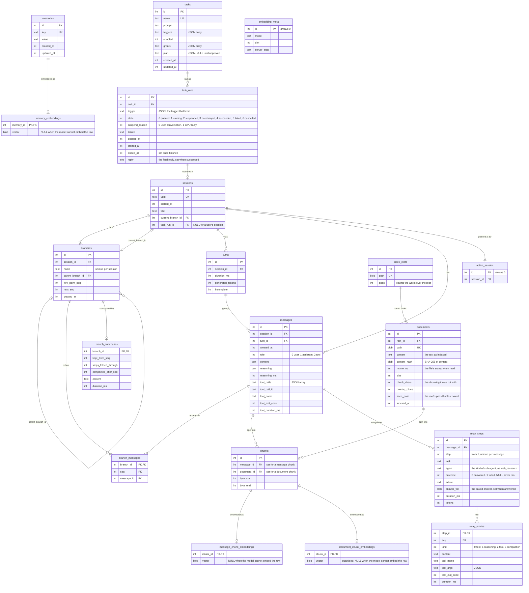

# Database schema

`assistd-memory` keeps everything the daemon remembers in one SQLite
file, `$XDG_DATA_HOME/assistd/memory.db` (`~/.local/share/assistd/memory.db`
by default).
Chats are saved whatever `[memory] enabled` says; turning it off only
withholds the memory tools and recalled context from the model.

## Entity-relationship diagram

Every table is `STRICT`, and every timestamp is Unix milliseconds.
Branches, turns, and messages carry their `session_id` and reference
each other through composite `(session_id, id)` keys, so nothing can
point across sessions. Deleting a session, branch, message, or memory
cascades to the rows that hang off it.

## Transcripts

- **`sessions`**: one row per conversation, written with its first
  message. `title` is a short name the model generates from the first
  prompt. `task_run_id` marks the session of a task run.
- **`active_session`**: at most one row, naming the session the user's
  conversation is on. It is written when a session is saved or switched
  to and deleted when the user starts a new one, and a starting daemon
  resumes the session it names on that session's current branch.
- **`branches`**: each session starts with a `main` branch. Forking
  copies the source branch's `branch_messages` rows (and its summary)
  under a new name, records `parent_branch_id` and `fork_point_seq`
  (the parent's last seq at the fork), and makes the fork the session's
  current branch. `next_seq` hands out the branch's next position.
- **`turns`**: one row per user prompt and everything the model did in
  response. `duration_ms` and `generated_tokens` are filled in together
  once the turn finishes. `incomplete` is set once a message of the turn
  failed to save.
- **`messages`**: every user prompt, assistant step, and tool result.
  Assistant rows may carry `reasoning` (with how long it took) and a
  non-empty `tool_calls` JSON array; tool rows always carry the call
  id, tool name, exit code, and run time. `CHECK` constraints tie each
  of these columns to its role.
- **`branch_messages`**: the ordered list of messages on each branch,
  keyed by a branch-local `seq`. Messages are stored once and shared
  by every branch forked after them, which is what makes forking
  cheap. Undo removes the last turn's rows from the branch, then
  deletes any of its messages (and the turn) that no other branch
  still references.
- **`branch_summaries`**: at most one compaction summary per branch.
  `kept_from_seq` is the user message from which history is kept word
  for word; `steps_folded_through`, when set, marks the tool steps of
  that turn folded into the summary; `compacted_after_seq` is the
  newest seq at the time. On resume the model gets the summary plus
  the rows from `kept_from_seq` on, while clients still see every row.
  Undoing a turn the summary covers drops the summary.
- **`relay_steps`** / **`relay_entries`**: what the sub-agents behind a
  `relay` tool result did, hung off that result's `messages` row so
  forks share it and undo deletes it with the message. Each planned
  step gets a row, one that never ran with a NULL `outcome`; its
  entries are the sub-agent's reply text, reasoning, tool calls with
  their output, and compactions, in order. They are written with the
  tool result in one transaction, replayed to clients on resume, and
  never reach the model's history or the embedding chunks, since they
  come from untrusted files and pages.

## Key/value memories

**`memories`** holds the facts saved by the `remember` tool and
`assistd memory`, one row per unique `key`. Saving an existing key
overwrites `value` in place and bumps `updated_at`. A trigger deletes
the memory's embedding whenever its value changes, so a stale vector
never outlives the text it was computed from.

## Tasks

**`tasks`** holds saved prompts run without the user opening a
conversation, one row per unique `name`, with the triggers that start
them and the plan and grants approved for the prompt. Saving a task
whose `prompt` changed clears `plan` and `grants` in the same
transaction, so an approval never outlives the prompt it was made for.
**`task_runs`** records each run: the trigger that fired it, its state,
and, once it succeeds, its final reply. Deleting a task deletes its runs
and their transcript sessions, except the active session, which stays
as an ordinary one.

## Embeddings

- **`chunks`**: each chunk belongs to exactly one message or one
  document, and is a byte range into `messages.content` or
  `documents.content`, so the text itself is never stored twice. User
  and assistant messages are cut into overlapping windows of 512
  characters (64 shared) in the same transaction that saves the
  message; tool results are not chunked.
- **`index_roots`**: the folders indexed for document search. Each
  walk over a root is a pass and bumps `pass`; deleting a root deletes
  its documents.
- **`documents`**: local files indexed for search, one row per path,
  holding the text as it was indexed. A file whose `mtime_ns`, `size`
  and chunking match its row is not read again. One that is read and
  hashes to the stored `content_hash` only has its stamp refreshed.
  Otherwise the chunks whose position and bytes are unchanged keep
  their vectors and the rest are replaced. Each row records the pass
  that last saw it, and finishing a pass deletes the root's documents
  it did not see. The rows are a rebuildable cache of files on disk,
  so a reset of `memory.db` costs only a re-index.
- **`message_chunk_embeddings`** / **`document_chunk_embeddings`** /
  **`memory_embeddings`**: at most one vector per chunk or memory,
  L2-normalised by the embedder so a dot product is cosine similarity. A chunk's
  vector goes in the table for its owner's kind, so a chat search never
  reads document vectors. Message chunk and memory vectors are BLOBs of
  little-endian `f32`s. A document chunk vector is quantised to a
  quarter of that: a little-endian `f32` step, sized so the vector's
  largest component is 127 steps, then one `i8` count of steps per
  dimension.
  A chunk or memory with no row here is pending, and the background
  embedding worker fills it in; a memory's vector is only stored if its
  value hasn't changed since it was read for embedding. A row with a
  `NULL` vector marks text the model rejected, so the worker does not
  retry it; `assistd memory reindex` clears those marks and tries again.
- **`embedding_meta`**: the one row naming what produced every stored
  vector: `embedding.model`, the vector dimension the server reported,
  and `embedding.custom_args`. When the embedder comes up and any of the
  three differs from the row, the three vector tables are dropped and
  recreated empty before anything can search or write, so vectors from
  two embedding spaces are never compared, and the worker embeds
  everything again.

Search (`recall`, `reminisce`) scans every vector of one source kind,
chats or documents, on that kind's own read-only connection and keeps
the top matches; there is no vector index. `reminisce` leaves out the
current session's messages.

One scan of 768-dimension vectors, measured on a Ryzen 7 9800X3D
with the file in the page cache:

| Chunks of the kind | `f32` (chats) | quantised (documents) |
|--------------------|---------------|-----------------------|
| 10,000             | 33 MB, 2 ms   | 8 MB, 1 ms            |
| 100,000            | 328 MB, 35 ms | 82 MB, 14 ms          |
| 1,000,000          | 3.3 GB, 330 ms | 820 MB, 200 ms       |

Quantising moved no top-8 result in these runs and changed a
similarity by at most 0.0005.

## Storage

- One read-write connection runs every write in order; three
  read-only connections serve history loads, chat and memory vector
  scans, and document vector scans, so none blocks another.
- The database runs in WAL mode with foreign keys and `secure_delete`
  on. After a delete or overwrite the WAL is checkpointed and truncated
  so removed text doesn't linger in the sidecar files.
- New databases use 16 KiB pages, which pack several 768- or
  1024-dimension vectors per page.
- The data directory is created `0700` and the database and its
  `-wal`, `-shm`, and `-journal` files are kept `0600`.
- The schema version lives in `PRAGMA user_version` and migrations run
  through `rusqlite_migration` when the database opens. A schema change
  is a new migration appended after the existing ones.
- The daemon refuses to start when the database cannot be opened or
  migrated, including one written by a newer `assistd` (a `user_version`
  above the binary's). It never runs without persistence and never
  replaces the file itself.
- Resetting is manual: stop the daemon and move `memory.db` and its
  `-wal` and `-shm` files aside; the next start creates an empty
  database. A schema change may require a reset instead of shipping a
  migration.
