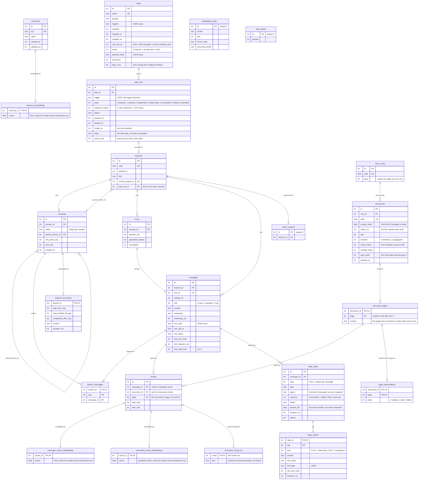

# Database schema

`assistd-memory` keeps everything the daemon remembers in one SQLite
file, `$XDG_DATA_HOME/assistd/memory.db` (`~/.local/share/assistd/memory.db`
by default).
Chats are saved whatever `[memory] enabled` says; turning it off only
withholds the memory tools and recalled context from the model.

## Entity-relationship diagram

Every table is `STRICT`, and every timestamp is Unix milliseconds.
Branches, turns, and messages carry their `session_id` and reference
each other through composite `(session_id, id)` keys, so nothing can
point across sessions. Deleting a session, branch, message, or memory
cascades to the rows that hang off it.

## Transcripts

- **`sessions`**: one row per conversation, written with its first
  message. `title` is a short name the model generates from the first
  prompt. `task_run_id` marks the session of a task run.
- **`active_session`**: at most one row, naming the session the user's
  conversation is on. It is written when a session is saved or switched
  to and deleted when the user starts a new one, and a starting daemon
  resumes the session it names on that session's current branch.
- **`branches`**: each session starts with a `main` branch. Forking
  copies the source branch's `branch_messages` rows (and its summary)
  under a new name, records `parent_branch_id` and `fork_point_seq`
  (the parent's last seq at the fork), and makes the fork the session's
  current branch. `next_seq` hands out the branch's next position.
- **`turns`**: one row per user prompt and everything the model did in
  response. `duration_ms` and `generated_tokens` are filled in together
  once the turn finishes. `incomplete` is set once a message of the turn
  failed to save.
- **`messages`**: every user prompt, assistant step, and tool result.
  Assistant rows may carry `reasoning` (with how long it took) and a
  non-empty `tool_calls` JSON array; tool rows always carry the call
  id, tool name, exit code, and run time. `CHECK` constraints tie each
  of these columns to its role.
- **`branch_messages`**: the ordered list of messages on each branch,
  keyed by a branch-local `seq`. Messages are stored once and shared
  by every branch forked after them, which is what makes forking
  cheap. Undo removes the last turn's rows from the branch, then
  deletes any of its messages (and the turn) that no other branch
  still references.
- **`branch_summaries`**: at most one compaction summary per branch.
  `kept_from_seq` is the user message from which history is kept word
  for word; `steps_folded_through`, when set, marks the tool steps of
  that turn folded into the summary; `compacted_after_seq` is the
  newest seq at the time. On resume the model gets the summary plus
  the rows from `kept_from_seq` on, while clients still see every row.
  Undoing a turn the summary covers drops the summary.
- **`relay_steps`** / **`relay_entries`**: what the sub-agents behind a
  `relay` tool result did, hung off that result's `messages` row so
  forks share it and undo deletes it with the message. Each planned
  step gets a row, one that never ran with a NULL `outcome`; its
  entries are the sub-agent's reply text, reasoning, tool calls with
  their output, and compactions, in order. They are written with the
  tool result in one transaction, replayed to clients on resume, and
  never reach the model's history or the embedding chunks, since they
  come from untrusted files and pages.

## Key/value memories

**`memories`** holds the facts saved by the `remember` tool and
`assistd memory`, one row per unique `key`. Saving an existing key
overwrites `value` in place and bumps `updated_at`. A trigger deletes
the memory's embedding whenever its value changes, so a stale vector
never outlives the text it was computed from.

## Tasks

**`tasks`** holds saved prompts run without the user opening a
conversation, one row per unique `name`, with the triggers that start
them, the permission mode their runs get, the hosts those runs fetch
from unasked, and how many finished runs to keep.
**`task_runs`** records each run: the trigger that fired it, its state,
its place in the queue while it waits, and, once it succeeds, its final
reply. Deleting a task deletes its runs and their transcript sessions,
except the active session, which stays as an ordinary one.
**`task_queue`** has a row only once the queue has been paused or
resumed, saying which.

## Embeddings

- **`chunks`**: each chunk belongs to exactly one message or one page
  of a document, and is a byte range into `messages.content` or that
  page's `document_pages.content`, so the text itself is never stored
  twice. User and assistant messages are cut into overlapping windows of
  512 characters (64 shared) in the same transaction that saves the
  message; tool results are not chunked. A document is cut page by
  page, so no chunk spans two pages, and within a page where its text
  divides: at blank lines and Markdown headings, with whole paragraphs
  packed into a chunk of up to 512 characters and a heading always
  starting a new one. Only a paragraph longer than that is cut into the
  same overlapping windows.
- **`index_roots`**: the folders indexed for document search. Each
  walk over a root, whole or held to the paths that changed under it,
  is a pass and bumps `pass`; deleting a root deletes its documents.
- **`documents`**: local files indexed for search, one row per path.
  A file whose `mtime_ns`, `size` and chunking match its row is not
  read again. One that is read and hashes to the stored `content_hash`,
  which covers its pages in order, only has its stamp refreshed, unless
  it has rows in `page_transcriptions`: the same text layer says nothing
  about whether the scans changed.
  Otherwise each chunk whose text is unchanged keeps its vector and
  takes the page and byte range that text now has, so an insertion
  re-embeds only the paragraphs it touched and a page added at the
  front only that page, and the rest are replaced. `chunker` names
  the strategy that cut the row, so a new strategy cuts every stored
  document again on the next pass. Each row records the pass
  that last saw it, and finishing a pass deletes the documents it did
  not see: all of the root's, or for a pass over changed paths those at
  or under them. The rows are a rebuildable cache of files on disk,
  so a reset of `memory.db` costs only a re-index.
- **`document_pages`**: a document's text as it was indexed, one row
  per page. What a page is follows the file's format: a PDF's pages
  are its own, a presentation's slides, a spreadsheet's sheets and an
  e-book's chapters are each a page, and a text, Markdown, source, HTML
  or word-processor file is one page.
  `page` is the page's position in the file from 0, and a page without
  text, as a scanned PDF page is, has a row with empty `content`, so a
  page's number in the index is its number in the file.
- **`page_transcriptions`**: the PDF pages that had no text when their
  file was read, each an image an OCR model can read. A row starts as
  waiting. Reading the page stores what the model found, which may be
  nothing, as the page's `document_pages.content` and marks the row
  read; a page that cannot be rendered or whose reply is not its text
  is marked failed and keeps empty content. Once none of a document's
  rows is waiting its pages are cut into chunks again and
  `content_hash` is taken over the pages as they now are. The rows stay
  until the file's stamp changes: indexing it again writes the pages as
  extracted, which drops the transcribed text with its chunks, and
  starts every empty page waiting again. A daemon start sets the failed
  rows back to waiting.
- **`message_chunk_embeddings`** / **`document_chunk_embeddings`** /
  **`memory_embeddings`**: at most one vector per chunk or memory,
  L2-normalised by the embedder so a dot product is cosine similarity. A chunk's
  vector goes in the table for its owner's kind, so a message search never
  reads document vectors. Message chunk and memory vectors are BLOBs of
  little-endian `f32`s. A document chunk vector is quantised to a
  quarter of that: a little-endian `f32` step, sized so the vector's
  largest component is 127 steps, then one `i8` count of steps per
  dimension.
  A chunk or memory with no row here is pending, and the background
  embedding worker fills it in; a memory's vector is only stored if its
  value hasn't changed since it was read for embedding. A row with a
  `NULL` vector marks text the model rejected, so the worker does not
  retry it; `assistd memory reindex` clears those marks and tries again.
- **`document_chunk_fts`**: an FTS5 index of the words of every document
  chunk, for the keyword half of a document search. It is contentless:
  a row carries its chunk's id and the index entries for the chunk's
  text, and the text itself stays in `document_pages` alone. The write
  that cuts a chunk adds its row, a trigger on `chunks` removes the row
  with the chunk however the chunk goes, and a chunk that only moves
  keeps it. FTS5 marks a removed row deleted and drops its entries as
  it merges the index. Words are split at every character that is not a
  letter or a digit and compared without case or accents, so
  `read_regular_file` is indexed as `read`, `regular`, `file` in a row.
  Message chunks are not indexed. On the index measured below it takes
  25 MB beside 62 MB of page text and 124 MB of vectors.
- **`embedding_meta`**: the one row naming what produced every stored
  vector: `embedding.model`, the vector dimension the server reported,
  `embedding.custom_args` and `embedding.document_prefix`. When the
  embedder comes up and any of the four differs from the row, the three
  vector tables are dropped and recreated empty before anything can
  search or write, so vectors from two embedding spaces are never
  compared, and the worker embeds everything again.
  `embedding.query_prefix` is not recorded: it shapes only the query
  vector, which is never stored.

Search (`recall`, `reminisce`, `docs search`) scans every vector of one source kind,
messages or documents, on that kind's own read-only connection and keeps
the top matches; there is no vector index. `reminisce` leaves out the
current session's messages. `docs search` ranks by keyword as well, as
[Document search](#document-search) describes.

One scan of 768-dimension vectors, measured on a Ryzen 7 9800X3D
with the file in the page cache:

| Chunks of the kind | `f32` (messages) | quantised (documents) |
|--------------------|------------------|-----------------------|
| 10,000             | 33 MB, 2 ms      | 8 MB, 1 ms            |
| 100,000            | 328 MB, 35 ms    | 82 MB, 14 ms          |
| 1,000,000          | 3.3 GB, 330 ms   | 820 MB, 200 ms       |

Quantising moved no top-8 result in these runs and changed a
similarity by at most 0.0005.

Since every search scans every document vector, the stored documents
are held to 500,000 chunks (`MAX_DOCUMENT_CHUNKS`), where one scan reads
about 410 MB in about 100 ms. The schema does not enforce the ceiling;
the index pass does. It checks the count before each file it stores, so
the file that crosses the ceiling is stored whole, and every file after
it is skipped as `index full` until documents are removed. Message
chunks have no ceiling.

## Document search

Embeddings match meaning and miss exact strings: an identifier, an error
message, a name, an invoice number. So `docs search` ranks the documents
twice and fuses the two rankings.

- **By vector**: each document by its chunk nearest the query vector.
- **By keyword**: each document by its chunk with the best BM25 score in
  `document_chunk_fts`, among the chunks that hold any word of the query.
  Each whitespace-separated word of the query is matched as a phrase of
  its own tokens, so `INV-2024-0113` finds only that number and no
  character of a query is read as FTS5 syntax.
- **Fused**: the 30 best documents of each ranking are scored by
  reciprocal rank fusion, the sum of `1 / (10 + rank)` over the rankings
  that hold the document, which needs no common scale between cosine and
  BM25. A document is shown through its chunk from the ranking that
  places it higher. At equal score or rank the keyword ranking wins.

A chunk needs no vector to be found by its words, so a document can be
searched for an exact string as soon as it is indexed; such a hit has no
similarity to report.

Keywords are matched per chunk, not per page or per document: the chunk
that matched is then the passage to show, and BM25 compares texts of one
size. Measured on an index of 3,050 files in 151,597 chunks (this
repository, Rust's books and error index, system documentation and a
novel) embedded with EmbeddingGemma 2, over 69 queries. Each cell is the
share of queries whose first relevant document came first, and within the
first five:

| Queries                                                    | Vectors only | Fused        |
|------------------------------------------------------------|--------------|--------------|
| 33 exact strings: identifiers, error messages, codes, names | 64%, 88%     | 94%, 100%    |
| 12 questions that hold one exact string                    | 75%, 100%    | 100%, 100%   |
| 24 paraphrases sharing no rare word with their answer      | 67%, 92%     | 75%, 92%     |

For an exact string, one of the first five hits showed the passage holding
it in 76% of queries by vector alone and in all of them fused. Matching
keywords per page or per document instead put the right document first
for 82% of the exact strings and showed the passage for 91%. With the
fusion's usual constant of 60 in place of 10, nearly any document found
by both rankings outranks the best of either, and the paraphrases' share
within the first five fell to 83%. The keyword query took 10 ms at the
median and 58 ms for a question made of common words, which most chunks
match.

## Storage

- One read-write connection runs every write in order; three
  read-only connections serve history loads, message and memory vector
  scans, and document vector scans, so none blocks another.
- The database runs in WAL mode with foreign keys and `secure_delete`
  on. After a delete or overwrite the WAL is checkpointed and truncated
  so removed text doesn't linger in the sidecar files.
- New databases use 16 KiB pages, which pack several 768- or
  1024-dimension vectors per page.
- The data directory is created `0700` and the database and its
  `-wal`, `-shm`, and `-journal` files are kept `0600`.
- The whole schema is one `rusqlite_migration` step, applied when an
  empty database opens and recorded as version 1 in
  `PRAGMA user_version`. A schema change is a new migration appended
  after it.
- The daemon refuses to start when the database cannot be opened or
  migrated, including one whose `user_version` is above the binary's:
  one written by a newer `assistd`, or by a release from before the
  schema became a single version. It never runs without persistence
  and never replaces the file itself.
- Resetting is manual: stop the daemon and move `memory.db` and its
  `-wal` and `-shm` files aside; the next start creates an empty
  database. A schema change may require a reset instead of shipping a
  migration.
